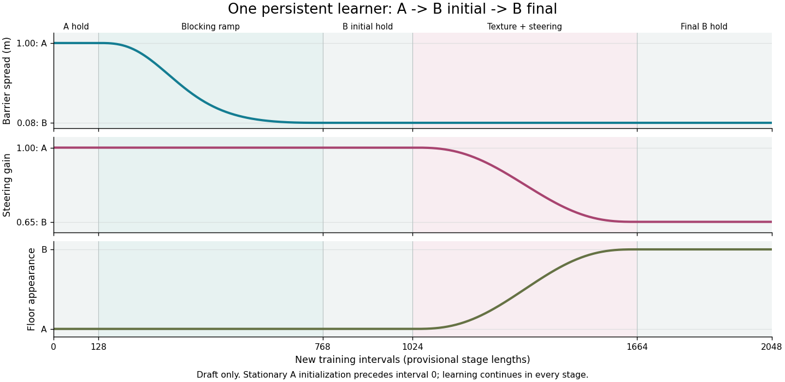

# Implementation Plan 19: Sample-Efficient Continual PiCar Learning

**Motivation:** find practical ways to keep learning when new experience,
replay memory, GPU memory, and update time are scarce. The MNIST studies,
especially Plan 15, motivate an STM/LTM architecture that can save new samples
without requiring indefinite replay. Robotics is the next test of that idea:
does it help a language-conditioned controller adapt to continuous changes
while retaining a useful earlier capability? Statistical efficiency and
computational efficiency are both objectives. A smaller training loss, a
better Fisher estimate, or a more attractive theoretical interpretation is
not sufficient evidence of practical success.

**Status:** Phase 0 bounded implementation acceptance passed on 2026-11-09:
280 tests, paired CPU smoke/recovery, and actual quantized-Qwen CUDA checks.
Phase 1 diagnostics and two Fix 1 passes are recorded. Native/split parity,
revised instruction contrasts, and short cooperative timing pilots pass;
navigation and reward readiness remain unresolved. **Phase 1 Fix 2** is now
implemented and its bounded diagnostics are complete. Generated rewards are
valid but coarse; ported Qwen reached the ball in 3/6 unobstructed trials and
the obstacle task achieved 0/12 across two interfaces. Both real-time student
pilots had zero non-startup fallbacks. These are readiness checks, not learning
results. The versioned task/reward revision leaves earlier artifacts intact.
Phases 2--5 and physical robot motion have not started. Revised conditional
whole-study forecasts are 21.4--30.8 h nominal, or 11.6--17.2 h at the smaller
permitted size. Task readiness is not yet established; neither forecast is
authorization to proceed. See the Phase 1 execution
record and `PLAN19_HANDOFF.md` for findings and recovery notes. The theory below is
provisional and belongs here until
experiments establish its value. Do not modify
[`mathematical_overview.ipynb`](../../mathematical_overview.ipynb).

**Latest check-in:** Phase 1 Fix 3 completed on 2026-11-11. The corrected
`fix3-v2` campaign transferred an approach skill and completed two student
pilots, but neither improved on the hard fixed layouts. The earlier saturated
reward interface remains preserved. Full STM comparison readiness is unmet;
later phases and physical motion remain pending. See the Fix 3 execution record.

**Report:** `numerical_experiment/picar/plan19_results.ipynb`, created during
implementation. Follow the concise, visual reporting style of Plan 13:
progress near the top, phases in chronological order, and a conclusion at the
bottom. The notebook reads artifacts only.

**Planning update (2026-11-14):** Phase 3 Fix 1 is complete. The new
[Phase 3 Fix 2](#phase-3-fix-2-curvature-aware-updates-and-solver-cost-2026-11-14)
below proposes a bounded comparison of centered proximal updates and a lagged
EWC anchor, including one versus three optimizer steps and measured compute
cost. It is drafted for review, not launched. The earlier status paragraphs
and execution records remain historical; Phase 4 remains deferred.

**Planning update (2026-11-17):** Fix 2 is complete. The new
[Phase 3 Fix 3](#phase-3-fix-3-six-example-visual-rewards-and-reward-scale-pilot-2026-11-17)
proposes a six-example frozen-Qwen evaluator and a bounded comparison of linear
and signed-quadratic rewards. It preserves the repaired optimizer, rebuilds
reward-compatible initialization from saved stationary demonstrations, and requires
held-out reward recording. This is a draft for review, not execution approval;
Phase 4 and physical motion remain deferred.

**Execution update (2026-11-17):** Fix 3 is authorized with a 12-hour additional
active-compute limit. Implementation/recovery acceptance passed 287 tests;
the actual frozen-Qwen input/response parity check passed. The new campaign
is re-scoring 659 unique stationary images before reward-compatible fitting.
The canonical notebook contains current Fix 3 progress and preserves prior
history. See the Fix 3 execution recipe and `PLAN19_HANDOFF.md` for restart.

**User-requested pause (2026-11-17):** Fix 3 is now cleanly stopped and the GPU
is released. One linear pilot is sealed; its paired signed-square pilot is
checkpointed at 544 captured transitions. Both initializers, initial panels,
and readiness checks are complete. The twelve-hour ledger is at 5.200 h.
Do not resume until requested; the detailed pause record and restart command
are below and in `PLAN19_HANDOFF.md`. Earlier status entries are historical.

**Resumption update (2026-11-17):** the user requested continuation. Recovery
checks pass. A separate operational wrapper pins the exact original theory
snapshot, because the user added STM theory to the live notebook while paused.
It preserves that update, records both document versions, and leaves numerical
sources, run identity and settings unchanged. See the Fix 3 resumption record.

**Fix 3 closeout (2026-11-17):** all four pilots are sealed and the GPU is
released. Charged runner compute is 7.9385 h of the authorized twelve hours.
Neither reward recipe established B success; final A success averaged 22.5%
linear and 20% signed square, versus 25% initially. The notebook and detailed
execution closeout below preserve the negative result and its qualifications.
Phase 4 remains deferred; unused budget is not automatic authorization.

**New draft (2026-11-19):** [Phase 3 Fix 4](#phase-3-fix-4-staged-a-to-b-learning-and-predictive-loss-2026-11-19)
repairs the mismatched curriculum clocks, provides substantially more learning
experience, restores the FD-versus-control comparison with linear rewards,
and requires held-out NLL. Its matching transition diagram is also in the
notebook. This is for review only; no Fix 4 compute is authorized.

**Execution authorization (2026-11-19):** the user approved Phase 3 Fix 4 and
its **28 additional active-hour ceiling**. Implementation, bounded acceptance,
resource/retention calibration and both paired development seeds are now
authorized. This supersedes the draft-only status above and within the
original amendment; it does not authorize Phase 4 or physical robot motion.
The 2,048-interval schedule remains provisional until the resource pilot.

**Operating model:** Phase 0 uses Astra 6 Extra High for the numerical slice
and Sol 6.1 Extra High for the surrounding implementation, integration, and
operational tests. Prefer Sol as the coordinator, with bounded Astra
assignments rather than Astra supervising every engineering step. Sol then
profiles, calibrates, runs, repairs, and closes out the experiment. Explicit
sub-agent model selection avoids requiring the user to switch models between
assignments. Record material mathematical or experimental changes explicitly.

**Resources:** aim for 20 cumulative active wall-clock compute hours, but
reforecast after profiling rather than promising an unmeasured VLM runtime.
The current planning range is 15--33 hours, excluding implementation labor.
An extension requires approval; the user's willingness to revisit the budget
is not an unlimited allocation. Use an external archive root supplied as an
argument, with a bounded local working set. See the resource table below.

## Research Question And Boundaries

At comparable retention and with the same model capacity and replay resources,
does age-dependent STM finite-difference KL regularization reduce the new
robot experience needed to acquire a changed task? What additional compute,
latency, and memory does that saving require?

Start with one task, one smooth outward-and-return drift schedule, and two
training conditions. Do not combine this first robotics study with LFUs,
adaptive $\pi$, multiple curvature estimators, or a large architecture search.
They remain possible later extensions, not prerequisites for useful results.

| Condition | Replay and diagonal LTM EWC | Trainable LTM and STM banks | STM FD-KL |
|---|---|---|---|
| Replay/EWC control | Yes | Yes | $\lambda_{\mathrm{FD}}=0$ |
| STM FD | Yes | Identical capacity | Development-calibrated positive strength |

The control has the same extra parameters as STM FD. It is not a smaller
LTM-only network. A frozen initial student is an evaluation reference; Qwen
and a scripted geometric controller provide readiness diagnostics, not extra
full-budget training arms. Report neither as an equal-cost learning control.

Internal precedents are [Plan 15](../../mnist_experiment/plan15.md) for the
STM comparison and sample-efficiency analysis,
[Plan 18](../../mnist_experiment/plan18.md) for memory-block interpretation,
and [Plan 13](../../mnist_experiment/plan13.md) for readable reporting.
Their effect sizes are motivation, not forecasts for this changed task.

Development-only retention calibration is mandatory. Preserve a failed
calibration as an informative trade-off, but do not turn it into a claim of
sample savings at equal retention. A useful negative or qualified result is
preferable to an apparently strong result with an uncontrolled old-task gap.

### Provenance And Deliberate Changes

This plan uses the supplied *PiCar continual-learning handoff* as design input,
not as executable instructions. Its ZIP SHA-256 is
`980eb641d10a0187690609ee96c6674b18f24c2f4def5ccbb0b141a650fbe46a`.
The inspected `kl-projection` checkout was at commit
`b0bdccae09ebb60ddabbf30fa63c87da20007150`.

The discussion supersedes several original handoff choices:

- Use continuous texture and steering-response changes, not an abrupt A/B switch.
- Preserve the eight-action to four-control weighted mapping, including camera controls.
- Let Qwen collect the initial demonstrations; distill once, then let the LSTM controller learn online.
- Give the LSTM an actually language-conditioned transformer feature, not only a visual/action prefix.
- Restrict transformer adaptation to top-$L$ blocks; profile actual activation memory.
- Replace the legacy composite actor/critic objective with the explicit likelihood below.
- Maintain simulator and physical backends under one interface, including robot-side safety software.
- Run physics independently of inference and optimization; account for delayed commands.

This is a new robotics specification. It does not revive the retired synthetic
Gaussian auxiliary-score experiment. The conditional Gaussian below models
action coordinates in a specified likelihood; it does not assume arbitrary
auxiliary scores are Gaussian.

## Theory: A Likelihood-Based RL Update

### What This Construction Claims

The goal is an actor/critic data loss that **is** a normalized conditional
negative log likelihood, not a claim that an arbitrary RL loss eventually
becomes one after enough optimization. Advantage-weighted regression provides
the algorithmic starting point: use returns to weight regression onto
experienced actions. Control-as-inference and maximum-a-posteriori policy
optimization provide related probabilistic perspectives. The particular joint
model and derivations below are this plan's construction, not a theorem
attributed to those papers. [AWR][awr] [Control as inference][inference]
[MPO][mpo]

There are three distinct statements to keep separate:

1. The proposed data objective is exactly a likelihood objective for a stated working model.
2. Its action update has a local policy-improvement interpretation under additional assumptions.
3. Classical likelihood efficiency requires still stronger local modeling, dependence, and identifiability assumptions.

Statement 1 does not establish statements 2 or 3 automatically. In particular,
more data does not make a misspecified working model correct. EWC, ridge, and
STM penalties are explicit additions to the data NLL, not hidden likelihood
terms or components of reported predictive NLL.

### Observations, Actions, And Returns

Let $h$ be the recorded information available before an action: camera history,
timestamped language events, executed action history, recurrent context,
elapsed time, and remaining task time. It excludes future rewards and
privileged simulator state. A trainable feature extractor may encode $h$;
the raw history is the conditioning observation, not a frozen learned feature.

Represent the eight action probabilities with seven identifiable logits:

$$
z\in\mathbb R^7,\qquad q(z)=\operatorname{softmax}(z_1,\ldots,z_7,0),
\qquad u(z)=\sum_{i=1}^8 q_i(z)v_i\in\mathbb R^4.
$$

Here $v_i$ is the calibrated primitive control vector for pan, tilt, steering,
and drive. The backend executes $u(z)$, not a sampled categorical primitive.
During training, exploration samples $Z\sim N(\mu_\Theta(h),\Gamma)$ before
this deterministic mapping. $\Gamma$ is fixed after development. Record the
actual sampled $z$, requested vector, executed vector, and behavior density.
Deterministic evaluation uses $z=\mu_\Theta(h)$. Safety intervention is part of
the recorded environment response, not a reason to relabel a requested action
as though it had never occurred.

Seven logits remove the softmax common-offset ambiguity, but the map into
four physical controls is still many-to-one. Retaining the actual sampled
logits makes the declared likelihood well-defined; it does not make all
logit changes physically meaningful. Report control-space changes and the
local sensitivity of the mapping alongside logit-space KL. Treat wasted
regularization in physically redundant directions as a possible limitation,
not evidence of useful retention.

Use observed finite-horizon returns, initially without bootstrapped targets.
Discretize the known bounded return range into $K$ bins with representatives
$g_j$ and observed label $J=j$. The return head predicts
$c_\Theta(j\mid h)$, with value $\sum_j g_j c_\Theta(j\mid h)$.
Categorical return distributions have a distributional-RL precedent; this plan
does not silently inherit C51's Bellman projection or control algorithm.
[Distributional RL][distributional]

Start with $K=21$; check $K=41$ on development artifacts. Derive the range from
the actual reward and horizon, not empirical extrema that silently clip new
returns. Quantization error in a return is at most half a bin width when the
range is respected. Refining bins reduces that error, not critic estimation
error or all RL approximation error.

Record a lagged baseline $b(h)$ at action time, before its outcome is known.
For fixed temperature $\tau>0$, define

$$
w_j(h)=\exp\!\left(\frac{g_j-b(h)}{\tau}\right)>0.
$$

Baseline values, bin edges, temperature, and the positive-definite action
scale $\Sigma_A$ are fixed conditioning data for a likelihood fit. They are
not differentiated through. Do not recompute historical baselines or retired
weights after a model update. A numerical log-weight cap is permissible only
as an explicit, frozen development choice; report its hit rate and qualify
the policy-gradient approximation below if clipping is active.

### One Normalized Joint Model

With $d_z=7$, use

$$
p_\Theta(j,z\mid h)
=c_\Theta(j\mid h)\,
\mathcal N\!\left(z;\mu_\Theta(h),\frac{\Sigma_A}{w_j(h)}\right).
$$

It integrates to one because each conditional Gaussian integrates to one and
$\sum_j c_\Theta(j\mid h)=1$. Its negative log likelihood is

$$
\begin{aligned}
\ell_\Theta(h,j,z)
&=-\log c_\Theta(j\mid h)
+\frac{w_j(h)}2
(z-\mu_\Theta(h))^T\Sigma_A^{-1}(z-\mu_\Theta(h))
+k(h,j),\\
k(h,j)
&=\frac{d_z}2\log(2\pi)+\frac12\log\det\Sigma_A
-\frac{d_z}2\log w_j(h).
\end{aligned}
$$

Thus the actor's weighted quadratic and the critic's categorical cross-entropy
are exactly one joint NLL up to a parameter-independent term. No arbitrary
trainable actor/critic weight is added outside this model. $\Sigma_A$ provides
a declared, development-calibrated relative scale. Shared actor/critic
features do not invalidate normalization.

Interpretation: conditional on an observed history, higher-return actions are
modeled as more concentrated around a preferred command. This is a statistical
factorization, not a causal claim that a future return generated an action.
The joint model is also **not** the Gaussian exploration distribution. They
serve different purposes and need separate names and metadata.

The single-center action model can be inadequate for genuinely multimodal
choices, such as passing an obstacle on either side. Include recent chosen
direction and executed history in $h$, inspect averaged-command failures, and
retain this limitation. Do not introduce a mixture policy mid-confirmation
without a new likelihood, KL implementation, and versioned comparison.

### Why The Actor Step Can Improve Return

For an unrestricted conditional mean and frozen weights, population weighted
regression gives

$$
\mu_{\mathrm{new}}(h)=
\frac{\mathbb E[w(J,h)Z\mid h]}{\mathbb E[w(J,h)\mid h]}.
$$

Suppose data at this history were generated by Gaussian exploration
$Z\sim N(\mu,\Gamma)$, continuation behavior is held fixed, return is bounded,
and weights are not clipped. Expanding in $1/\tau$ gives

$$
\mu_{\mathrm{new}}-\mu
=\frac{\operatorname{Cov}(Z,g_J\mid h)}{\tau}
+O(\tau^{-2}).
$$

For $\mathcal J_h(\mu)=\mathbb E[g_J\mid h,Z\sim N(\mu,\Gamma)]$, the
Gaussian likelihood-ratio identity gives

$$
\operatorname{Cov}(Z,g_J\mid h)=\Gamma\nabla_\mu\mathcal J_h(\mu).
$$

Consequently the leading displacement is a positive-definite preconditioned
ascent direction, with local leading improvement proportional to
$\nabla\mathcal J_h^T\Gamma\nabla\mathcal J_h/\tau$ when a smooth local
expansion applies. This argument concerns the binned return; fine bins
approximate the original bounded return. The baseline cancels from the
conditional weighted mean when it is an action-independent constant at $h$.

This is a local argument for the weighted-regression mechanism, not a global
RL convergence guarantee. Parameter sharing, finite samples, stale behavior
mixtures in replay, finite temperatures, safety saturation, regularization,
and incomplete optimization can all change the result. Log the behavior
version and action coverage. In particular, fitting returns from old policies
does not create a certified current-policy critic for unobserved actions.

The Gaussian-behavior calculation and the working-model correctness
assumption are separate idealizations; do not claim the collected joint data
must simultaneously satisfy both exactly.

### The Single Fisher And A Cheap Exact Predictive KL

Use scores $s=\nabla_\Theta\log p_\Theta$ and loss gradients
$g=\nabla_\Theta\ell=-s$. The intended Fisher remains the model-induced
quantity $\mathcal I(\Theta)=\mathbb E_\Theta[ss^T]$. At a fixed recorded
conditioning history, write its integrand $F_h$ as

$$
F_h(\Theta)=
\sum_j c_j\,\nabla\log c_j\nabla\log c_j^T
+\overline w_\Theta(h)\,J_\mu^T\Sigma_A^{-1}J_\mu,
\qquad
\overline w_\Theta(h)=\sum_j c_jw_j.
$$

The actor score has zero conditional mean at each $j$, so its cross terms
with the categorical score vanish under the model, including when their
parameters overlap. LTM and STM Fisher blocks are coordinate blocks of this
one matrix, not different Fisher estimands. History sampling approximates the
conditioning average. Changes in visitation, behavior, or a weight recipe
are not derivatives with respect to $\Theta$ at fixed history.

For two parameter values sharing the same conditioning design,

$$
\operatorname{KL}(p_\Theta\Vert p_{\Theta'})
=\operatorname{KL}(c_\Theta\Vert c_{\Theta'})
+\frac{\overline w_\Theta(h)}2
\|\mu_\Theta(h)-\mu_{\Theta'}(h)\|_{\Sigma_A^{-1}}^2.
$$

This is exact for the declared joint model. It needs neither a dense Fisher
matrix nor action samples. The reverse KL uses the other categorical
distribution and its corresponding $\overline w$. Use this formula for STM
finite differences, and test it against numerical/model-sampling references
on a tiny network before using the VLM.

For the eviction Fisher diagonal, a small model can sum output-Jacobian
contributions exactly. Production may use model-sampled per-record scores:
sample $j$ from $c_\Theta$, then $z$ from its conditional Gaussian, detach both
synthetic labels, and differentiate their log likelihood. Average squared
per-record scores, never the square of a batch-mean score. Compare one, two,
and four model-label draws in a bounded pilot. Use the same estimator in
both conditions. Do not replace the Fisher by squared gradients of the
regularized training objective or by an unlabeled empirical-Fisher shortcut.

No full eigendecomposition, parameter Hessian, or dense Fisher is required.
If an implementation still needs one, stop and reconcile that change with
these formulas before running it.

### Statistical Scope, Dependence, And Sample Counting

The likelihood framing permits classical local reasoning when the working
model is locally adequate, the relevant directions are identifiable,
conditional scores are suitably centered, moments exist, dependence is
controlled, and optimization approximates the intended solution. EWC and
STM penalties then define a regularized likelihood problem; they do not
magically preserve unregularized MLE efficiency.

LoRA factor gauges and redundant physical effects can make parameter Fisher
matrices singular. Fix the factor scaling convention, avoid inverse-Fisher
claims on the full raw parameterization, and evaluate functional predictions.
Do not claim a LAN approximation merely because external drift is smooth;
measure changes in predictive distributions and update adequacy.

An individual transition is a legitimate observation even when adjacent
transitions are dependent, just as observations in a time-series likelihood
remain observations. It is not automatically an independent observation.
Keep these counts separate:

- **New experience:** unique acquired transitions, counted once.
- **Replay exposure:** repeated uses of those transitions in optimization.
- **Sequence context:** supporting frames/actions needed to interpret a transition.
- **Independent uncertainty units:** fresh paired learning replicas, not replay draws or video frames.

Report return/score autocorrelation and an explicitly diagnostic correlation
length if estimable. Do not advertise an iid effective sample size obtained
by counting replay draws. Formal inference uses paired replica outcomes;
episode dependence remains inside each replica.

A sandwich covariance is not part of the initial implementation. Normalized
likelihoods do not remove misspecification, but adding a difficult covariance
estimator is not required for the primary applied comparison. State the
model-based Fisher interpretation and use replica-level uncertainty. Revisit
robust covariance only if a specific calibration failure makes it useful.

## STM, LTM, And Retirement

### Parameterization

For each selected transformer linear map, use parallel additive adapters:

$$
W_{\mathrm{eff}}=W_0+s_LB_LA_L+s_SB_SA_S.
$$

$W_0$ is frozen and quantized where supported. The LTM and STM factors are
separate trainable banks. This is not LoRA recursively applied to another
adapter. Keep factor scales, initialization conventions, placement, and
parameter ordering fixed after development. Do not merge, rebalance, or reset
adapters in the middle of a trajectory.

The small LSTM's dense recurrent and readout parameters are LTM. Add STM
low-rank contributions to declared gate/projection/readout matrices, with
tests against the equivalent dense effective matrices. The initial candidate
is rank-one STM and rank-four LTM transformer adapters; profile alternatives
as described below. Both conditions have every declared trainable coordinate.

All ordinary likelihood gradients from replay may update both banks. EWC
protects only LTM. STM FD gradients may update every parameter on which that
penalty actually depends, including LTM; do not detach LTM merely because
the finite-difference displacement is in STM coordinates.

Two parallel low-rank banks can represent more than the LTM bank alone. This
is controlled by the matched-capacity comparison, not denied by terminology.
Lower STM sensitivity is a diagnostic, not proof that information has moved
into a uniquely identifiable LTM representation. [LoRA][lora]

### Objective And Age-Dependent FD

At an optimization event, let $B$ contain newly labeled, not previously fitted
transitions and $R$ the eligible replay sample. Do not include a record in both
roles in that event. Use equal weights on their mean NLLs when both exist;
use the available mean when only one exists. Sleep uses the replay mean.
Record these cases explicitly because returns arrive after actions.

With LTM anchor $a_t$, archived diagonal $D_t$, and fixed adaptation weight
$\pi_0$, set $\omega=(1-\pi_0)/\pi_0$ and optimize

$$
\mathcal L_t(\Theta)=\mathcal L_{\mathrm{data},t}
+\frac{\omega}{2}(\Theta_L-a_t)^TD_t(\Theta_L-a_t)
+\mathcal R_t(\Theta)+\lambda_{\mathrm{FD}}\mathcal C_t(\Theta).
$$

Use the existing scale-normalized ridge convention explicitly:
$s_t=\operatorname{tr}(D_t)/d_L$, $\kappa_t=c_r\max(s_t,s_{\min})$, and

$$
\mathcal R_t=\frac{\omega\kappa_t}{2}
\left(\|\Theta_L-a_t\|^2+
\|\Theta_S-\Theta_{S,t}^{\mathrm{preupdate}}\|^2\right).
$$

Record the numerical floor $s_{\min}$ separately from statistical ridge.
Freeze the pre-update anchor across all optimizer iterations of that event.
No implicit AdamW decay may duplicate this penalty. Ridge and all objective
weights are visible in the recipe and notebook settings.

For replay item $i$, let $a_i\in[0,1]$ be its clipped age since arrival divided
by replay capacity, measured in newly acquired transitions. Let $E_Sv$ embed
a probe into STM coordinates, with $\mathbb E[vv^T]=I_{d_S}$. Define

$$
\Theta^\pm=\Theta\pm\frac{\epsilon}{2}E_Sv,
\qquad
\Phi_i(\Theta,v)=
\frac{\operatorname{KL}(p_{\Theta^+}\Vert p_{\Theta^-})+
\operatorname{KL}(p_{\Theta^-}\Vert p_{\Theta^+})}{\epsilon^2},
$$

$$
\mathcal C_t=\frac{1}{|R|d_S}\sum_{i\in R}a_i^2
\frac1P\sum_{p=1}^P\Phi_i(\Theta,v_p).
$$

The histories and weight recipes are the same at both endpoints. For smooth
models, the probe expectation approaches
$\operatorname{tr}(F_{h_i,SS})/d_S$ as $\epsilon\to0$. This is sensitivity in
the declared fixed adapter coordinates, not a gauge-invariant count of stored
observations. Use functional STM perturbation and prediction diagnostics too.
Freeze probes within an optimizer event; draw them from a named RNG stream.
Validate half/double step sizes, quantization resolution, and both-endpoint
autograd. Do not silently substitute directional KL or a detached endpoint.

### What Enters EWC

An online observation enters the LTM archive **once, on retirement from
eligible replay**, after its return label and last permitted replay use.
Neither repeated replay, reward completion, nor sleep creates a second
admission. Initialization has a separate ledger distinguishing observations
already retired from those still in the initial buffer.

Start with direct diagonal EMA, not LFU transport. With $e$ newly retired
items and nominal arrival unit $m_0=1$ transition,

$$
\eta_e=1-(1-\pi_0)^{e/m_0},\qquad
D_{t+1}=(1-\eta_e)D_t+\eta_e\widehat F_{LL,\mathrm{evicted}},
\qquad a_{t+1}=\Theta_L^{\mathrm{accepted}}.
$$

Do not recenter or update the archive if $e=0$. Store the resolved aggregation
rule when several retirements occur together. Evaluate their Fisher at the
accepted parameter value and their frozen conditioning recipes. This is an
online-EWC approximation, not the exact old-data likelihood Hessian or an
exact sufficient statistic. The fixed starting choice is $\pi_0=.025$;
development may choose a common alternative, never an adaptive rule in this
study. [EWC][ewc]

Keep the original parameter-learning process distinct from maintenance of
the Fisher summary. This plan explicitly omits LFUs; it does not implement
only part of $C+R$ and call it a full LFU.

## Shared Robot Interface And Deployment

### Small Interface Below The Learner

Define backend-neutral observation, command, and receipt schemas. Implement
the same contract for a simulator and a physical PiCar client. Required fields
include schema version, run/session ID, monotone command sequence ID, capture
and receipt timestamps, observation ID, bounded four-control vector, command
duration/expiry, executed controls, and safety status. Simulation-only reset
and privileged diagnostic state belong in a separate administrative interface.

Use explicit units and semantics. Camera absolute angles versus increments,
steering angle versus normalized command, drive speed versus drive duration,
and neutral values must not depend on the backend. The old controller's
nonzero-steering/zero-drive side effect must not silently move the new robot.
Resolve it in a calibrated mapping and version the intentional behavior change.
Do not assume zero is a safe neutral value for an absolute camera servo.

Preserve the existing eight primitives and probability-weighted mapping from
`src/picar_kl/actions.py`; port it with a golden mapping test, then apply one
explicit physical-unit calibration. Applying a mixture and sampling a
primitive are different experiments. Validate forward, reverse, stop, camera,
and steering combinations, including opposing actions that cancel.

The legacy normalized vectors, before physical-unit calibration, are:

| Primitive | Pan | Tilt | Steering | Drive |
|---|---:|---:|---:|---:|
| `drive-left` | 0 | 0 | -1 | 1 |
| `drive-right` | 0 | 0 | 1 | 1 |
| `drive-forward` | 0 | 0 | 0 | 1 |
| `drive-backward` | 0 | 0 | 0 | -1 |
| `look-left` | 1 | 0 | 0 | 0 |
| `look-right` | -1 | 0 | 0 | 0 |
| `look-up` | 0 | 1 | 0 | 0 |
| `look-forward` | 0 | 0 | 0 | 0 |

The last primitive provides a nominal neutral command; hardware watchdog
stopping bypasses the learned distribution entirely. This table does not
establish servo signs or prove that a weighted neutral camera value has the
correct physical meaning. Measure those properties in the interface audit.

The learner never imports a simulator-specific pose or controller. Future
physical demos should replace the backend and calibration, not rewrite the
learning algorithm. Match latency, camera geometry, action saturation, steering
response, braking, and frame timing using user-supplied measurements when
available. Until then, label the simulator parameters as unvalidated defaults.

### Raspberry Pi Responsibilities

Maintain a lightweight robot-side service under `demo/picar/`, with its own
minimal dependency set and deployment instructions. Torch, Qwen, training,
and artifact analysis stay off the Pi. Port appropriate parts of
`src/picar_kl/robot/server.py` and the existing hardware controller after
checking license/provenance; do not import the external checkout at runtime.

The Pi must enforce bounds, command expiry, local watchdog stopping, and
session/sequence deduplication. Retrying an acknowledged command must not
repeat its motion. Reconnection stays disarmed until explicitly armed; a
new session cannot replay stale queued commands. Use authenticated,
non-public control endpoints and POST for state-changing requests, with
bounded payloads and timeouts. Do not expose an unauthenticated motor service.

Physical calibration or motor operation always requires a separate explicit
user action. Automated tests use a fake driver. A verbal task instruction is
not the emergency-stop mechanism; the local watchdog and operator stop remain
independent of model inference. No downloaded model or simulator setup script
may trigger physical motion.

### Existing Code To Reuse Carefully

| Source in `kl-projection` | Useful starting point | Required correction or check |
|---|---|---|
| `src/picar_kl/actions.py` | Eight primitives and weighted four-vector | Unit-calibrated backend semantics |
| `src/picar_kl/models/vlm_head.py` | Transformer conditioning head | Use language-attending features in the live path |
| `src/picar_kl/models/phase2.py` | Student construction | Current prefix head is not the required language path |
| `src/picar_kl/models/lstm_policy.py` | Small recurrent policy | Explicit recurrent-state and model-version handling |
| `src/picar_kl/context/state.py` | Language/action history | Executed actions and instruction completion, not repeated commands |
| `src/picar_kl/reward/prompts.py`, `reward/scoring.py` | Explicit graded visual reward and generated numeric JSON | Reproduce RGB scoring before adapting the rubric; completion-token probability is a different quantity |
| `src/picar_kl/context/messages.py`, `vlm/control.py` | System/user roles, operator corrections, action/status messages | Port causal semantics into this repository; preserve the executed weighted control |
| `src/picar_kl/io/observation_store.py` | Per-frame storage and metadata | Checksums, deduplication, bounded caches, archive eligibility |
| `src/picar_kl/legacy/robot_demo/src/model/replay_buffer.py` | Transition replay semantics | Replace bulky tuple duplication and unbounded serialization |
| `src/picar_kl/legacy/robot_demo/src/model/backbones.py` | Quantized Qwen loading | Top-$L$ restriction and verified gradient boundary |
| `src/picar_kl/robot/server.py` | Lightweight injectable service | Watchdog, session/sequence protocol, authentication |

Reuse coherent code, not hidden assumptions from the legacy composite RL loss.
Record copied-file provenance and licenses. Do not restructure historical
MNIST implementations just to make their names generic.

## Model, Language, And Timing

### Shared Backbone, Separated Roles

Begin with the existing Qwen2.5-VL-3B-Instruct family, pinning an exact model
revision, processor, tokenizer, quantization setup, and software environment.
One frozen quantized backbone is shared across teacher/evaluator and learner
roles. Explicit role-specific adapters and heads isolate the frozen
teacher/reward semantics from online learning. No implicit switch may leave
learner adapters active during reward scoring. [Qwen model card][qwen]

**Reproducibility amendment (2026-11-09):** the explicit model-loading command
downloads the pinned revision into this project's ignored model cache by
default, then reuses it. `--model-path` optionally points to an existing model;
it is not required for a fresh clone. `--offline` must fail clearly on missing
assets instead of downloading or silently changing models. No import or
reporting operation downloads a model. Software dependencies must be installed
from declared packages or provided by this repository, never imported from a
sibling checkout or personal absolute path.

Freeze the vision tower and lower transformer blocks. Restrict trainable LoRA
to the top $L$ selected transformer blocks and explicitly listed heads.
Profile $L\in\{1,2,4\}$ sequentially, not as a factorial search. PEFT supports
layer selection, but configuration alone is not proof of a short backward
graph. Verify `requires_grad`, saved tensors, and peak allocated/reserved
memory. Run the frozen prefix without autograd and detach its outputs only
where all trainable dependencies are truly above that boundary. Do not
accidentally freeze a trainable language or vision projection. [QLoRA][qlora]
[PEFT layer selection][peft] [PyTorch autograd][autograd]

Training the top blocks still costs forward passes through the frozen prefix.
Measure actual image-token and text-context lengths after preprocessing.
Caches are valid only for identical inputs, prefix weights, processor settings,
and relevant positional/context information; a frozen backbone does not make
arbitrary history features reusable. Separate teacher/evaluator KV caches
from learner caches and invalidate trainable-role caches on publication.

The LSTM receives visual/action history plus a conditioning vector from a
transformer computation that actually attended the current language context.
No generated motor-control text is needed after distillation. Language events
remain in context alongside their subsequent executed actions and elapsed
time, so "turn right" can become a completed action rather than a perpetual
fresh command. Bound and version context truncation; do not silently discard
an unfinished instruction. A new instruction or materially changed history
can require a new feature computation, whose cost must be counted.

Test identical visual histories with contrasting instructions, and test the
same instruction before and after its requested action has been completed.
Log feature age, context contents, and command changes. Neither a class named
"conditioning head" nor a transformer hidden state alone proves correct
language wiring.

### Online Scheduling And Sleep

Use separate physics/capture, inference, and learning workers with bounded
queues. Control inference has GPU priority; training starts only in available
windows, publishes parameters atomically, and never modifies a model during
an in-flight inference. Serialize role execution on the shared GPU unless
profiling demonstrates safe overlap. Reward scoring can be deferred, but its
backlog and eventual compute are charged.

Physics continues while inference or training runs. At each nominal control
deadline, use the newest valid command or the declared safe fallback; discard
expired commands. Do not accelerate catch-up steps to hide a stalled policy.
Log capture-to-command latency, inference time, update time, batch size,
missed deadlines, fallback actions, and model age. The default simulator runs
at real-time speed; accelerated development diagnostics are labeled separately.

Learning occurs between action decisions when capacity permits, not by
freezing a moving world. If real-time operation is infeasible, first reduce
trainable layers, context, resolution, or update work through the common
profiling policy. A slower control period is allowed during development only
after checking task controllability and recording the change for both arms.

Use periodic stationary "sleep" intervals for larger replay batches and more
optimizer work. Default eligible data is the current replay buffer only.
Freeze the sleep schedule before confirmation, initially one interval per
approximately 400 new transitions at a safe episode boundary. Count sleep
compute and time unavailable for interaction separately. Sleep and test
episodes do not advance the scripted training drift clock, by explicit
experimental design; this is not a claim that natural drift stops while a
physical robot charges. During a declared sleep interval the controller is
stopped, not pretending to meet active-task deadlines.

Reusing already retired observations during sleep is a required future,
default-off option. **Implementation status:** `LearningConfig.validate`
currently rejects `retired_archive_replay=True`; this option has not yet been
implemented. Finish its explicit evidence-accounting protocol before claiming
support. Enabling it is a separately versioned experimental
condition, requiring an explicit accounting rule for repeated evidence and
archived EWC; it is not an autonomous performance rescue in the primary pair.
The later Phase 1 Fix 2, item 5, now assigns implementation and acceptance of
that default-off option; this paragraph records its pre-Fix-2 status.

## Simulator And Continuous Drift

### Task And Geometry

**Revision notice:** the specification below defines the original
`safe-stop-v1` task used by the completed readiness artifacts. The pending
Phase 1 Fix 2 proposes `ball-contact-v1` for future acquisition:
target contact is success; obstacle/wall contact is failure. Its diagnostic
ladder and precedence rules are specified there. Do not relabel earlier
collisions as successes or silently combine task versions. The obstacle,
action interface and continuous drift remain part of the proposed full task.

Use PyBullet for dynamics and Gymnasium-compatible episode conventions,
rather than a hand-written kinematic game engine. The robot must navigate
around an obstacle, approach a target, and stop at an acceptable distance.
Keep graphics and sensors simple enough to run alongside the VLM. [PyBullet][bullet]

The following are engineering defaults from the handoff, not measurements of
the physical PiCar:

| Item | Initial value |
|---|---|
| Arena | $3.6\times2.4$ m; walls 0.35 m high |
| Vehicle footprint / wheelbase | $0.32\times0.18$ m / 0.20 m |
| Nominal start | $(0.5,0)$ m, facing the target |
| Obstacle | Center $(1.575,0)$ m; $0.25\times0.50\times0.09$ m |
| Target | Radius 0.10 m; center $(2.9,0,0.10)$ m |
| Camera | Relative position $(0.06,0,0.18)$ m; pitch $-8^\circ$ |
| Camera geometry | Horizontal FOV $90^\circ$; 4:3 aspect ratio |
| Render / candidate learner image | $448\times336$ / $160\times120$ or $224\times168$ |
| Forward / reverse speed limit | 0.20 / 0.10 m/s |
| Steering bound | $\pm25^\circ$ before drift calibration |
| Physics step / nominal control interval | $1/240$ s / 0.5 s |
| Episode deadline | 20 physical seconds |

Derive vertical FOV from horizontal FOV and aspect ratio rather than setting
both to $90^\circ$. Simulate bounded camera pan/tilt because the accepted
action mapping includes them. A fixed-camera diagnostic must explicitly mask
the same controls in all compared methods; do not quietly remove the camera
channels from only the simulator.

Start-position jitter is initially $x\in[0.4,0.6]$ m,
$y\in[-0.15,0.15]$ m, and yaw within $\pm10^\circ$; target lateral jitter
is $\pm0.2$ m and obstacle lateral jitter $\pm0.15$ m. Include mirrored layouts.
Check both passages against vehicle turning radius and camera visibility.
Reject impossible resets using a method-independent rule fixed before fresh
evaluation. The privileged scripted controller is a feasibility diagnostic,
not an unreported source of primary demonstrations.

Success requires front-bumper clearance to the target in $[0.25,0.45]$ m,
heading error at most $15^\circ$, speed at most 0.02 m/s, and one continuous
second satisfying these conditions without contact. Define geometric surfaces
precisely in tests. Collision takes precedence over success; a valid success
at the final allowed physics tick precedes deadline failure. Record failure
type, clearance, heading, and completion time as well as the binary result.

The learner and Qwen teacher see RGB, language, their available history, and
timing. They do not see world pose, target coordinates, steering gain, drift
index, or a top-down map. Privileged geometry is allowed for terminal labels,
feasibility checks, and reporting, with that hybrid supervision stated plainly.

### Smooth Outward-And-Return Change

Let $\alpha\in[0,1]$ blend A and B. Start with an A floor texture and steering
gain 1; B uses a visibly different floor texture and steering gain 0.65.
Interpolate texture intensities and use gain $1-0.35\alpha$. Preserve geometry
and feasibility. Do not add more drift variables until these two have passed
the acquisition/readiness checks.

For normalized ramp progress $r\in[0,1]$, use
$q(r)=10r^3-15r^4+6r^5$. The training exposure schedule is:

| Fraction of training exposure | Regime |
|---|---|
| 0--10% | Stable A |
| 10--45% | Smooth A-to-B ramp |
| 45--55% | Stable B |
| 55--90% | Smooth B-to-A ramp |
| 90--100% | Stable A |

Interpolate within physics steps; do not jump to a new texture/gain at each
episode reset. Pilot at least 200 new transitions per ramp and several
episodes, then inspect predictive change per observation and tracking lag.
Continuity alone does not certify that change is slow enough for a local
statistical approximation. Conversely, a visible texture change alone does
not establish a learning challenge.

Use the same exogenous drift schedule at matched training exposure counts.
Within each nominal acquisition interval, interpolate its fractional progress
using physical time. Count captured intervals even when inference misses its
deadline and a fallback command executes. Pauses, sleep, resets, and held-out
evaluation are explicitly outside this training exposure clock. Log physical
time, simulator time, wall time, and acquisition count separately.

### Reward And Return Labels

**Revision notice:** the equations immediately below describe the retained
`potential-v1` reward used in earlier implementation/diagnostics. The pending
Phase 1 Fix 2 defines `dense-visual-v1` for new runs, together with
revised return bounds and a bin-resolution audit. Changing only the evaluator
prompt would not implement that amendment. No scientific learning results
have yet been produced under either reward version.

A frozen evaluator scores a potential $\Phi(h)\in[0,1]$ from a short RGB
history with timestamps and a fixed prompt. It must not read privileged state
or future frames. Cache each endpoint potential once per model/prompt/history
version and reuse it consistently in neighboring rewards.

Use a time-consistent discount
$\gamma_t=\gamma_0^{\Delta t_t/\Delta t_0}$, with initial $\gamma_0=.99$ and
$\Delta t_0=0.5$ s. The proposed reward is

$$
r_t=\gamma_t\Phi(h_{t+1})-\Phi(h_t)
-.02\,\Delta t_t/\Delta t_0+r_t^{\mathrm{terminal}},
$$

with terminal bonuses $+10$ for success, $-5$ for collision, and $-1$ for
deadline failure. Set terminal potential to zero. The actual elapsed-time
discount and step cost are deliberate refinements of a fixed-step handoff
reward; freeze them for all methods. Derive conservative return bounds from
these quantities and the finite horizon. Record each component separately.

Potential-based shaping has a policy-invariance rationale under its stated
conditions. In this complete-return formulation it also telescopes:

$$
G_t^{\mathrm{shaped}}=G_t^{\mathrm{base}}-\Phi(h_t)
$$

when the terminal potential is zero and the same discount products are used.
Therefore do not promise that VLM shaping automatically solves sparse-return
credit assignment here. It offers diagnostics and a possible later
bootstrapping ingredient; complete-return AWR can cancel its conditional
baseline effect. Test this identity rather than presenting shaped reward as
extra independent supervision. [Potential shaping][shaping]

The deadline is a real finite-horizon task ending, with remaining time exposed
to the controller. Infrastructure interruptions are not deadline failures,
collisions, or zero returns. A partial interrupted episode must resume
correctly or remain explicitly incomplete. Distinguish termination from
truncation in both stored data and return calculation. [Time limits][time]

The evaluator's outputs must satisfy a strict finite numeric schema. Retry
invalid scoring offline before finalizing labels; never turn parser failure
into reward zero or selectively discard bad-task outcomes. Report failures,
label delay, queued work, and scoring cost. This remains a hybrid simulator
reward, not demonstrated VLM-only reward learning on a physical robot.

## Initial Collection, Replay, And Storage

### Qwen Collection And One-Time Distillation

Collect A-domain experience with Qwen controlling the robot and no online
parameter learning. Use timestamped natural-language task instructions and
coaching, including recovery, stopping, and completion cases. Autonomous
runs use a fixed, visible-history-based coaching script; user participation
is optional and never a dependency for finishing the simulator study.
Human-assisted data, if added, is tagged and shared across conditions.

For the pending Fix 2 revision, bind this collection to the newly admitted
task/reward/coaching identities. Reuse neither a historical completion-score
dataset nor a legacy critic merely because its dimensions match. Publish
assisted and unassisted readiness separately. The new dense visual rewards
must survive return discretization before fitting the shared initial model.

Start with 300--600 transitions and a provisional ceiling of 1,200 before
reforecasting. Store the teacher's eight-action distribution and its actually
executed weighted control. Specify a fixed validated extraction method from
the teacher output. If only hard commands are available, label them as hard
demonstrations; do not fabricate calibrated teacher probabilities.

Teacher distributions can contain exact zeros, which have no finite reference
logits. Before teacher execution, apply a declared small probability floor
and renormalization, record both distributions, and compute
$z_i=\log(q_i/q_8)$ from the executed distribution. Use this same distribution
for the distillation target and the requested weighted control. Calibrate
the floor's physical effect, especially on stopping, and freeze it before
collection. Do not smooth only after execution and then pretend those logits
generated the observation. A smoothed hard instruction remains an engineered
demonstration target, not an estimate of teacher uncertainty.

Initialize the student with
$\operatorname{KL}(q_{\mathrm{teacher}}\Vert q_{\mathrm{student}})$ on
eligible recorded histories. This is the one-time KL projection. Then perform
a bounded A-only fit of the declared joint return/action likelihood so the
online critic and score model are initialized before building EWC. Distillation
and the joint likelihood are different objectives; record their stages rather
than mixing their gradients into an undocumented Fisher. Freeze a common
initialized checkpoint, return-bin design, and initial replay/archive ledger.
[Knowledge distillation][distillation]

After this point the LSTM emits all ordinary motor actions. Qwen remains the
shared contextual backbone and frozen evaluator, not a continuing stream of
teacher action labels. New learning uses observed experience and the stated
RL likelihood. Progress & Compress is a useful knowledge-consolidation
precedent, but this plan does not copy its repeated distillation schedule.
[Progress & Compress][progress]

Use one shared bootstrap asset for feasibility unless profiling supports
independent initializations. Fresh replicas then measure uncertainty
**conditional on that common bootstrap**, not across independently pretrained
teachers. Count bootstrap data and compute separately and also show end-to-end
totals; online savings must not conceal a large startup cost.

### Transition Store And Recurrent Context

Store each frame once with content/checksum references. A transition record
contains current/next frame IDs, timestamps, instruction/context IDs, requested
logits and action distribution, requested/executed controls, receipts, reward
components, return/bin, lagged baseline, behavior/model version, and terminal
or interruption flags. Keep return-label readiness separate from acquisition.

Finite-horizon returns become available at episode end. Maintain a bounded
pending episode store in addition to the replay buffer; count it against
working memory. Schedule fitting of newly labeled transitions without
pretending they are new acquisitions at label-completion time. Every new
transition gets a fixed optimization allowance; delayed labels do not create
an unlimited burst of updates that pauses physics.

Sample individual training transitions with a short reconstructible history,
not whole episodes as the sampling unit. History frames and actions still
occupy storage and may overlap strongly. Count their bytes and references in
the replay budget. Do not retrieve retired observations for free recurrent
burn-in. Resolve boundary context explicitly: initially use a fixed context
length, masked at real episode starts, and a declared policy for context
whose predecessors have left eligibility.

Prefer reconstructing recurrent state under current weights over treating an
old stored hidden state as current. Parameter updates can make hidden states
stale; recurrent replay literature documents this practical issue. On actor
publication, rebuild live state from the bounded retained history, or publish
only at a safe episode boundary if the rebuild cannot meet deadlines.
Checkpoint this policy and all required context. [Recurrent replay][r2d2]

Start with FIFO capacity $C=128$ transitions and replay batch 4. Profile
capacities 64/128/256 and batches 1/4/8 only to establish a feasible common
envelope, not to start another buffer-allocation study. A context dependency
that extends effective retention must be disclosed and bounded. Keep archival
raw data physically available for audit but logically ineligible for training
after retirement.

### External Archive And Quotas

Use a configurable `--archive-root` for large immutable raw data, video,
completed checkpoints, and manifests. Keep the active working set, indexes,
and bounded decode caches on the primary disk. Never publish a user-specific
mount path in source, configs, or example commands.

Proposed initial quotas are 100 GB local working artifacts and 1 TB external
artifacts, subject to actual free-space checks and the user's archive contents.
The presence of an 8 TB drive is not permission to consume all free space.
Keep at least the greater of 20 GB or 10% of available allocation as reserve;
reforecast bytes per transition, model checkpoint, and video in Phase 1.
Include temporary files, failed runs, and archive copies in admission checks.

Prioritize compact transitions, reproducibility metadata, and learner states
over dense full-time video. Reconstruct or selectively render video from
recorded simulator states/actions where validated; raw camera samples needed
by replay remain exact. Store the frozen backbone once by revision/checksum;
do not duplicate its billions of parameters in every trajectory checkpoint.

If the external drive disappears, stop admitting new work, preserve a bounded
local checkpoint, and report the reason. Do not silently spill terabytes onto
the primary disk. Verify checksums before pruning a copied local artifact.
Never move or delete code as part of archive management.

## Applied Metrics And Statistical Efficiency

### Primary Story

Report **new-task capability, old-task retention, samples, and compute together**.
Use held-out reset/layout panels that never enter training, replay, EWC,
reward calibration, or hyperparameter selection after the development split.
Frozen A and B panels hold the environment fixed across checkpoints; a
current-regime panel is useful diagnostically but cannot substitute for them.

All success/collision metrics carry the admitted task version. Under the
proposed `ball-contact-v1`, target contact is successful acquisition, while
wall/obstacle contact is an unsafe collision. Do not use the old aggregate
contact-as-failure statistic or pool it with `safe-stop-v1` outcomes. Show
visual reward separately from this held-out operational capability.

Let $p_m^B(n)$ be B-panel task success after $n$ unique new transitions under
method $m$, and $F_m^B(n)=1-p_m^B(n)$. Define budget-averaged failure

$$
A_m^B(N)=\frac1N\int_0^N F_m^B(n)\,dn,
$$

using the declared interpolation between measured checkpoints. The primary
paired effect is $A_{\mathrm{control}}^B-A_{\mathrm{FD}}^B$: positive means
better new-task performance across the same experience budgets. This does
not require fitting a linear learning curve. Show actual checkpoints and
uncertainty, not only a smoothed area statistic.

For A retention, use
$H_m^A(n)=F_m^A(n)-F_{\mathrm{initial}}^A$ and report both budget average and
endpoint, plus the FD-minus-control gap. Also report collision rate, task
completion time, final clearance/heading error, and instruction-following
checks. Continuous geometric diagnostics explain near misses but do not
replace the operational success definition after seeing results.

Fresh B tests assess genuinely new performance. A tests assess retained
capability after its supporting training records have aged out of replay.
Additionally, a small fixed retired-cohort panel may report predictive NLL and
STM perturbation sensitivity, clearly separated from live task success and
never used for optimization. Fisher trace is a mechanism diagnostic, not a
claim that an observation resides in one parameter bank.

### Samples Saved And The S Statistic

Use the outward ramp and B hold, ending at 55% of exposure, for sample
equivalence. A whole outward-and-return cycle need not have monotone learning
curves, so do not fit one line through it or claim a global sample multiplier.

The proposed capability target is 70% B success; development may select one
other reachable target before fresh runs, with the reason recorded. Define
the primary target crossing as the first of two consecutive measured
checkpoints meeting the target and the declared A-retention ceiling. Show
attainment fractions and interval/censoring information. If the panel is too
small to estimate crossings usefully, report budget-averaged performance and
label sample equivalence unavailable rather than manufacture precision.

For supported interpolated mean-curve crossings $n_m(q)$ at the same capability
and acceptable retention, report

$$
f(q)=1-\frac{n_{\mathrm{FD}}(q)}{n_{\mathrm{control}}(q)},\qquad
c(q)=\frac{T_{\mathrm{FD}}(n_{\mathrm{FD}}(q))}
{T_{\mathrm{control}}(n_{\mathrm{control}}(q))},\qquad
S(q)=\frac{f(q)}{c(q)}.
$$

**Elevator pitch:** $f$ is the fraction of new experience saved. $S$ divides
that saving by the compute multiplier needed to reach the same capability.
For example, saving half the experience at twice the compute gives $S=.25$.
Neither $S$ nor a fitted crossing is itself a probability of success.

$T$ includes operational inference, learning, reward labeling, Fisher
maintenance, and sleep through the crossing. Report learner-only compute too,
but do not substitute it for operational cost without changing the label.
The complete study ledger additionally includes initialization, held-out tests,
profiling, failures, and reporting. Show online-only and bootstrap-inclusive
sample costs separately. Different cost definitions must not masquerade as
directly comparable historical $S$ scores.

Interpolate only within observed brackets. No extrapolation to targets never
reached, no automatic linear fit, and no silent exclusion of bootstrap draws
that fail to cross. Display the supported-draw fraction and censoring. A plot
of both success curves with a horizontal target and horizontal sample-saving
arrow is the main explanation; a compact table supplies uncertainty and cost.

### Pairing And Uncertainty

Use six fresh paired replicas as the initial target. Each pair shares the
bootstrap checkpoint, exogenous reset panel, drift, sensor-noise stream,
coaching policy, and named exploration random variates where meaningful.
Different actions necessarily produce different trajectories; do not claim
identical experienced states or rewards. Evaluation uses common held-out
layouts and sensor noise, with no parameter updates.

Compute paired mean effects and 95% intervals across complete replicas.
Use whole-pair bootstrap resampling for nonlinear sample-equivalence
summaries, retaining failed-crossing information. Six replicas are a modest
uncertainty sample; treat mechanism and multiple secondary comparisons as
exploratory. Do not use individual transitions, evaluation frames, or replay
draws as independent replicas. Report all planned pairs, including poor runs.

No significance-driven stopping. Operational pauses and budget cutoffs are
allowed, with progress and incomplete-pair counts visible. A retention-gap
interval containing zero does not establish equality; show its width against
the declared practical tolerance.

## Experimental Phases

### Phase 0: Model-Split Implementation And Acceptance

**Purpose:** leave Sol a tested, executable experiment, not a collection of
mathematical sketches that require the user to switch models while away.
Reserve Astra's effort for translating the mathematical contract into correct
numerical software; delegate the substantial surrounding engineering to Sol.

Implement the simulator, shared protocol, lightweight Pi service with fake
hardware tests, top-$L$ model/adapter wiring, one-time distillation path,
joint likelihood, exact KL, diagonal Fisher, retirement ledger, delayed
returns, replay/context storage, scheduler, reporting, and resume mechanics.
Keep modules small and reuse established project artifact/seeding utilities
where appropriate. Document numerical conventions next to the implementation.

#### Model Routing And Ownership

Use these explicit agent settings, verified against the delegation interface
when this amendment was written on 2026-11-09:

| Requested model | Model identifier | Reasoning effort |
|---|---|---|
| Astra 6 Extra High | `gpt-6-astra` | `xhigh` |
| Sol 6.1 Extra High | `gpt-6.1-sol` | `xhigh` |

Set both fields on delegated assignments; do not rely on parent defaults or
substitute an older Sol model. These settings choose sub-agents, not the model
of an already-running parent conversation. Prefer a Sol parent for routine
coordination; if the parent is Astra, still delegate the engineering work and
avoid duplicative supervisory analysis. If an explicitly requested model is
unavailable at execution time, report that limitation rather than silently
substituting a different model or reasoning effort.

Official [model identifiers][openai-models] and
[model-selection guidance][openai-selection] are supporting references;
availability of these overrides in the actual delegation tool is the
operational check. This amendment changes work allocation, not experimental
scope, numerical definitions, or the evidence required for acceptance.

| Sub-phase | Owner | Deliverable and boundary |
|---|---|---|
| 0A: Numerical contracts | Astra 6 Extra High | Typed numerical inputs/outputs, detach/freeze rules, state-transition ordering, and tiny reference fixtures for integration |
| 0B: Numerical implementation | Astra 6 Extra High | Joint NLL, exact KL, diagonal Fisher, STM FD, EWC/ridge objective, return/weight calculations, and mathematical unit tests |
| 0C: Model and language plumbing | Sol 6.1 Extra High | Quantized loading, top-$L$ adapters, role isolation, recurrent model, context/cache lifecycle, and one-time distillation wiring |
| 0D: Simulator and robot interface | Sol 6.1 Extra High | Shared protocol, dynamics/rendering, drift, terminal events, Pi service, fake hardware, safety and timing tests |
| 0E: Data and execution reliability | Sol 6.1 Extra High | Transition/context store, pending labels, eviction transactions, checkpoints, resume, quotas, scheduling, and CLI |
| 0F: Reporting and visualization | Sol 6.1 Extra High | Artifact-only summaries, progress, notebook, synchronized video, and statistical-analysis implementation against fixed definitions |
| 0G: Integration and acceptance | Sol 6.1 Extra High; bounded Astra numerical review | End-to-end smoke/recovery tests, real-model resource admission, numerical-boundary audit, and execution handoff |

#### Phase 0A: Astra Numerical Contracts

Before consumers implement their numerical calls, specify tensor shapes,
coordinate ordering, batch reduction, dtype, RNG ownership, and all fixed
conditioning inputs. Cover the seven-logit action representation, categorical
return bins, baseline/weight freezing, model-sampled detached score labels,
LTM/STM masks, FD probe scaling, and numerical versus statistical ridge.

Define the pure numerical interfaces separately from simulator, storage, and
scheduler effects. For example, return construction consumes recorded reward,
discount, and termination arrays; it does not inspect the simulator. The
EWC kernel consumes accepted parameters and a declared eviction batch; it
does not decide whether that batch has already been committed. The caller
must satisfy a documented transaction order and eligibility contract.

Provide tiny deterministic fixtures for NLL/KL, return telescoping, Fisher
diagonal, FD gradients, EWC admission/no-admission, and the definitions of
budget-averaged failure and $f,c,S$. These establish expected behavior without
requiring Sol to rederive the theory. Keep this contract concise and versioned;
do not create a second prose copy of this entire plan.

**Exit:** stable callable contracts and fixtures sufficient for independent
implementation. Reuse the same Astra numerical agent for 0B where practical.

#### Phase 0B: Astra Numerical Implementation

Implement and test the math-bearing slice: normalized joint likelihood and
its constants, exact directed/symmetric KL, model-induced Fisher diagonal,
per-record score sampling, FD perturbations and gradients, age weighting,
ridge/EWC scaling, eviction EMA, and the weighted actor/critic objective.
Include discount-product returns, return binning, frozen advantage weights,
and teacher logit conversion where they determine the likelihood inputs.

Use tiny models and float64 references to establish identities, then exercise
the intended accumulation dtypes. Specify how an effective model is evaluated
at perturbed adapter coordinates without detaching trainable dependencies.
The production Qwen loader, queues, archive implementation, notebook layout,
and Pi service belong to Sol, not this assignment.

**Exit:** tested numerical functions and a small objective/gradient reference
that Sol can run through the production adapter wrapper. Numerical acceptance
must include failure cases, not merely agreement at one benign parameter value.

#### Phase 0C: Sol Model And Language Plumbing

Implement the actual Qwen loading/quantization, explicit top-$L$ selection,
parallel adapters, role isolation, LSTM and conditioning path, recurrent-state
reconstruction, and cache invalidation. Wire one-time distillation and online
objective calls to the accepted numerical interfaces. Use separate source
files and tests from the Astra kernels; do not recreate their formulas inside
the training loop.

Test trainable-parameter inventories, adapter effective weights, language
conditioning, completed-instruction handling, role-specific gradients, and
the frozen-prefix backward boundary. Compare objective values and gradients
through the production wrapper against Astra's tiny-model fixtures. Unexpected
gradient routing is a numerical-boundary defect to resolve explicitly, not
an excuse to detach a costly branch.

#### Phase 0D: Sol Simulator And Robot Interface

Implement the backend-neutral protocol, primitive mapping, unit calibration,
simulator, continuous drift, camera/rendering, terminal-event logic, and
lightweight Pi service. Add watchdog, deduplication, authentication, timing,
and fake-driver tests. This work can begin alongside 0A/0B because it need not
wait for the numerical kernels.

Expose recorded reward components and elapsed-time inputs; call the numerical
return function instead of independently redefining discounting or episode
termination. Keep privileged evaluation state out of learner observations.
No physical robot connection or motor actuation is part of acceptance.

#### Phase 0E: Sol Data And Execution Reliability

Implement compact storage, replay/context eligibility, pending-return queues,
the exactly-once eviction ledger, durable simulator recovery, atomic model
publication, resource accounting, external-drive handling, and standalone
resume/status/report/stop commands. Call the accepted EWC kernel inside the
transaction contract; do not change its estimator to simplify persistence.

Test forced interruptions around every scientific commit boundary, including
the distinction between a repeated computation and a repeated admission of
evidence. Integrate control-priority GPU scheduling and bounded work queues.
This remains substantive engineering requiring tests, even though it does
not need Astra to author it.

#### Phase 0F: Sol Reporting And Visualization

Implement the concise notebook, live progress summaries, artifact readers,
held-out metric aggregation, paired intervals, sample-crossing/censoring
analysis, and synchronized egocentric/top-down video. Use fixed schemas and
synthetic fixtures while real trajectories are unavailable.

Follow the metric definitions in this plan and 0A fixtures. Do not introduce
different denominators, independent-frame uncertainty, or silent failed-crossing
exclusions. Keep the numerical estimation rules distinct from presentation
code so a targeted review does not require re-reading plotting machinery.

#### Phase 0G: Sol Integration And Focused Astra Review

Sol integrates the components, runs the acceptance suite, fixes routine
integration defects, and produces the handoff. Astra performs one bounded
review of the math-bearing integration: real adapter-coordinate gradients,
frozen likelihood inputs, FD normalization, Fisher score sampling, and the
eviction/update order. Include a compact check of the $f,c,S$ aggregation
against reference cases. Give Astra the relevant diff, fixtures, and test
results, not a request to reimplement the whole application.

Numerical defects return to the numerical owner with a reproducible failing
case. Sol owns repair of protocol, storage, CLI, renderer, and ordinary model
wiring defects. The numerical gate must pass before scientific runs, but
there is no requirement for Astra to supervise simulator profiling or each
later experimental batch. Sol retains the autonomous repair authority stated
below; material scientific changes still require versioning and disclosure.

#### Delegation And Token Discipline

Use bounded assignments with disjoint write sets, relevant plan sections,
specific acceptance commands, and an explicit output contract. By default,
start workers with a scoped brief rather than copying the entire conversation;
pass broader context only when it is genuinely needed. Each worker should
return changed paths, test results, unresolved limitations, and a short
integration note, not a second narrative plan.

Keep at most one Astra numerical worker active by default. Keep the number of
Sol workers modest, initially two, and reuse them for related sequential
assignments. Work packages are ownership units, not a requirement to spawn
seven agents. After 0A, model and data consumers can use the shared contracts
while 0B and the independent simulator work proceed. Reporting can start from
sealed artifact schemas and synthetic examples. Reserve shared-schema edits
for the coordinator to avoid conflicting patches.

Do not ask every worker to review the whole repository, duplicate a worker's
implementation in the parent, or run two independent full acceptance suites
without a concrete reason. The coordinator should do useful non-overlapping
work while delegates run, integrate each finished patch once, and close idle
workers. Serialize resource-heavy GPU checks; CPU coding/test concurrency
must also respect the node's current availability.

Record requested model/effort, task ownership, retries, and reported token or
credit usage where the harness exposes it. Mark unavailable usage as unknown;
do not infer exact billing from output length. This split targets lower
expensive-model usage, not a guaranteed reduction in total tokens: extra
handoffs and Extra High reasoning still have costs. Preserve the explicitly
requested reasoning levels unless the user changes them. No numerical
accuracy or recovery test is dropped merely to save tokens.

#### Common Acceptance And Handoff

Required fast tests, implemented by the corresponding owners above, include:

- Joint likelihood normalization and parameter-independent terms; fixed versus trainable weight misuse.
- Exact KL against a small reference; symmetric FD convergence and gradients through both endpoints.
- Joint Fisher formula versus per-record model-score sampling; detached synthetic labels and $g=-s$ signs.
- A toy weighted-mean update and its large-temperature Gaussian policy-gradient expansion.
- Adapter placement, parameter counts, role isolation, quantized forward checks, and LSTM effective matrices.
- Language reaches actions; completed commands are not reissued as new instructions; no future/privileged leakage.
- Action mapping, physical units, duration, watchdog, expired/repeated commands, and reconnect disarming.
- FOV, feasible resets, continuous gain/texture drift, terminal precedence, and potential telescoping.
- Delayed labels, episode interruption, retirement exactly once, and no archive admission on replay/sleep alone.
- Recurrent context eligibility, stale-cache invalidation, and pending-store bounds.
- Forced interruption/resume at action, label, update, retirement, and publication boundaries.
- Storage quota and external-drive loss; atomic completion; artifact-only reporting.

Provide a tiny CPU smoke configuration with a small deterministic encoder and
fake teacher/evaluator. It tests the pipeline, not Qwen capability. Add a
bounded CUDA smoke using the actual model only after resource admission;
model download and its storage/time are recorded, never hidden in a notebook.
Tests must never connect to a physical motor service by default.

Supply a standalone stage runner, status/report/stop commands, a pinned
environment manifest, and `PLAN19_HANDOFF.md` with exact next commands,
completed checks, open limitations, and budget counters. Validate in the
user's existing virtual environment; do not silently upgrade it underneath
other running studies. If dependencies conflict, propose an isolated robotics
environment and record its relationship to the main environment.

**Exit:** CPU acceptance, tested checkpoint recovery, working report skeleton,
and a reproducible profiling entry point. Do not declare simulator research
success because the smoke run produces a positive reward.

#### Phase 0 Execution Record

The immutable acceptance bundle is
`cache/numerical_experiment/picar/phase0/acceptance-v3` (280 tests passed;
no failures, errors, or skips). A fixed-seed synchronized scene preview was
also inspected. The notebook is pre-rendered from scalar artifacts and
does not require a model or training to open.

The initial CUDA diagnostic exposed FD step-size sensitivity. Before any
scientific runs, the adapted top transformer suffix and final norm were moved
to FP32 computation over still-quantized frozen weights, and small-output KL
arithmetic was stabilized. The frozen lower prefix remains BF16. A corrected
half/base/double probe gave penalty ratio 1.0472 and gradient cosines above
.9999, with gradients reaching both LTM and STM. Earlier diagnostics remain
available rather than being overwritten. The final acceptance bundle repeated
the corrected check against its fixed source snapshot.

The small probe reserved about 6.7 GiB on the 12 GB GPU. It used one image and
one history step, not the candidate context-8/batch-4 workload. Those larger
resource and real-time control settings remain uncalibrated. The standalone
smoke runner rejects production configuration; it is not a route for silently
substituting accelerated clocks or fake teacher/evaluator roles into science.

Other acceptance repairs covered independent paired optimizer/RNG state,
zero-age indexing, exact observation-ID recovery, and immutable nested-run
boundaries. A separate clocked physics worker and bounded control session keep
acquisition progressing under delayed inference/updates. Fallback intervals
are tagged, not invented as Gaussian policy labels. See the handoff for the
remaining stage-integration and physical-readiness boundaries.

### Phase 1: Sol Physical Readiness And Resource Calibration

**Purpose:** establish that this is a controllable task and a feasible online
system before spending the remaining budget on learning curves.

Run the scripted feasibility controller, camera/mapping audit, frozen reward
sanity panel, Qwen latency probe, and end-to-end control/update profiler.
Measure actual GPU free memory; reserve headroom rather than filling all VRAM.
Use available physical measurements if supplied. Missing physical calibration
does not block simulated learning, but it blocks strong sim-to-real claims.

Stage the profile rather than crossing every knob:

1. Fix a usable sensor/token/context configuration and a safe control period.
2. Test top-$L$ choices 1, 2, then 4 only if headroom permits.
3. Test LSTM widths 64/128, LTM ranks 4/8, and STM rank 1; rank 2 is optional if clearly feasible.
4. Measure online batches 1/4/8 and context lengths 8/16 at the shortlisted model.
5. Compare one/two/four eviction score draws and one/two FD probes on a bounded batch.

Prefer the smallest model that preserves task competence and language
conditioning. A top-zero-block frozen-feature fallback may establish a
diagnostic baseline, but cannot silently replace the agreed top-$L$ experiment.
If recurrent LoRA is numerically problematic, fix and test it or propose a
clearly versioned placement change for both conditions.

Publish VRAM, forward/backward/FD/Fisher times, teacher/reward throughput,
deadline misses, bytes per transition, projected checkpoint cost, and the
20-hour resource admission forecast. Include evaluation and sleep in the
forecast. Inspect egocentric/top-down clips before accepting simulator geometry.

**Exit:** common feasible model and timing recipe, documented uncalibrated
physical assumptions, and measured cost ranges. If no feasible configuration
exists, preserve diagnostics and request a concrete scope/resource decision;
do not silently turn the experiment into offline imitation.

#### Phase 1 Execution Record (2026-11-09)

The diagnostic campaign `cache/numerical_experiment/picar/phase1/resource-v2`
finished and stopped for the requested resource check-in. Nine staged CUDA
probes, the scene audit, frozen-role checks, and an independent-clock pilot
are sealed as separate immutable units. The main campaign took 6.1 minutes
of active execution; earlier diagnostics, implementation, and tests are
additional. No Phase 2--5 learning or physical robot motion occurred.
**The profiling work is finished, but task/online-readiness exit gates have
not passed.**

The memory shortlist is top-$L=1$, LSTM width 64, LTM/STM ranks 4/1,
history 8, replay batch 1, one FD probe and one eviction score draw. Inputs
are 160x120 RGB with a 19,200-pixel processor limit. It reserved 7.11 GiB
on the 12 GB card, leaving 3.85 GiB after initial non-PyTorch use. Top-$L=2$,
batch 4, and context 16 ran out of memory; top-4 and batch-8 were consequently
skipped. Width 128, rank 8, two FD probes and two/four Fisher draws were
measured successfully, but did not justify enlarging the resource shortlist.
This is not yet a competence-selected model.

| Operation, selected shortlist | Median seconds |
|---|---:|
| Cold action inference, history 8 | 0.790 |
| Control fit: one new plus one replay transition | 1.714 |
| FD fit: same new/replay allocation | 1.980 |
| One retired-transition Fisher, history 8 | 0.866 |
| Frozen teacher / evaluator | 0.172 / 0.169 |
| Durable checkpoint transaction, 8.22 MB learner state | 0.056 |

Fits include their own NLL/FD work; do not add the isolated backward probes
to these fit timings. Every event begins with a cold encoder cache and the
new/replay inputs differ. An exact, bounded CPU cache reuses only frozen
prefix activations within an event: adapted suffixes and FD endpoints remain
differentiated. Frozen roles now encode only the final independent RGB row,
whose recorded text/action context is unchanged; previously computed earlier
role rows were discarded. CPU output/gradient equivalence tests cover both
optimizations. The initial uncached diagnostic remains in `resource-v1`.
The smoke FD coefficient is not a selected scientific penalty strength.

| Readiness check | Finding |
|---|---|
| Privileged scripted controller, actual calibrated action mixtures | 10/10 A/B/mirrored layouts succeeded; valid stopped hold |
| Camera/control mapping | Passed; synchronized ego/top-down clips inspected |
| Frozen Qwen teacher | 0/2 A and 0/2 B diagnostic rollouts succeeded; all collided |
| Frozen completion potential | Did not order success above far failure; collision panels scored highest |
| Independent-clock pilot | Physics continued through two ~2.1 s updates, but 6/17 non-startup control intervals used safe fallback at a 1.25 s period |
| Physical PiCar measurements | Not supplied; no hardware validation claimed |

Four teacher rollouts are a readiness warning, not a precise success-rate
estimate or proof that Qwen cannot learn/control this task. Likewise, the
two-update pilot does not admit continuous one-update-per-acquisition
operation. Resolve teacher/reward extraction and the action/update scheduling
envelope before collecting scientific bootstrap data. A safe fallback is
tagged as such, never relabeled as a valid sampled Gaussian policy action.

| Conditional whole-study scope | Bootstrap | Development | Fresh pairs | Closeout | Total, including recorded early work |
|---|---:|---:|---:|---:|---:|
| Nominal: 6 pairs, 2,400 new transitions/arm | 0.6--0.9 h | 5.8--9.3 h | 32.1--44.5 h | 0.25--0.75 h | **38.9--55.7 h** |
| Smaller permitted size: 4 pairs, 1,200/arm | 0.6--0.9 h | 5.8--9.3 h | 12.1--16.8 h | 0.25--0.75 h | **19.0--28.0 h** |

These are engineering allowances, not confidence intervals or authorization
to exceed 20 hours. They include shared 600-transition bootstrap, 8--12 short
development trajectories, seven held-out checkpoints/72 evaluation episodes
per arm, sleep and checkpoint I/O. They assume one optimizer event and one
eviction Fisher per new transition; larger sleep batches, teacher rescue and
additional solver steps need remeasurement. Full-history Fisher timing is
conservative when FIFO eviction masks already-retired context. Physics and
GPU time overlap rather than being counted twice. No affordable sound
whole-study configuration is yet guaranteed.

Storage is another admission issue: raw training frames/records project to
13.5 GB nominal or 4.7 GB smaller, but retaining every full transaction
snapshot projects to **1.55 TB / 393 GB** respectively, before development,
videos and failed attempts. The nominal policy exceeds the proposed 1 TB
archive quota; either exceeds the 100 GB local quota. Before learning, use a
bounded recovery-checkpoint policy with append-only event records and an
explicit archive root. Do not silently consume the external drive or prune
completed artifacts. The Phase 1 artifacts themselves occupy about 95 MB.

#### Phase 1 Fix 1: Grounded Roles And Feasible Online Execution

**Motivation:** the initial resource campaign exposed readiness defects, not
an STM learning result. Scripted control succeeded on 10/10 layouts, but Qwen
teacher rollouts all collided, the completion potential ranked collisions
above success, and whole-update model exclusion caused 6/17 non-startup
intervals to fall back. Repair the interface and execution envelope before
spending the scientific learning budget. Preserve every original artifact.

**Scope and autonomy:** Sol implements and runs a separately versioned,
resumable readiness pass under `cache/numerical_experiment/picar/phase1/`.
No Phase 2--5 learning or physical actuation is authorized by this repair.
Aim for at most three additional active compute hours, including failed
attempts, with engineering time reported separately. Start with small stored
development panels, permit two bounded role rescue attempts, and stop with
clear diagnostics if useful task competence is still absent. Do not turn
weak teacher behavior into an apparent negative STM result. Update the
concise results notebook after each completed diagnostic unit.

1. **Audit the model interface before tuning it.** Compare native Qwen
   forward/generation with the split encoder on identical RGB/text inputs,
   accounting explicitly for the FP32 adapted suffix. Check selected-token
   logits, precision, preprocessing, positional masks, and batch isolation.
   Record unconstrained descriptions, total probability on permitted answers,
   and mirrored-image/contrasting-instruction responses. Restricted digit
   softmax is an unvalidated decision interface, not calibrated uncertainty.
   Native generation and multi-image input are supported reference routes,
   not assumptions about task competence. [Qwen interface][qwen]
2. **Ground the teacher and visual potential.** State each primitive's real
   drive/steering/camera effect and the units/order of recorded controls.
   Explicitly name the neutral command's stopping effect rather than only
   calling it "look-forward." Compare the retained legacy interface against
   clearer constrained answers, a short timestamped RGB sequence and a
   modestly higher frozen-role resolution. Keep privileged state, panel IDs,
   desired labels and future frames out of model inputs. Preserve the
   probability-weighted control map. If hard generated choices are softened
   for execution/distillation, apply the probability floor before execution
   and label them `hard_engineered`, never calibrated soft probabilities.
   Describe visible completion/progress explicitly and test its ranking on
   separate layouts; monocular images cannot certify exact physical distance.
   Select using development only, then audit a fresh A readiness panel of
   20 layouts and report B behavior separately. Existing 70% teacher guidance
   remains a readiness guide, not a significance claim. No teacher or reward
   fitting may consume the future scientific confirmation panel.
3. **Make scheduling genuinely inference-priority.** Drop expired work before
   expensive inference. Permit cooperative yields only at graph-safe boundaries
   where no functional parameter override remains installed and actor-visible
   parameters have not changed. Serialize GPU work; do not claim thread-level
   overlap removes its cost. Inference may read the last published parameters
   while gradients are being accumulated, but publication/optimizer mutation
   remains atomic, with exactly one publication per accepted event. Preserve
   actor exploration RNG consumption if a yielded update rolls back. Test
   gradient equivalence, failures, competing writers, expiry and recovery.
   Profile cold action latency, maximum uninterruptible work, fallback rate,
   update throughput and bounded deferred-label work. Recheck scripted
   controllability before selecting a slower common control period or shorter
   context. Do not pause physics, fabricate policy actions, or silently move
   all learning to episode boundaries to pass a deadline test.
4. **Bound persistence rather than repeatedly copying history.** Offer a
   separately versioned checkpoint/journal policy with current/previous
   recovery state, explicit milestones and compact append-only evidence and
   transaction records. Validate atomic publication, halt recovery, idempotent
   retirement/event handling and quota accounting before using it. No old
   completed artifact may be rewritten or pruned. Keep legacy storage readable
   and default behavior explicit. Archive roots remain arguments; no personal
   paths or external source-tree imports enter project code.

The simulator's terminal success/collision/deadline labels are distinct from
the VLM shaping potential. Because complete-return shaping telescopes as
derived above, a no-shaping variant is a legitimate **explicitly versioned
fallback for review**, not permission to silently replace the primary reward.
Likewise, a between-episode-only update variant must be proposed and labeled,
not passed off as successful between-action online execution. Implementing
diagnostic alternatives does not select them for the later learning study.

**Deliverables:** tested repair code and `--resume` entry point; immutable
native/custom audits, role panels/rollouts and real-time scheduling diagnostics;
before/after readiness summary and progress in `plan19_results.ipynb`; amended
resource/storage forecast only after a feasible common recipe is identified.
Keep failed attempts visible. Report unresolved gates without inventing a
competent teacher or an affordable full study. The mathematical likelihood,
diagonal eviction-only EWC, STM FD objective and
`mathematical_overview.ipynb` remain unchanged.

**Implementation refinements:** preserve the initial Fix 1 revision, including
its failed role tests. The follow-up revision keeps the original grounded
prompt available (`prompt_version=1`) and explicitly appends current active
instructions in version 2, without reactivating completed instructions or
repeating a competing default mission. An optional cadence-aware braking
rule retimes only the privileged feasibility controller: cap approach speed
by the distance to the stopping neighborhood divided by the control period.
It changes neither robot dynamics nor learner controls and supplies no
primary demonstrations. History-4 scheduling alternatives remain common-model
development candidates, not an automatically selected scientific condition.
Compare shorter periods with controllability before accepting long deadlines
that happen to eliminate missed inference. Both repair revisions count toward
the same three-hour compute allowance.

**Fix 1 execution record (2026-11-09):** implementation and bounded diagnostics
are complete in immutable `phase1/fix1-v1` and `phase1/fix1-v2` campaigns.
The two campaigns consumed 9.8 recorded active compute minutes, excluding
implementation/unit-test time. Neither starts Phase 2--5. The newer campaign
contains a checksummed source bundle and operational recovery notes; original
failures remain archived and are not pooled with its revised role interface.

| Repair check | Observed result |
|---|---|
| Native versus split Qwen, matched precision | Exact hidden-state agreement on all four diagnostic scenes |
| Restricted answer validity | About 99.8% vocabulary mass on the permitted digits; rare-token normalization was not the failure |
| Live language wiring, revised interface | Stop, left and right contrasts pass for both revised restricted and generated interfaces; original grounded prompt remains available |
| Context-4 cooperative timing, periods 0.75 / 1.0 / 1.25 s | 0/20, 0/15 and 0/13 non-startup fallbacks, respectively; two diagnostic optimizer events per pilot |
| Context-4 atomic comparison, same periods | 4/24, 2/17 and 0/12 fallbacks; denominators differ because these are closed-loop timing pilots, not a paired task-effect estimate |
| Cadence-aware scripted feasibility | 10/10 layouts at 0.75 s and 1.0 s; 8/10 at 1.25 s |
| Revised teachers, closed-loop development | Both interfaces still failed their two A and two B rollouts; 20-layout fresh validation was therefore not attempted |
| Visual completion potential | Still failed the success-versus-far/collision ordering check |
| Storage and recovery | Opt-in `journal-v1` passes crash/idempotency/legacy compatibility tests and is used by repair runs; existing completed data is untouched |

Context 4 with a 1.0 s control period is a promising **burst-timing candidate**,
not a selected complete learning recipe. Two optimizer events do not prove
sustained one-update-per-observation throughput, deferred-label capacity, or
student competence. No favorable runtime revision is claimed until those
questions and teacher readiness are settled. Current blockers are teacher
navigation skill and visual reward quality, not native/split forward parity
or the basic verbal instruction connection. A different bootstrap/control
strategy or explicit reward fallback requires the subsequent scope discussion.

A Tk GUI backend abort interrupted the second pass. Headless Agg rendering
was enabled, completed units were verified/skipped with `--resume`, and the
incomplete short timing pilot was retried. No scientific settings changed for
that recovery. This operational event is also recorded in the notebook and
the source-bundle artifact.

#### Phase 1 Fix 2: Restore Dense Visual Rewards And The Robot Workflow

**Status and motivation (2026-11-09):** drafted by Astra for review; Sol
implements and executes after authorization. This is a separate amendment
following the completed **Phase 1 Fix 1**, not a replacement of that work.
The initial, unexecuted draft was nested under Fix 1; the user corrected its
name to Fix 2 and requested explicit inclusion of the related corrections.
Keep Fix 1's specification, execution record and artifacts intact. Future
material revisions should append a numbered amendment and an execution
record, with only status/index pointers maintained in earlier sections.
The user reports
successful frozen, quantized Qwen guidance and graded red-ball rewards on the
physical robot. Inspection found three departures in this implementation:
binary completion-token scoring replaced explicit numeric visual progress;
potential differences replaced accumulated visual reward; and readiness
required obstacle avoidance plus precise stopping from the outset. The
failed diagnostics therefore do not establish that Qwen cannot provide the
intended teacher or reward. Reproduce the simpler behavior before making that
claim or studying STM efficacy.

The earlier project's `src/picar_kl/reward/prompts.py` and `reward/scoring.py`
provide the implementation reference: generated `{"reward": number}` in
[0,10], with zero for an absent ball and graded values as it approaches.
The checked-in prompt peaks at a large, fully visible ball and penalizes an
overfilled image; it does **not** explicitly reward contact. The user's live
experience may have used another configuration. Record this distinction;
describe the contact task below as a proposed revision matching the user's
stated intent, not an exact recovery of an identified old run. Copy necessary
code/prompts with provenance into this repository; another checkout is never
a runtime dependency or required installation asset.

**Scope:** repair and verify the common acquisition/reward system, implement
the missing default-off retired-sleep option and physical/speech interfaces,
then stop for the resource check-in. Physical interface acceptance uses
injected drivers and recorded inputs. Do not launch Phases 2--5, enable retired
replay in the primary experiment, or operate the physical robot.
Retain the shared quantized backbone, top-$L$ adaptation, additive STM/LTM,
eight-action weighted mapping, one-time distillation, normalized joint NLL,
diagonal eviction-only EWC and symmetric STM FD-KL. New task/reward semantics
receive new identities; historical artifacts remain readable and immutable.
The following instructions supersede the earlier Fix 1 binary-potential
readiness criterion and task/reward defaults for the new revision only.

| Correction | Fix 2 implementation and acceptance |
|---|---|
| Graded visual rewards and return resolution | Items 1 and 3: generated scores, accumulated rewards, bounds, bins and weight diagnostics |
| Target contact versus unsafe collision | Item 2: explicit task version, event precedence and separate reported outcomes |
| Instructions, corrections and completed-action history | Items 2 and 6: causal conversational context, timestamped text/speech events and replay/resume tests |
| Public time remaining | Item 2: explicit countdown in actor/teacher inputs, context identity and reconstruction |
| Retired-data replay during sleep | Item 5: functioning default-off option with an explicit evidence-accounting rule |
| Real Pi actuator/camera and live speech interfaces | Item 6: project-local implementations, declared optional dependencies and no-hardware acceptance tests |

All six are deliverables, not observations left in an audit table. Actual
physical calibration/operation and scientific use of retired replay remain
separate follow-on work. The implementation status below is not a claim that
these features already exist.

**1. Reproduce and diagnose the role interfaces.**

Port the earlier system/user message separation, numeric JSON reward prompt,
and named-action JSON generation before adding new abstractions. Preserve
raw generated text, parse outcome, prompt hash, preprocessing, input tokens,
model revision and latency. Reject nonfinite/out-of-range or malformed
scores; bounded retries are recorded and never fabricate reward zero.
Compare the exact old score rubric with one clearly versioned task-aligned
rubric. Ordinary generated action choices remain `hard_engineered` after
the declared probability floor, applied before execution/distillation.
Keep the probability-weighted control vector, including camera channels.

Use existing RGB artifacts first, then a compact development panel with
four layouts and six visible situations per layout: absent target, far,
intermediate, close, partly occluded, and excessively cropped/too close.
Include mirrored views and A/B textures. Construct a disjoint four-layout
validation panel before selecting the interface. Privileged geometry may
construct/audit these panels but cannot enter model prompts, file captions,
features or reward values. Do not give Qwen the intended order or state name.
The exact legacy rubric may decrease at excessive proximity; test that
separately from the valid approach interval.

Show a small contact sheet with raw scores and an approach-distance versus
score plot. Require finite valid output, a useful absent/present separation,
and mostly correct far-to-near ordering within matched views. Use 80% correct
strict order on clearly separated approach pairs as an engineering guide;
report ties and the denominator, and inspect failures rather than treating
this small panel as a significance test. Do not require every success image
to outscore every collision image: visible proximity and physical safety are
different components. A car close to an obstacle may still see a close ball.
The separate terminal penalty handles that event. Compare the new score with
the archived completion probability without treating their scales as equal.

**2. Give navigation a diagnostic ladder and a coherent task definition.**

The proposed new full task, `ball-contact-v1`, keeps the existing arena,
obstacle, camera/controls and continuous texture/steering drift. Target
contact ends the episode successfully and stops the drive; wall or obstacle
contact is failure and takes precedence if simultaneous. Floor/wheel support
contact is not a terminal event. Retain the 20-second deadline and +10/-5/-1
success/collision/deadline bonuses. Do not impose the old clearance band,
heading tolerance or one-second stopped hold on target-contact success.
Retain `safe-stop-v1` and its tests for old runs and optional diagnostic
comparison. Report target contact and unsafe contact as separate events.
The future real backend needs an explicitly validated contact observation
(sensor or operator annotation); RGB alone is not assumed to certify it.
This remains a hybrid simulator reward, with Qwen supplying dense visual
scores and simulator contacts supplying terminal events.

Run at most six development layouts at each of two stages: unobstructed
ball approach, then the full obstacle task. Keep tasks/denominators separate.
Test the direct port first; allow one targeted correction informed by the
failure clips, such as clearer action semantics, history or image resolution.
Avoid an open-ended prompt search. Passing the unobstructed stage alone
does not admit the full task. If it alone works, finish with an explicit
recommendation to simplify the later experiment; do not silently collect
primary bootstrap data on an easier task.

Use the earlier conversational context pattern as well as the visual input.
The current `phase1_roles._batch` always supplies one fixed instruction:
replace that assumption in the new runner with an explicit, timestamped
instruction/history argument. Test a new instruction, a correction after
executed actions, and a completed instruction that must not restart.
Retain short prior robot status messages as fallible history, not new ground
truth. Include previous available visual scores if the ported interface uses
them, respecting their actual availability timestamps. No future reward or
terminal result may appear in pre-action context. A visible-history-based
coaching policy is allowed, fixed in development and reported separately from
unassisted teacher performance. It may not read simulator pose or an oracle
controller. Human coaching remains optional and explicitly tagged.

Expose episode time remaining explicitly to the actor/teacher context:
`models.render_context` currently supplies timestamps but no deadline field.
Version the context schema and include this known task clock in cache keys,
replay reconstruction and resume tests. It is public task information, not
future outcome leakage. Preserve the finite-horizon likelihood assumptions.

If the full task becomes usable, freeze the selected interface/coaching
recipe and run the existing 20-layout fresh A readiness check; report B
diagnostics separately. Preserve the 70% teacher guide and every failure.
Coaching-assisted success must be named as such, and no fresh-panel feedback
may tune that recipe. Inspect synchronized ego/top-down clips at both stages.

**3. Restore reward density through the entire return pipeline.**

Let the frozen, RGB-only evaluator generate $v(h)\in[0,10]$. For the new
`dense-visual-v1` reward, propose

$$
r_t=\beta\frac{\Delta t_t}{T_{\max}}\frac{v(h_{t+1})}{10}
     -c\frac{\Delta t_t}{\Delta t_0}+b_t,
\qquad
\gamma_t=\gamma_0^{\Delta t_t/\Delta t_0},
$$

with $T_{\max}=20$ s, $\Delta t_0=0.5$ s, $\gamma_0=.99$,
$\beta=2$, $c=.02$, and the terminal bonus $b_t$ specified above. This
normalizes the visual reward into at most two undiscounted units over a full
episode, leaving successful completion substantially more valuable. It is
an explicit scale choice for the new task, not a claim that the earlier robot
used these weights. Actual elapsed time, including a partial final interval,
sets the exposure weight. The undiscounted visual reward budget depends on
elapsed time, not picture count. Keep control cadence common across methods;
this weighting does not assert identical trajectories or exactly identical
discretized discounted returns after changing cadence. Do not multiply
terminal bonuses by elapsed time or zero the visual score solely because an
episode terminates.

Keep cached evaluator outputs frozen per RGB/history/prompt/model identity.
Use recorded post-action observations only, without future frames. Deferred
scoring/labeling does not invent new acquisitions. The visual score is now a
stage reward, not $\gamma_t\Phi_{t+1}-\Phi_t$. Thus it remains in the complete
return instead of telescoping to a starting-state offset. Potential-based
policy invariance does not apply to this deliberate objective revision.
Both learning conditions must use the same revised reward. [Original
potential-based shaping rationale][shaping]

Positive progress rewards can encourage lingering. Before admission, test
scripted reward sequences for immediate success, delayed success while
maximizing visual score, visible-ball loitering until deadline, disappearance,
and collision. With the proposed scales, prolonged maximum visibility must
not beat timely success. These are reward-arithmetic audits, not primary
demonstrations. Report actual teacher behavior as well: a bounded reward
does not guarantee that the learned policy optimizes it well. If a scale
correction is necessary, freeze it from these common development diagnostics,
record the reason, recompute bounds, and do not tune it separately by method.

Derive bounds before any new initial likelihood fit. For these defaults,
conservative bounds are

$$
-5-cT_{\max}/\Delta t_0\leq G_t\leq10+\beta,
\quad\text{so use an enclosing range }[-6,12].
$$

The existing `LearningConfig` range [-8,11] must not be inherited by accident.
Keep out-of-range returns as errors, never silent clipping. Start the new
recipe with 41 bins and inspect 81, then at most 161 only if needed; this is
a bounded resolution check, not a treatment factorial. On recorded or
constructed paired sequences with the same terminal outcome/time and visibly
different approach histories, report raw return differences, bin ties and
the resulting advantage-weight differences. Ensure useful graded differences
survive discretization before declaring reward density restored. Also report
the log-weight error bound (half the maximum bin width divided by $\tau$),
weight concentration and any cap hits. If no affordable resolution preserves
the signal, report the issue rather than change the likelihood family.

The categorical-return/Gaussian-action likelihood, score definition, Fisher
and exact joint KL formulas remain valid with this new fixed label recipe.
However, bins, baseline scale, temperature and critic initialization must
match the new reward. Version all of them together; rebuild the shared
bootstrap/initial Fisher when Phase 2 is later authorized. No old return
labels, critic states or EWC summaries are silently reused across versions.
The raw observations may be explicitly re-scored into separate derived
artifacts with parent checksums, never edited in place.

**4. Implement narrowly, verify the chain, and reforecast.**

| Component | Sol implementation instruction |
|---|---|
| `role_repair.py`, `teacher.py` | New generated numeric scorer and versioned conversational teacher; preserve old role implementations |
| `src/robotics/geometry.py`, `simulator.py` | Explicit task version; distinguish target versus unsafe contact, terminal precedence and exact resume |
| `models.py`, role history builders | Actual causal instruction/status history and public time remaining; cache/replay identity includes both |
| `src/continual/picar_math.py`, `NUMERICAL_CONTRACT.md` | Add a separate dense-reward helper and documented contract; retain `shaped_rewards` and its historical telescoping tests |
| `config.py`, return-label orchestration, `learner.py` | Reward/task versions, derived bounds/bins and scale provenance; audit label-to-weight-to-gradient behavior |
| `phase1_fix*.py`, schema/reporting | New resume-safe campaign identity and explicit raw score, stage reward, terminal reward and return fields |

Add focused tests for strict numeric parsing, frozen evaluator isolation,
causal language/deadline handling, contact types, reward bounds, partial
intervals, no terminal-bonus duplication, bin/weight resolution, and exact
recovery before/after label commits. Keep the normalized-NLL, KL, both-bank
FD gradient and eviction-only tests passing. Compare teacher/evaluator native
and custom routes only where changed preprocessing or generation warrants
it; do not rerun every completed resource sweep. Never modify
`mathematical_overview.ipynb`.

Profile generation cost again: the earlier ~0.17-second restricted-token
role timings do not forecast full JSON generation. Run a short multi-episode
independent-clock diagnostic that includes actual frozen reward calls,
completed-return labeling, bounded learner updates and eviction work for
both loss settings. It is a pipeline/timing test, not a learning comparison.
Use the cooperative scheduler and measure queue growth/drain, fallback
fraction, maximum uninterruptible work, update batch size and publication
age. Do not claim sustained service from another two-update burst or hide
deferred scoring/retirement after the timed window. If work exceeds the
online window, use the declared bounded update/sleep schedule and report its
actual service rate; do not silently freeze physics or label offline updates
as between-action learning.

Use new immutable units (suggested family `phase1/fix2-v1`), explicit
`--resume`, journal checkpoints and a source snapshot. Store task, rubric,
reward and coaching versions in the identity and reject incompatible resume.
Reuse original RGB data read-only; use new layout seeds for validation.
Refresh the notebook from artifacts as units finish, with a short explanation
of why prior results did not test the intended dense reward. Show only a
contact sheet, score plot, staged success table, timing/backlog summary and
concise conclusion; link raw traces instead of adding a wall of numbers.
Do not edit old numerical outputs or present planned corrections as results.

**5. Complete the optional retired-data sleep path.**

Implement `retired_archive_replay` as a working, explicitly versioned,
default-off capability instead of an unconditional configuration rejection.
The main Replay/EWC-versus-STM comparison continues to use eligible replay
only, and its resolved configuration must reject accidental activation.
This repair validates the option with tiny CPU fixtures, not an additional
scientific treatment or performance rescue.

Use a declared `supplemental-rehearsal-v1` protocol: during a stopped sleep
interval, replay a bounded sample of archived, fully labeled transitions
with their original frozen likelihood designs and reconstructible histories.
Reject incompatible task, reward, model or label-design versions instead of
mixing archived observations from a different experiment.
Combine eligible and archived items in one replay batch mean, with a fixed
configured archived fraction and the same total batch/step budget. Defaults
for an explicitly enabled test are archived fraction 0.25 and age 1 for
archived items' STM penalty; neither is selected for scientific efficacy.
Report the realized source counts when a source has insufficient eligible
records. Never replace missing archived data with fabricated observations
or silently expand replay eligibility during ordinary online updates.

These observations already contributed to EWC. Retain the existing EWC
term, explicitly describing the extra likelihood exposure as supplemental
rehearsal, not an independent new observation or an exact disjoint-data
likelihood decomposition. Do not attempt to subtract a sample from an
aggregate diagonal EMA without attribution information. Archived replays
must not increment new-data/sample counts, drift exposure, retirement counts
or EWC admissions, and must not recenter the archive or compute a second
retirement Fisher. A later scientific study of this option must account for
the deliberate repeated use of information; the default primary experiment
does not incur it.

Fetch archived context through an explicit permission/eligibility path.
Charge frame/context bytes, read/decode time and optimizer work; retain only
a bounded cache. Preserve checksums, labels, baselines and retirement IDs.
Unavailable archive storage pauses the requested operation with a recorded
reason. Persist source-sampling RNG, planned batch IDs and optimizer commit
receipts so resume neither resamples committed work nor repeats admissions.
Test default-off behavior, enabled selection, exact counts/EWC invariance,
archive failures, bounded context access and halt/resume around sleep commits.
Update CLI/configuration documentation and remove the blanket rejection only
once these tests pass.

**6. Complete the transferable robot and speech interfaces in software.**

Provide a project-local physical driver implementing the existing
`demo/picar/service.py` `Driver` contract (`apply`, `stop`, `capture_rgb`).
Port the minimal actuator/camera functionality from the earlier project,
recording provenance and any third-party license requirements. Its legacy
`robot/legacy_car_env/car.py` performs setup, camera opening and servo writes
at import: do not copy those side effects. Load hardware dependencies lazily
and perform initialization only in an explicit physical-service launch.
Keep fake-driver launch as the default for automated acceptance. Implement
hardware-specific SI-to-servo/speed conversion through explicit calibration
configuration; do not present guessed calibration constants as measurements.
Camera conversion, resolution, timestamps, failed reads and shutdown must
follow the same backend contract used by simulation.

Keep the Pi's dependencies lightweight and declared separately; Qwen, Torch,
learning and speech-model inference remain server-side. Document how a fresh
clone installs the optional hardware dependencies without another checkout.
Preserve service authentication, session/sequence deduplication, expiry,
watchdog stopping and explicit arming. Write injected wheel/servo/camera
tests covering signs, units, saturation, stop, capture failures, reconnect
and shutdown. Do not import real hardware modules or connect to the robot
during acceptance. Deliver an installation/calibration procedure for the
later operator session and label physical behavior as unvalidated until then.

Wire a common timestamped instruction-event interface from typed input and
optional server-side speech transcription into the same history used by
teacher, learner and replay. Reuse the earlier speech/stream design with
project-local code and declared optional dependencies. Support recorded
audio/transcripts for unattended tests; model assets download to this
project's cache unless an explicit reuse path is supplied. User microphone
input remains optional for completing simulated experiments. Speech inference
must not block capture, control deadlines or the watchdog; include its cost
if enabled in a later operational run.

Store event IDs, utterance timestamps and the time a transcript became
available. An utterance cannot influence actions before its text was available.
Corrected, superseded and completed instructions retain causal provenance;
resume must not inject the same speech event twice. Test typed/transcribed
equivalence, delayed transcription, interruption/correction, completion,
duplicate delivery and replay reconstruction. A transcript/status interface
may support robot replies, but ordinary student motor actions continue to
come directly from the LSTM; do not reintroduce per-action language generation
after the one-time distillation. No microphone, speaker or robot access is
needed for these acceptance tests.

**Deliverables and time accounting:** include all six work items in the
handoff and notebook progress summary. Mark software acceptance separately
from physical validation, and mark default-off feature support separately
from a scientifically executed treatment. Sol should finish the no-hardware
interface tests even if navigation remains weak, preserving useful engineering
results without claiming experiment readiness.

| Work | Additional active wall-clock estimate |
|---|---:|
| Interface reproduction, RGB score panels and reward arithmetic | 0.1--0.3 h |
| Staged teacher diagnostics and conditional fresh readiness | 0.3--0.8 h |
| Return resolution, real-time pipeline and recovery checks | 0.3--0.8 h |
| Retired-sleep and physical/speech interface acceptance, no hardware | 0.1--0.3 h |
| Notebook, artifact audit and revised study forecast | 0.1--0.2 h |
| **Total** | **0.9--2.4 h** |

Allow roughly 4--9 hours of Sol implementation/debugging separately, revised
from 2--5 hours to include items 5 and 6. These are planning estimates. Keep
Fix 2's charges separate from the completed Fix 1 ledger while counting both
against the existing three-hour repair envelope and overall study ledger.
Fix 1 consumed 9.8 recorded minutes; renaming the new work does not reset the
allowance or grant a fresh three hours per attempt. Show both phase totals
and cumulative charges on resume. Report a measured reforecast if needed.
Report the existing 39--56 / 19--28-hour study forecasts as superseded
conditional estimates until the revised path is measured. Finish with a
measured full-study proposal and remaining concerns, not automatic Phase 2.

**Alignment audit and assigned corrections:**

| User requirement | Current finding | Required disposition |
|---|---|---|
| Graded Qwen rewards for visible approach | Binary completion score plus telescoping shaping differed materially | Repair here, including return resolution and scales |
| Reproduce useful initial Qwen control | Fixed-instruction tests omitted the planned coaching/conversation path; full stopping task was harder than simple approach | Repair and report staged, assisted/unassisted competence separately |
| Contact as strong success evidence | Old task treats target contact as failure; checked-in old prompt itself does not specify contact | Proposed explicit `ball-contact-v1` revision above; preserve old task and label hybrid terminal supervision |
| Language-conditioned LSTM, one initial distillation | Architecture/stage plan is aligned; conversational rollout integration is incomplete | Finish causal history here; complete distillation/student readiness in Phase 2 |
| Small top-$L$ STM/LTM and eviction-only diagonal EWC | Implemented architecture/numerical path matches the intended design | Preserve; the readiness failures do not motivate changing STM mathematics |
| Online updates plus recharge/sleep work | Cooperative machinery exists, but sustained load remains unmeasured | Measure here; carry the admitted service/sleep schedule into later runners |
| Optional retired-data use during sleep | Config currently rejects it despite earlier prose claiming implementation | Fix 2 item 5 implements and CPU-tests the default-off supplemental-rehearsal protocol; primary scientific runs keep it off |
| Maintained real Pi deployment | Shared client/service and fake-driver tests exist; actual actuator/camera adapter and live speech bridge are not delivered | Fix 2 item 6 implements both interfaces and no-hardware tests; real calibration/actuation follows separately |
| Reproducibility, storage, reader-facing progress | Project-local model defaults and bounded journals are aligned | Preserve; use externally supplied archive paths and include all deferred work in forecasts |

No additional architecture redesign is indicated by this audit. The primary
repairs concern what the robot is asked to do, what is rewarded, how that
reward reaches the likelihood, and which planned interfaces are actually
connected in the acquisition loop.

**Fix 2 execution record (2026-11-09):** all six implementation work items
are delivered. The completed corrected campaign is
`cache/numerical_experiment/picar/phase1/fix2-v2`; its software acceptance
passed **637 tests**. The first attempt, `fix2-v1`, is retained with a stop
request and immutable completed units. Its parser rejected otherwise valid
JSON in a single Markdown fence. Version 2 accepts bare JSON or one exact
JSON fence, retaining strict keys, types and score ranges. Its timing replay
also masks retired recurrent predecessors. These changes have new source
identities and exact-source snapshots; neither attempt was overwritten.

| Deliverable | Executed result and remaining qualification |
|---|---|
| Dense visual rewards and contact semantics | Valid generated 0--10 scores; contact-aligned rubric correctly ordered 5/12 development and 8/12 held-out approach pairs, below the 80% guide. Absence/close separation passes, but far/intermediate ties remain common. Historical reward/task versions are unchanged. |
| Staged teacher navigation and causal context | Ported interface reached the ball in 3/6 unobstructed episodes; longer grounded interface achieved 0/6. Full obstacle task achieved 0/12 across both interfaces. Rollouts used accelerated physics for diagnosis, not real-time teacher admission. |
| Return likelihood and resolution | Constructed return/actor-gradient checks pass with 41 bins; no evidence in those checks requires 81 or 161. All scored returns use the revised bounded dense-reward definition. |
| Multi-episode real-time pipeline | Each loss completed three episodes, 44 updates (28 online, 16 stopped drain/sleep), 36 retirements, and 0/44 non-startup fallbacks. Peak label backlog was 17; it drained to zero. These paired untrained pilots are timing acceptance, not evidence of task competence or uninterrupted one-update-per-observation service. |
| Optional retired-data sleep | Implemented and CPU-tested, including exact crash recovery, immutable archive identity and explicit supplemental-rehearsal accounting. Default off; not used by either timing pilot or admitted as a primary treatment. |
| Maintained Pi and speech interfaces | Actual calibrated actuator/camera adapter, causal instruction ledger and bounded speech bridge delivered and tested through injected hardware/recorded inputs. Real servo calibration, speech-model inference, microphone use and physical motion remain unvalidated. |

Fresh 20-layout teacher validation was **not admitted** because the
development full-task readiness guide failed. All failed/partial results
remain in the notebook, including preselected ego/top-down videos. The
longer prompt performed worse than the ported interface; this repair does
not establish that the frozen Qwen model cannot navigate under other
interfaces. Numeric rewards now provide a coarse approach signal, but do
not yet reproduce the desired smoothly graded reward density.

**Measured resource check-in:** version 2 charged 17.9 active minutes; both
Fix 2 attempts charged 21.3 minutes. Including Fix 1, cumulative repairs
charged **31.1 minutes**, within the existing three-hour repair envelope.
The paired pipeline wall times were 84.5 s (control) and 84.2 s (FD), with
median fit wall times near 0.60 s. These include cooperative scheduling
waits and are not a controlled claim that FD is cheaper than the control.
The timing recipe uses context 4, capacity 8, new/replay batches 1/1 and a
one-second physical control period. A durable checkpoint transaction took
0.057 s median; its 4.76 MB initial learner state does not include populated
optimizer moments.

Conditional whole-study forecasts, including earlier acceptance/profiling
and all repair charges, are **21.4--30.8 h** for six pairs at 2,400 new
transitions/arm, or **11.6--17.2 h** for four pairs at 1,200/arm. The sealed
forecast originally charged repairs but omitted 10.6 minutes of earlier
acceptance/profiling; reporting adds that time explicitly without changing
the sealed artifact. These serialized operation estimates include measured
cooperative waits, so they are conservative, but do not establish readiness
or select a production replay/service recipe. Bootstrap/teacher rescue may
change costs. **Execution stops here for the task/resource check-in; no
Phase 2--5, physical actuation or STM efficacy experiment was started.**

**Closeout integrity:** verified all 60 completed Fix 2 units and all three
checksummed source archives without changing completion markers. Completed
campaign resume verified/skipped in under one second without importing Torch.
The final notebook's eight code cells execute artifact-only; 24 focused
reporting tests pass after the reporting-only readability changes. Four
preselected videos decode with the recorded frame counts and visible motion.
Fix 1's section and `mathematical_overview.ipynb` retain their prior hashes.

**Follow-up recognition diagnostic (2026-11-10, user requested):** frozen
Qwen answered six independent questions on four saved initial frames (seeds
601/611, with/without the obstacle) and one ball-absent control. All 30 raw
answers and input/model provenance are sealed separately under
`cache/numerical_experiment/picar/diagnostics/visual-questions-v1`; active
compute was 89.3 seconds. No control prompt or prior answer primed a query.
The open-ended question spontaneously identified the red sphere in all four
positive images. Direct ball/sphere questions correctly rejected the absent
control, but the two distance questions invented a sphere position there.
Obstructed views were often described as a ball "on top of" the block, and
distance replies used unsupported units/coordinates. This argues against
basic recognition failing solely because of the synthetic appearance on
these images; it does not establish reliable depth, navigation or use of
vision under the control prompt. No existing run, task or readiness guide
was changed, and no later learning phase was started.

#### Phase 1 Fix 3: Centering Rewards And A Gradual Navigation Curriculum

**Motivation and status (2026-11-11):** implemented and executed; see the
versioned diagnostic and execution records below for readiness limitations.
Fix 2 produced useful straight
approaches (3/6 unobstructed successes with the ported teacher), but no
obstacle-task successes. Its follow-up recognition diagnostic identified the
red sphere in every positive image while exposing unreliable spatial and
distance descriptions. These findings motivate giving the **trainable policy**
an easier starting distribution and a gradually increasing need to navigate.
They do not establish that recognition is universally reliable or that the
frozen teacher can acquire spatial skills from additional rewards.

Qwen's demonstrator and evaluator remain frozen. Qwen supplies initial
experience, followed by one-time student distillation; the student then learns
from its own experience through the existing joint-likelihood update. The
purpose of this amendment is to make that progression viable, not require
the demonstrator to solve the eventual difficult task before learning starts.
Preserve Fixes 1 and 2, their prompts, execution records and artifacts.

**Scope and precedence:** version the common visual reward, navigation prompt
and reset distribution. Keep `ball-contact-v1`, the eight-action weighted
control mapping, top-$L$ architecture, STM/LTM parameterization and eviction-only
diagonal EWC. For this revision, the curriculum and easier-task bootstrap
below supersede Fix 2's requirement that frozen Qwen first pass full-obstacle
readiness, and the original requirement to keep obstacle geometry fixed.
The later Phase 2 skill/readiness checks apply to the admitted **initial easy
distribution**, not the final obstacle distribution. Difficult-task competence
is something the student is intended to learn. No claim of STM efficacy or
full Phase 2--5 execution follows from this repair alone.

**1. Add a small, auditable centering reward.**

Keep proximity and terminal success dominant. Use one frozen-Qwen evaluation
of each post-action image to obtain visible-ball status $V\in\{0,1\}$,
proximity $p\in[0,10]$, and horizontal centering $c\in[0,1]$. The centering
rubric should award 1 for roughly central placement and decrease smoothly
toward 0 near the image edges; it must not penalize ordinary small offsets.
Keep the semantic rubric short, with the strict output schema specified
separately. Preserve raw responses and validate every component. These are
visual judgments, not calibrated probabilities or geometric measurements.

Use the recorded camera pan $\phi$, available through the shared robot
interface, to discount centering obtained by looking sideways:

$$
w(\phi)=\max\!\left(0,1-\frac{|\phi|}{10^\circ}\right),
\qquad
v=V\min\{10,\;p+\eta w(\phi)c\},\qquad \eta=0.5.
$$

Use consistent angle units in code. This is at most half a point of bonus on
the existing 0--10 visual scale; camera pan alone must not earn the full
bonus. It is a practical mitigation, not a proof against every reward exploit.
Qwen receives RGB for its scores, not simulator target position, distance,
pose or the intended panel label. Pan affects only the transparent arithmetic
above, and must be measured/recorded rather than inferred from a requested
command when the backend can lag. Missing pan is a diagnostic failure, not
an assumed forward view. Store proximity and awarded centering separately.

Feed $v$ into Fix 2's elapsed-time-weighted `dense-visual-v1` formula under a
new reward identity. Keep terminal bonuses, time cost and visual budget
unchanged. The total centering addition is at most 0.1 undiscounted return
units over a 20-second episode with those defaults; the enclosing return
range remains [-6,12]. Near-contact crops retain their proximity reward even
when centering is uncertain. A detour may temporarily lose the small bonus;
there is no rule requiring the ball to remain centered during avoidance.

Construct matched development images at comparable apparent ball size with
central, moderately offset and edge positions. Include left/right mirrors,
absent balls, close crops, obstacle detours and camera-pan-only contrasts.
Show raw component scores and final rewards. Test that proximity ordering
survives, absence gives zero, and central placement usually improves the score
when proximity is matched. Validate the selected rubric on disjoint images;
report ties and failures. Allow one targeted rubric repair, not a broad
prompt search. Check that reward differences survive return binning and
produce different likelihood weights, using Fix 2's bounded resolution audit
if necessary. A requested bonus that disappears in scoring or discretization
is not an implemented learning signal.

**2. Give the teacher concise, consistent guidance.**

Add the following semantic instruction to the versioned navigation prompt:

> When the route is clear, steer toward the red ball and straighten as it
> becomes centered. Prefer keeping it roughly centered while approaching.
> When an obstacle blocks the route, go around it; temporarily moving the
> ball away from the image center is acceptable.

Retain the necessary action/output contract and causal instruction ledger.
Supply the task guidance at every decision, as the existing interface does.
Do not add verbose reasoning requests or require a reasoning transcript.
Prompt revisions may change frozen-Qwen behavior, but reward feedback does
not train its weights. After initial collection and one-time distillation,
ordinary control belongs to the trainable student; neither teacher actions
nor repeated distillation silently re-enter online learning.

**3. Narrow barrier placement gradually while preserving feasible routes.**

Keep the barrier's size and longitudinal coordinate fixed. At each reset,
let $y_{\mathrm{path}}$ be the lateral coordinate of the start-to-target line
at the barrier's longitudinal coordinate. Sample lateral placement from

$$
Y\mid n,\text{layout}\sim
\operatorname{TruncNormal}\!\left(
 y_{\mathrm{path}},\sigma(n)^2;\;y_{\min},y_{\max}\right),
$$

where the physical bounds are fixed across curriculum progress. Use a smooth
scale schedule, for example

$$
\log\sigma(n)=(1-q(r))\log\sigma_{\mathrm{easy}}
                 +q(r)\log\sigma_{\mathrm{hard}},
\qquad q(r)=10r^3-15r^4+6r^5,
$$

with clipped progress $r$ between a declared ramp start and end, and strictly
positive endpoint scales. This implements the agreed broad-to-concentrated
placement idea with fixed support, avoiding moving uniform endpoints. It
does not itself prove LAN or establish that the chosen rate is sufficiently
slow. Start development with an easy hold for the first 10% of online
exposure, a ramp over 10--80%, and a final hard hold. Use at least the existing
200-transition ramp minimum and several episodes; lengthen within the budget
if the observed change concentrates into only a few resets.

Calibrate scales and bounds through cheap geometry draws before VLM rollouts.
Aim provisionally for 40--60% of early layouts to have a clear direct approach
and at least 90% of late layouts to obstruct it. These are distribution-design
guides, not promised success rates. Determine blockage using the vehicle's
finite footprint and a declared clearance margin, not a point-like ray.
Inspect the resulting density and blockage curves; report achievable rates
instead of silently changing the arena, target or barrier dimensions.

Replace the old screen requiring wide passages on **both** sides. Admit
side-offset barriers when at least one route remains feasible, accounting
for turning radius, start/target access, walls and both endpoint steering
gains. Keep this screen independent of policy and curriculum progress.
Screening changes the realized placement distribution: log rejections and
measure blockage on accepted layouts. Check representative paths with the
scripted controller as a geometry diagnostic; do not use its controls as
primary demonstrations. Preserve the old screen for historical run versions.

Placement stays fixed within an episode. Curriculum progress uses cumulative
captured training control intervals, including executed fallbacks, and is
sampled at reset; pauses, sleep and evaluation do not advance it. Do not
advance difficulty on success or slow it for one method after confirmation.
Pair the schedule and named reset RNG streams across methods. Policies can
finish episodes at different exposures, so log actual reset exposures and
realized layouts rather than claiming identical state trajectories.

During initial teacher collection and distillation, hold difficulty at the
easy endpoint and texture/gain at A. For later online trajectories, retain
the existing smooth A-to-B-to-A texture/gain path and add this gradual barrier
curriculum. Label these axes separately: returning texture/gain to A does
**not** restore the initial placement distribution while barriers remain hard.
Report initial-task retention on the fixed easy-A panel, never on that altered
end-of-training distribution. No full factorial drift study is required.

**4. Verify a learning opportunity, then stop for the check-in.**

After unit/CPU acceptance, execute a small ordered diagnostic rather than
requiring zero-shot obstacle mastery:

1. Compare the historical and revised teacher prompts on the same six easy
   development layouts. Preserve successes and failures, action diversity,
   steering corrections and representative clips. Treat the old prompt as a
   bounded diagnostic comparator, not another full learning arm.
2. Collect at most 300 easy-distribution teacher transitions for a diagnostic
   bootstrap and perform one-time student distillation plus the initial
   likelihood fit. Record all experience and costs; do not select only
   successful episodes. Keep failed demonstrations distinguishable for review.
3. Run a bounded Replay/EWC student trainability pilot from that shared
   initialization, with two development seeds and at most 320 new transitions
   per seed. Use the gradual curriculum and declared exploration. Compare
   pre/post checkpoints on the same held-out diagnostic layouts against the
   frozen initialized student. This probes the common learner and does not
   test an FD effect. Shorten optional evaluation before shortening the ramp
   below its minimum; report an incomplete pilot if the remaining budget cannot
   support it.

The earlier 70% teacher/60% student easy-task guides remain provisional
readiness information, not a demand that the teacher already solve the hard
task. Examine task success, collisions, heading/approach progress and action
coverage before interpreting a small binary panel. At most one common
development repair of curriculum rate or the existing exploration/optimizer
settings is allowed, with a new version and recorded rationale. There is no
requirement for statistically significant pilot learning, nor an automatic
rejection of the idea after a noisy short run. A stationary policy or a lost
reward signal should receive an explicit diagnosis before full-budget runs.

Preselect fixed evaluation panels for clear approaches, partial obstruction
and reliably blocked approaches, including mirrored layouts and small target
offsets. Freeze their layouts and reward rubric across checkpoints. Use
disjoint development and later confirmation seeds; evaluated transitions
never enter replay, distillation, EWC or the exposure clock. Keep the initial
easy-A retention panel and hard-B acquisition panel explicit in later phase
calibration. Training success alone mixes learning with changing difficulty.
After any development repair, both later methods receive the same sealed
curriculum, reward, bootstrap, evaluation and service schedule.

**5. Reporting, recovery and resource acceptance.**

Add a concise, chronological **Phase 1 Fix 3** notebook section with the
motivation above, one settings table and the following reader-facing results:

- Placement density at early/middle/late exposure, with direct-path blockage
  probability and the texture/gain schedule clearly distinguished.
- A small reward contact sheet showing proximity, centering and total score,
  including a camera-pan contrast.
- Fixed-panel success/collision rates before and after the student pilot,
  with counts and separate difficulty levels; one representative synchronized
  ego/top-down clip before and after learning on a preselected common layout.
- Progress near the notebook top: completed/pending units, active compute,
  remaining estimate, and a short readiness conclusion with unresolved issues.

Use a new configuration-driven Fix 3 entry point and immutable campaign root
under `cache/numerical_experiment/picar/phase1/`. Preserve old loaders and
completed artifacts. Implement `--resume` before GPU execution, including
placement RNG, exposure/reset state, evaluator cache identity, replay and
retirement ledgers, learner/optimizer state and interrupted-episode handling.
Never turn an interrupted episode into a failure reward. Test reward bounds,
camera-pan discount, collision precedence, distribution/screen invariants,
evaluation isolation and stop/resume equivalence. Record new prompt, reward,
curriculum and source identities. Rescored historical RGB belongs in derived
artifacts with parent hashes; historical returns or Fisher assets cannot be
silently reused under changed labels. Default-off retired-data rehearsal
and the physical robot remain outside this repair.

| Work | Provisional active wall-clock compute |
|---|---:|
| Geometry, focused acceptance and reporting | 0.10--0.20 h |
| Frozen reward/prompt panels and teacher rollouts | 0.15--0.40 h |
| Small bootstrap, student pilot and fixed evaluations | 0.55--1.40 h |
| **Fix 3 total** | **0.80--2.00 h** |

These are estimates, excluding implementation labor, not a fresh allowance.
Charge all attempts to the existing three-hour cumulative repair envelope
and the overall 20-hour study ledger, including Fixes 1/2 and the 89.3-second
recognition diagnostic. Reforecast after the first measured units; preserve
partial results and report any needed extension before exceeding the cap.
At closeout, state what an easy bootstrap can supply, what the student has
actually learned, the admitted difficulty/reward settings and updated costs
for Phases 2--5. Execution of this amendment ends at that check-in; subsequent
full learning and physical operation require their own authorization.

**Fix 3 implementation/diagnostic note (2026-11-11):** the first attempt,
`fix3-v1`, passed 704 software tests and the geometry audit, but the new
combined visual-component prompt assigned proximity 10 to almost all
visible balls. Saturation then erased the centering addition. Preserve those
completed panels and the interrupted teacher diagnostic; no student was
trained in that attempt. The permitted targeted rubric repair is versioned
as `fix3-v2`: restore Fix 2's exact contact/proximity prompt and request the
ball's horizontal image coordinate in a separate frozen RGB-only query.
Map that coordinate to the declared central-quarter plateau and linear edge
taper, then apply the unchanged measured-pan discount and half-point bonus.
This replaces the proposed single combined query with two short queries for
visible images (one for absence), with their separate identities and charged
costs. It adds no simulator geometry to the evaluator and trains neither
frozen role. Use new validation image seeds after the development-only repair.
Do not launch another prompt search if this revision remains imperfect;
report the observed reward limitations and their effect on the pilot.

**Fix 3 execution record (2026-11-11):** `fix3-v2/orchestration/COMPLETED`
seals the corrected campaign and its 23 child units. Actual software acceptance
passed **705 tests**; final reporting checks separately cover artifact-only
execution, completed-attempt selection and fixed-layout identity. The stopped
`fix3-v1` attempt, its saturated scores and exact source archive remain intact.

| Component | Observed result |
|---|---|
| Curriculum geometry | 58.2% of 512 accepted early layouts had a clear direct path; all late layouts blocked that path. A privileged pursuit diagnostic reached contact in 12/12 checked level/gain cases; none of its controls entered training. |
| Corrected frozen rewards | Strict approach ordering was 4/6 in development and 4/6 on new validation layouts. Centering ordering was 4/6 and 2/6 respectively. Absence scored zero, but proximity remained coarse and off-axis errors persisted. The desired smooth reward density is not established. |
| Teacher prompt comparison | Both prompts succeeded in 3/6 easy-distribution diagnostic trials. Every command in those trials was forward. The declared tie-break selected the centering-guided prompt. |
| Shared bootstrap | 292 captured intervals across 44 episodes, 247 executed teacher-action examples, 16 successful episodes. All 247 teacher actions were forward. One-time distillation's first/last recorded pre-update KL was 1.957/0.00412; an initial joint-NLL pass followed. |
| Initial evidence split | 239 examples entered diagonal EWC; eight remained in FIFO replay. No observation was used in both sets. |
| Exploration calibration | The default logit SD .1 produced negligible control variation. The smallest grid candidate meeting the declared speed/steering-variation guide was 4.0; both pilots used it. This is a common calibration, not an optimality claim. |
| Student pilots | Seed 193701 captured 305 new intervals; seed 193702 captured 300. Each completed 255 updates during acquisition and 21 during the final stopped drain, with no pending updates at completion. Ordinary non-startup misses were 2/278 and 1/277. |
| Recovery and integrity | A real CUDA halt at distillation step 95 recovered parameters, KL Adam tensors and named RNG states exactly. Audit verified 32 completed units across both attempts, 1,898 frame blobs, 203 media files and two source archives without changing completion markers. Six videos decode with nonblank, moving imagery. Completed resume skips without importing Torch. |

Both pilots began from the identical saved bootstrap and used the same fixed
evaluation layouts, with independent training streams:

| Student seed | Easy A: before to after | Middle A: before to after | Hard B: before to after |
|---|---|---|---|
| 193701 | 2/2 to 2/2 | 2/2 to 2/2 | 0/2 to 0/2 |
| 193702 | 2/2 to 2/2 | 2/2 to 2/2 | 0/2 to 0/2 |

These are descriptive counts on two preselected layouts per level, not
independent population accuracy estimates or evidence of significance. The
clear easy panel is not a representative validation of the entire broad
initial reset distribution. The bootstrap supplied useful approach behavior,
but the pilots did **not** demonstrate acquisition of the changed obstacle
task. Final fixed-panel policies still gave the forward action 89.8--98.5%
mean probability. Forward-only demonstrations and coarse visual rewards are
evidence-driven candidates for investigation; this combined pilot does not
isolate their causal contributions. Numerical updates and exploration did
occur. No further prompt search, blind parameter sweep or full STM comparison
was launched. The next gate is demonstrating changed-task learning by the
common learner, before allocating confirmation compute to the STM treatment.

**Resource check-in:** the corrected campaign charged **80.5 active minutes**;
including the stopped first attempt, recorded Fix 3 compute was **84.9 minutes**.
The bootstrap's own accumulated timing is 33.2 minutes across invocations;
its final invocation alone is not its total cost. The two complete pilots took
17.2 and 17.6 minutes including evaluation. Cumulative recorded repairs and
recognition diagnostics were 117.5 minutes. Reserve a further conservative
five minutes for development checks, the separate GPU restoration check and
closeout audits outside the campaign ledger: about **122.5 minutes** of repairs,
within the existing three-hour cap. Including the earlier 10.6 minutes of
acceptance/profiling, conservative study compute so far is about 2.22 hours.
Implementation labor is separate. Local Fix 3 artifacts remain below 1 GB;
external offloading was unnecessary.

The pilots measured about 2.95 wall seconds per captured training interval
after subtracting fixed evaluation work. As a conditional throughput
extrapolation, using that Replay/EWC cost for both arm slots gives:

| Possible later allocation | Acquisition, labeling, updates and retirement only |
|---|---:|
| Four pairs, 1,200 new observations per arm | About 7.9 h |
| Six pairs, 2,400 new observations per arm | About 23.6 h |

These are **not total-study forecasts**: FD overhead in this revised setting,
further bootstrap/development, held-out evaluation and final analysis are
additional. The nominal allocation cannot fit the 20-hour target at this
throughput. The smaller allocation may be feasible, but neither is admitted
while changed-task acquisition remains unproven. Costs will need another
profile if the reward, initialization or curriculum changes. Lightweight
closeout evidence is under `fix3-v2/review/`; the notebook includes the
before/after plot, reward contact sheet, paired clips and concise conclusion.

### Phase 2: Sol Bootstrap And Student Readiness

**Purpose:** give the continual learner a real initial capability to retain.

Collect Qwen-controlled A data, perform one-time distillation, fit the initial
joint model, and construct the nonoverlapping initial replay/archive split.
Audit held-out A performance and language responsiveness. Provisional readiness
guides are at least 70% teacher success and 60% student success on a 20-layout
development panel, with the student within 15 percentage points of the teacher.
These are engineering guides, not hypotheses to test for significance.

Allow two bounded rescue attempts using clearer observation history,
demonstration coverage, or a common optimizer/model configuration. Do not
inject privileged geometric actions into the primary Qwen dataset as an
unreported shortcut. If Qwen cannot demonstrate a useful capability, report
that blocker instead of measuring "retention" of an unlearned task.

Confirm the initial controller is meaningfully worse at B and that an
unregularized or lightly regularized development learner can improve there.
Differences of roughly 10 percentage points provide a useful first guide,
not a mandatory post hoc condition for selecting a favorable STM environment.
Use continuous terminal errors to distinguish a binary-metric ceiling from
no adaptation requirement. Freeze common initialization and data provenance.

**Exit:** useful A skill, plausible B learning opportunity, valid initial
likelihood/Fisher assets, and a revised fresh-run forecast.

#### Phase 2 Execution Recipe (2026-11-12)

**Motivation:** move from Fix 3's small execution diagnostic to a bounded
assessment of the initial student and its ability to acquire navigation.
Do not require frozen Qwen to solve the hard task, and do not begin Phase 3
or confirmation automatically. The user authorized Phase 2 and its check-in.

Reuse the completed compatible Fix 3 bootstrap first: 292 captured intervals,
247 teacher-action examples, one completed KL stage and initial likelihood
fit, 239 retired examples and eight eligible replay entries. Verify the
completion seal, model/likelihood compatibility and disjoint evidence ledger.
Reusing that asset adds neither new teacher data nor another distillation.
A fresh checkout without an explicit bootstrap source instead collects up to
600 easy-A intervals and builds its own one-time initialization.

The common starting recipe remains top-L 1, context 4, hidden width 64,
LTM/STM ranks 4/1, replay capacity 8, new/replay batches 1/1, 161 return bins,
adaptation weight .025, ridge coefficient .1, Adam learning rate .001,
exploration logit SD 4, and FD strength zero. Reward and contact semantics
are the corrected Fix 3 versions. Online physics/control cadence is 1 s;
teacher collection uses 2 s. Record service misses and charged stopped work.

Evaluate the initial student and frozen teacher on easy-A seeds
192501--192520, and the student on hard-B seeds 192501--192510. Retain the
whole initial mixture and report clear/blocked strata, rather than selecting
only clear layouts to meet the provisional 70%/60% guides. The same exact
initial-checkpoint evaluations may be referenced across candidate runs;
evaluate new initializations separately. Check language conditioning without
fitting. Record preselected learned-student videos on both easy and hard
panels so they cannot be confused with privileged scripted feasibility clips.

Run two baseline development trajectories, seeds 192101/192102, up to 640
captured intervals each. Stretch both the texture/gain path and barrier
curriculum to that duration; do not replay the 320-interval drift twice.
If neither shows a ten-percentage-point hard-panel success increase, allow
at most two sequential, explicitly versioned rescue recipes: first remove
statistical ridge while keeping the other common settings; then, if needed
and affordable, collect a new bootstrap with teacher probability floor .01
instead of .001 and repeat that no-ridge pilot. Apply the new floor **before**
execution; never resmooth historical actions and pretend they were executed.
The second rescue initializes a fresh model and performs its one-time KL,
not repeated distillation during online learning. Keep both successful and
unsuccessful candidates. The ten-point trigger is an operational guide, not
a significance declaration or permission to choose confirmation outcomes.

Allocate at most **five active compute hours** to this phase, inside the
20-hour cumulative study target; stop optional rescue work when insufficient
time remains. All elapsed experiment work, labeling, tests, checkpoints,
evaluation and failed attempts count. Implementation labor is separate.
Seal the resolved recipe, named seeds and source snapshot; use immutable
child runs, `--resume`, checkpointed signals/STOP files and rolling notebook
updates. Publish a revised forecast with FD cost explicitly unmeasured until
profiled. End at the Phase 2 readiness/resource check-in, even if learning is
only partial or remains absent.

#### Phase 2 Conditioning Diagnostic And Targeted Rescue (2026-11-12)

The broader initial assessment found 7/20 easy-A successes (7/11 clear,
0/9 blocked) and 0/10 hard-B successes. Frozen Qwen also achieved 7/20 easy-A
successes. Thus initial approach competence is present but limited; neither
controller meets the original overall readiness guides. These are retained
results, not grounds for silently removing blocked layouts.

The language audit exposed a more specific conditioning issue: instructions
change the encoded Qwen features substantially, but action logits change by
less than about $5\times10^{-7}$ on the retained histories. An artifact-only
reconstruction of the 64-dimensional projection found absolute preactivation
median 11.59, all 32 instruction/history probes' coordinates at
$|\tanh(z)|>.99$, and a median local tanh derivative of zero in float32.
This is a plausible loss-of-sensitivity mechanism, not an isolated causal
proof or a result about STM FD. Preserve the complete diagnostic artifacts.

Finish the two already planned 640-interval baseline pilots. Supersede the
**unexecuted** ridge/floor rescue recipes with at most two targeted common
model-configuration rescues, recording a new source/configuration family:

1. Per-timestep, parameter-free RMS-normalize the Qwen feature vector before
   concatenating the original SI-unit controls and elapsed time. Use
   $v/\sqrt{\operatorname{mean}(v^2)+10^{-6}}$, differentiating through the
   denominator. Do not modify teacher/evaluator role features.
2. If needed and affordable, additionally RMS-normalize the projected
   64-dimensional vector before its tanh. This prevents the entire projected
   vector from having large magnitude simultaneously. Keep parameter counts,
   ridge .1, adaptation weight .025, probability floor .001 and other common
   settings unchanged so this is a conditioning intervention, not another
   hyperparameter factorial.

Use fresh deterministic model weights and empty Adam/Fisher/anchor ledgers.
Reconstruct the original 247 causal demonstration histories and executed
targets from sealed frames, contexts, probabilities, logits and return
records. Verify their hashes and mappings. Reuse the unchanged frozen-reward
labels, not old model-dependent Fisher assets. Each candidate gets its own
one-time KL, initial likelihood fit and newly computed Fisher/replay split.
This is independent initialization from a common demonstration dataset, not
online rehearsal of retired data or repeated distillation within a trajectory.
Count the original acquisitions once and expose repeated initialization compute.

Both rescues use the same development seed and 20/10-layout panels, with
640 new online intervals and explicit language/sensitivity diagnostics.
Training and inference must use identical normalization, without changing
the joint-likelihood objective or adding trainable parameters. Validate
functional gradients and the exact recurrent forward path before GPU work.

All Phase 2 versions share the **same five-hour cap**, including the original
baseline campaign. Concurrent CPU diagnostics are covered by its running
wall-clock ledger rather than charged again as overlapping full intervals.
Seal the original campaign as superseded only after both baseline results
are durable; completed children remain unchanged. End at the readiness and
resource check-in. No Phase 3 or confirmatory FD comparison is authorized.

#### Phase 2 Execution Record (2026-11-12)

The phase is complete and stopped at its check-in. All results are retained;
the original ridge/floor rescue proposals were not run. Fixed-layout outcomes
were unchanged in all four bounded development trajectories:

| Student configuration | New captured intervals | Easy-A before / after | Hard-B before / after |
|---|---:|---|---|
| Original baseline, seed 192101 | 620 | 7/20 / 7/20 | 0/10 / 0/10 |
| Original baseline, seed 192102 | 619 | 7/20 / 7/20 | 0/10 / 0/10 |
| Feature RMS, seed 192101 | 635 | 7/20 / 7/20 | 0/10 / 0/10 |
| Feature and projection RMS, seed 192101 | 623 | 7/20 / 7/20 | 0/10 / 0/10 |

The original frozen teacher also achieved 7/20 easy-A successes, comprising
7/11 clear and 0/9 blocked layouts. These panels are descriptive; repeated
layout evaluations are not independent training trajectories. Captures include
startup/fallback intervals, not an assertion that every capture is fitted.

Feature RMS alone left all tested initialization projection coordinates
saturated. Additional projection RMS reduced that fraction to zero, with
median local tanh slope .462 and maximum instruction-dependent logit change
.051, versus approximately $4.77\times10^{-7}$ in the original student.
Thus the measured sensitivity bottleneck is repairable, but repairing it did
not improve navigation success in these pilots. This is not an STM result,
proof of correct instruction following, or proof that saturation alone caused
the earlier failures. Common-controller learning remains unresolved; the
phase's operational hard-panel improvement guide was not met.

The two versions jointly charged **3.41 active campaign hours**, including
the recorded validation allowance. A separately sealed closeout review adds
a conservative five-minute allowance for final tests, notebook rendering and
artifact verification: **3.50 h total**, below the shared five-hour limit. The
conservative cumulative study charge is about **5.76 h**, leaving **14.24 h**
of the 20 h target. Measured processing was 2.92 s/captured interval. The
revised conditional forecasts are:

| Scope | Processing with hypothetical FD cost multiplier 1--2 | Evaluation at pilot panel size |
|---|---:|---:|
| Four pairs, 1,200 intervals per condition | 7.8--11.7 h | 1.41 h |
| Six pairs, 2,400 intervals per condition | 23.4--35.1 h | 2.12 h |

FD overhead remains unmeasured; development, extra evaluation and closeout
are additional. These forecasts do not authorize a larger study. The next
decision should address why the common learner has not acquired obstacle
navigation, rather than interpret an FD comparison without that prerequisite.
All trajectories have zero pending updates; both orchestration records and
their scientific source archives are sealed. The notebook includes the
historical baseline table, normalization diagnostics and paired outcome plots.
No Phase 3, FD efficacy trial, physical actuation or theory-primer edit occurred.
Closeout verified 23 existing completion seals, all ten notebook code cells
without Torch, completed-resume immutability and unchanged scientific sources.
The 124 focused Phase 2 tests and 51 final reporting tests passed. The extra
allowance is recorded separately rather than changing the completed forecast.

### Phase 3: Sol Bounded Development And Retention Matching

**Purpose:** calibrate both methods fairly, not assume that MNIST strengths,
ridge scales, or solve budgets transfer to a VLM policy.

Use two development replica seeds disjoint from confirmation. Start with
$\pi_0=.025$, a common short optimizer budget, no implicit weight decay,
and the profiled replay configuration. Tune a common learning-rate/solve
setting before treatment-specific regularization. If the common adaptation
weight is plainly unsuitable, a bounded shared check at .01 and .05 is
allowed and recorded. Do not tune it independently to favor an arm.

Use the task, reward formula and bin resolution admitted by the latest
versioned Phase 1 repair. Recheck return bounds and weight concentration on
the actual Phase 2 bootstrap; old smoke scales are not selected hyperparameters.
Calibrate the common RL scales before comparing FD strengths. Set the initial
temperature from a robust spread of bootstrap returns/advantages, then check
half/base/double temperature only if weight concentration or absent learning
warrants it. Inspect normalized weight concentration and saturation; a
weight-based effective count is a weighting diagnostic, not an iid sample
count. Initialize $\Sigma_A$ from stabilized bootstrap action residual scales
or a documented common isotropic scale, and freeze it after development.
Select exploration $\Gamma$ by observed control variation and safe task
coverage, not logit variance alone: a saturated softmax can make sizeable
logit noise physically ineffective. These are bounded, sequential common
calibrations, not additional treatment-specific factorials. Record all values
and preserve their normalizing terms in likelihood checks.

First obtain a strong Replay/EWC recipe. Explore a small ridge bracket,
initially $c_r\in\{.03,.1,.3\}$; extend to 0 or 1 only if a boundary is clearly
limiting. Then shortlist positive FD strengths using initial penalty-to-data
gradient ratios around .01, .1, and 1, followed by actual trajectories. These
ratios initialize a search, not evidence that the resulting penalties have
equal effects. Validate $\epsilon$ before changing strength.

Use held-out A and B development panels to plot acquisition versus retention
and cost. First require the control to remain within a provisional 10-point
A failure increase from initialization. Match FD's average and endpoint A
failure to the selected control within a provisional five-percentage-point
tolerance, while selecting for B performance. These tolerances must be checked
against panel resolution and uncertainty before being sealed. Repeated panels
improve measurement, not the number of independent learning replicas.

If no matched pair exists, report the frontier and keep the best informative
comparison with its retention qualification; do not erase it or silently
relax tolerances after fresh evaluation. Allow at most two documented
development repair rounds inside the allotted budget. Sol may correct
numerical defects and poor common settings without waiting for the user.

Before confirmation, seal model/role revisions, both recipes, drift duration,
return design, temperature/action scales, context/replay rules, sleep,
evaluation panels, target capability, inference convention, seeds, and analysis.
Decide trajectory length and replica count from measured costs before looking
at fresh outcomes. The starting target is 2,400 unique transitions per arm;
1,200--3,600 is the permitted pre-confirmation sizing bracket, subject to the
ramp-duration and readiness requirements.

**Exit:** a sealed comparison, retention status, capability target, and
resource forecast. Publish the selected and rejected development candidates
in compact artifact-backed form.

#### Phase 3 Execution Recipe (2026-11-12)

**Motivation:** Phase 2 repaired a saturated visual-to-LSTM projection without
improving navigation. Its 247 demonstrations all used the same forward
command, leaving steering to online exploration. Phase 3 therefore diagnoses
and calibrates common optimization, reward weighting and physical exploration
before attributing any result to FD. Keep the Phase 2 architecture with feature
and projection RMS; no new trainable parameters, prompts, task geometry or
reward formula are introduced.

Two implementation corrections are local to a new versioned development
runner: permit positive FD (the historical readiness runner rejected it),
and make the configured optimizer steps and learning rate effective after
initial Adam-state restoration. Preserve Adam moments, independent seeds,
atomic updates and exactly-once retirement. Earlier numerical code and
completed artifacts remain unchanged.

Use development seeds 193101/193102, disjoint from proposed confirmation
seeds 194101--194104. Fixed panels use easy-A seeds 193501--193520 and hard-B
193501--193510, including blocked layouts. Evaluate before training, at the
first drained complete episode boundary after half the 640-interval budget,
and at the end. Record the actual midpoint exposure; do not assume it was
exactly 320. Identical initial parameters may reference the same sealed
initial panel, with an explicit initial-asset identity, rather than repeatedly
charging identical evaluations. Later panels are evaluated separately.

Common calibration is bounded and sequential:

1. Use the recorded bootstrap interdecile spread divided by 2.5631 as a robust
   temperature scale, then inspect half/base/double. Prefer the smallest with
   normalized weight effective fraction at least .25, maximum weight share
   at most .1 and float32-safe log weights. These are weighting diagnostics,
   not iid sample counts. Retain the documented isotropic unit action variance:
   constant teacher logits cannot identify a useful empirical action covariance.
2. Reconstruct the same original demonstrations and build a fresh common
   one-time initialization and Fisher for the selected likelihood. Do not
   transplant the Phase 2 Fisher across a changed temperature. No new teacher
   data or online rehearsal of retired observations is implied.
3. On reversible scratch copies of the initialization, compare common
   learning-rate/step settings (.0003,1), (.001,1), (.001,2), (.003,1),
   (.003,2), (.001,4). Choose a finite, positive retained-data NLL reduction
   per step with symmetric working-model KL at most .25. This is a numerical
   calibration, not evidence of task learning. Restore parameters, Adam and
   named RNGs after every probe.
4. Inspect Gaussian logit noise SD 2/4/6/8 through the calibrated physical
   mapping. Prefer the smallest giving at least 20% forward-and-steering
   commands, at least 50% forward coverage, and no more than 30% large-pan
   commands on retained histories. If none meets all guides, retain the best
   steering-minus-pan coverage score. Hypothetical draws are not new data.

Start actual common-control trajectories with ridge .1, .03 and .3 on the
first development seed. Keep the entire 640-interval ramp rather than speed
it up for screening. If acquisition remains absent, one shared plasticity/
solve repair may check adaptation weight .05 and two/four optimizer steps.
Select the control before its second-seed replication; do not switch to a
luckier unreplicated candidate afterward.

Validate FD on the actual normalized model with common probes and
half/base/double epsilon. Require penalty max/min at most 1.25, gradient-norm
max/min at most 1.5 and adjacent gradient cosine at least .95. At most two
adjacent numerical brackets may be checked if necessary. Initial FD strengths
target penalty/data gradient ratios .01/.1/1; these do not assert equal
downstream effects. Measure actual update costs with restored-state scratch
fits, then start actual FD development at the middle ratio. If retention is
unmatched and time permits, try the appropriate adjacent strength. Common
plasticity and FD-strength repairs together are limited to two rounds.

Attempt both development seeds for the selected control and FD recipe, with
dynamic cost admission and **six active compute hours maximum**, including
validation, I/O, scoring, reporting and a five-minute closeout allowance.
The prior conservative study charge is 5.76 h; this phase does not authorize
Phase 4 or a whole-study extension. Record candidates omitted by budget rather
than invent outcomes. A numerical FD check is useful even if common task
learning remains unresolved, but cannot establish FD efficacy or readiness.

Select using mean/endpoint old-capability loss and hard-B acquisition. Match
FD's average and endpoint A loss to the selected control within five points;
20 A layouts give only five-point endpoint resolution, not proof of retention
equivalence. Keep unmatched frontiers and negative results. Seal a comparison
only to the extent supported by completed development replicas; do not claim
sample savings or automatically start fresh runs. Publish a revised forecast
using measured FD trajectory costs where available and explicitly identify
unmeasured extra confirmation panels.

#### Phase 3 Retention-Directed Repair Amendment (2026-11-12)

The first calibrated ridge-.1 trajectory lost easy-A capability from 5/20
to 0/20 and gained no hard-B success. Its final controls showed a strong
right-turn bias across layouts, rather than successful obstacle navigation.
The original proposed repair increased adaptation weight and optimizer steps;
that direction is not well motivated when forgetting already exceeds the
ten-point retention guide. Preserve that proposal and its implementation as
history, but do not execute it mechanically in this observed regime.

Finish all three already admitted ridge candidates. If any establishes the
operational hard-task gain at acceptable retention, continue the original
development schedule unchanged. Otherwise allow a separately versioned
supervisor to replace the **unexecuted** common plasticity repair with a
retention-directed shared configuration: learning rate .0003, one optimizer
step and adaptation weight .01, using the best original control's ridge.
Keep temperature, action variance, exploration, architecture, reward, replay
and drift fixed. These are already allowed common calibration choices, not
FD-specific tuning or a new likelihood family.

The replacement may reuse the sealed Phase 3 initialization and Fisher:
their model parameters and likelihood design are unchanged. No KL stage,
teacher acquisition or online replay of retired data is repeated. Seal the
old orchestration only after all three control results and the stopped
writer's budget checkpoint are durable. Preserve its source archive and
every completed/partial unit. Reference historical controls explicitly,
without charging them again or combining different recipes as one condition.

Evaluate the gentler candidate on the first development seed, then select
between it and the original controls using the same acquisition/retention
rules. Attempt the selected control's second seed and the selected FD
comparison on both seeds as the remaining budget permits. A matched original
control may remain preferable; the amendment does not presume the repair
works. Retain all negative results. The gentler common repair counts as one
of the maximum two development repair rounds; any earlier partially executed
plasticity repair also consumes a round. At most one adjacent FD-strength
repair remains, and only if the total limit permits it.

Both orchestration versions share the **same six-hour Phase 3 ceiling** and
the same prior study ledger. Supervisor waiting overlaps the original run
and is not charged twice. Report the versioned handover, cumulative charge
and budget omissions in the notebook. The original scientific source files
remain frozen; the new supervisor is a separate module. No Phase 4 or
physical operation is authorized by this amendment.

**Refinement before executing the repair:** further artifact review found
zero successful training episodes among the first candidate's 43 episodes.
Its median joint data NLL was 165.54, versus EWC .00769 and ridge .0000234.
These objective magnitudes are not gradient ratios or a causal diagnosis,
but the SD-8 behavior noise has variance 64 while the working action scale
was only 1. This motivates calibrating relative likelihood scales as well
as reducing update aggression. A Phase 2 SD-4 trajectory had three successes
in 53 episodes, under other different settings; that comparison is a lead,
not an isolated exploration effect.

The authoritative unexecuted repair recipe therefore supersedes the simpler
retention-only proposal above: **learning rate .001, one optimizer step,
adaptation weight .01, exploration SD 4, action variance 16**, and the best
original control's ridge. Retain temperature 2.8375266913896, architecture,
reward, stream and replay. Matching the unit-weight action scale to the
known Gaussian behavior variance is a documented scale choice, not proof that
the joint working model is correctly specified.

Unlike the earlier retention-only proposal, this changes the likelihood
design. Build a fresh independent common initialization, one-time KL/NLL fit
and Fisher from the same 247 original demonstrations; **do not reuse the old
Fisher or copy its initial evaluations**. No new teacher data are acquired.
If development ultimately selects an original control rather than the new
recipe, its FD comparison must use that original control's own compatible
initialization, likelihood and panels. All preparation and trajectories still
share the same six-hour cap. Neither preliminary repair proposal was executed.

#### Phase 3 Interruption Record (2026-11-12)

At the user's request, both tmux workers stopped gracefully at 21:56 UTC.
The ridge-.1 and ridge-.03 controls are complete (627/625 captures): easy-A
success fell from 5/20 to 0/20 in both, and hard-B success stayed 0/10.
The ridge-.3 candidate is saved at 330/640 intervals during midpoint
evaluation. Its missing endpoint is not a failure result. The tested
conditional supervisor stopped while waiting; no repair or FD trajectory
has begun and no source handover has occurred.

The durable Phase 3 charge is 2.405 h, cumulative study charge 8.161 h;
roughly 3.595 h of this phase's shared ceiling remains. Idle pause time is
excluded. Seven completed seals and both active journal chains/recovery
snapshots passed read-only integrity checks. All frozen scientific sources
and the mathematical overview are unchanged. Detailed restart commands and
the exact partial unit are recorded in `PLAN19_HANDOFF.md`. Phase 4 remains
unauthorized.

#### Phase 3 Execution Record (2026-11-12)

The resumed campaign completed and stopped at its development check-in.
All original artifacts and the separately versioned retention repair remain
immutable; no original scientific source or theory-primer content changed.

| Candidate | Development seed | Easy A, initial to final | Hard B, initial to final | Average A loss (percentage points) |
|---|---:|---:|---:|---:|
| Replay/EWC, ridge .1 | 193101 | 5/20 to 0/20 | 0/10 to 0/10 | 18.3 |
| Replay/EWC, ridge .03 | 193101 | 5/20 to 0/20 | 0/10 to 0/10 | 18.3 |
| Replay/EWC, ridge .3 | 193101 | 5/20 to 2/20 | 0/10 to 0/10 | 16.1 |
| Gentler variance-16 repair | 193101 | 5/20 to 2/20 | 0/10 to 0/10 | 3.5 |
| Replay/EWC, ridge .3 | 193102 | 5/20 to 0/20 | 0/10 to 0/10 | 18.5 |

Average A loss is initial success minus the exposure-weighted trapezoidal
mean success over three checkpoints, not an average of independent replicas.
The gentle repair retained all five initial easy successes at midpoint, but
did not improve endpoint acquisition or retention. The recorded conservative
selection rule therefore kept original ridge .3 for replication. Its mean
endpoint A deterioration was 20 points, exceeding the ten-point guide;
common hard-task learning remains unresolved. This is not a negative FD result.

FD passed the half/base/double numerical checks with epsilon .01 selected.
Initial gradient ratios .01/.1/1 gave strengths .8177/8.1773/81.7725.
Scratch two-step fits measured .2653 s control versus .3799 s FD (1.43x),
excluding full-trajectory scoring, checkpointing and evaluation. The first
FD trajectory was not admitted: its 69.8-minute estimate, even before the
safety margin, exceeded 63.8 minutes remaining excluding closeout. No FD
trajectory, retention-matched efficacy comparison or sample-savings estimate
was produced. Missing experiments are omissions, not failures.

Phase 3 charged 4.964 active hours including its five-minute closeout
allowance, inside the shared six-hour ceiling. Cumulative study charge is
10.719 h, leaving 9.281 h against the 20-hour target. Control processing
measured 3.12 s/captured interval. Whole-trajectory FD overhead is unmeasured;
the preserved forecast's evaluation-only rows are not total fresh-study times.
No confirmation scope is admitted on the strength of these results.

All 19 completion seals, 72 frozen scientific sources and unchanged theory
hash verified. Completed resume made no seal changes and imported no Torch.
All 11 notebook code cells executed without Torch; 53 final reporting tests
and 79 supervisor runtime acceptance tests passed. Both supervisor trajectories
finished with no pending updates. The GPU is free; Phase 4 remains unauthorized.

#### Phase 3 Fix 1: Stationary Initialization And Bulk Fisher (2026-11-13)

**Motivation:** the preceding development did not establish a suitable starting
point for the continual-learning experiment. It reused only 247 usable teacher
histories, performed one distillation pass and one joint-NLL pass, and supplied
no fixed-dataset convergence curves. Both LTM and STM could acquire the initial
skill, although EWC protects only LTM. Most importantly, the initial Fisher
used the online $\pi=.025$ retirement EMA: 239 retirements concentrated weight
as though there were about 79 equally weighted terms. That is a weighting
diagnostic, not an iid effective sample size. Neither numerical finiteness nor
frozen-Qwen pretraining establishes an adequately fitted controller or a
calibrated initial Fisher for this likelihood.

Repair initialization before drawing conclusions about the common learner or
FD. The local information-compression argument in the mathematical overview
motivates a well-fitted anchor and an accurate initial information estimate;
it does not promise that more data alone cures poor coverage, misspecification,
or incomplete optimization. This repair must distinguish those possibilities
with plots, rather than simply acquire a much larger dataset.

**Scope and precedence:** this is a new, separately versioned initialization
and development campaign, not a mutation of the completed Phase 2/3 runs or
the earlier retention-directed repair. Preserve their code identities,
configuration, checkpoints, outcomes and completion seals. This subsection
supersedes their initialization procedure and remaining resource assumptions
for the new campaign only. Do not edit `mathematical_overview.ipynb`.
Writing this amendment does not launch it. Once separately authorized, Sol
may implement and execute the bounded repair without further user review at
each internal checkpoint. Phase 4 and physical robot operation remain deferred.

**Resource decision:** the user has relaxed the original whole-plan 20-hour
target. Budget **8--10 additional active compute hours**, with a **ten-hour
ceiling for this repair**, not ten hours remaining across all of Plan 19.
Keep the historical cumulative ledger and charge new work separately. Further
data collection or a larger study can be proposed after inspecting this repair;
neither adequate convergence nor a successful FD comparison is guaranteed.

##### 1. Freeze And Audit The Initial Sampling Regime

Collect only at the initial A point: fixed initial textures, steering response,
barrier-placement distribution, instruction/coaching protocol, reward, control
cadence and horizon. Vary independently seeded layouts and episodes according
to that fixed distribution; do not advance either curriculum/drift clock as
the initialization dataset grows. No online learning occurs during collection.
This is conditional regression on recorded histories, not a claim that adjacent
transitions or overlapping recurrent contexts are marginally independent.

Keep the frozen Qwen demonstrator/evaluator and the admitted task/reward
revision. Audit initial images, action/control diversity, ball bearing and
distance coverage, return bins, success/collision/timeout fractions, and chosen
routes. The previous demonstrations were all forward commands: collecting
more copies of that behavior is not evidence of useful navigation coverage.
Do not filter away failures or select episodes by their eventual returns.
If collection needs a prompt/coaching correction, record a new protocol and
dataset version before using it; do not silently pool incompatible designs.

Start with a small, nested data ladder, approximately 256, 512 and 1,024 usable
training histories, rounded to complete episodes. These are checkpoints for
inspection, not assumed sufficient sample sizes or mandatory acquisitions.
Use measured learning curves and remaining time to choose whether another
doubling is worthwhile. Historical demonstrations may be referenced only when
their complete protocol and records match; count their original acquisitions
once, and charge any new processing. Report transitions, usable histories,
episodes, optimization exposures and model-score draws separately.

Assign whole episodes to training or a fixed validation pool using a named
split seed; aim for approximately 20% validation episodes with enough episodes
for a meaningful diagnostic. No history/context may cross that split.
Validation outcomes never enter fitting, Fisher construction, replay or EWC.
They guide development, so they are not fresh confirmatory evidence. Keep
capability evaluation layouts separately identified and disjoint from collection.

##### 2. Fit A Common LTM-Resident Initialization

Retain the admitted quantized backbone, feature/projection normalization,
top-$L$ adapter placement, ranks, LSTM and heads. Train LTM adapters and dense
LSTM/readout parameters; hold STM at a neutral effective contribution throughout
initial fitting. Initialize LoRA factors normally with random $A_S$ and zero
$B_S$, rather than zeroing both factors and preventing later learning. Check
that STM tensors remain unchanged and that the published parameter-bank
partition is complete. Both online methods will start from the same asset.

Use this ordering:

1. **One initial distillation stage:** fit recorded teacher action distributions
   using multiple offline KL passes, not one pass by definition. Evaluate KL
   on the same training/validation histories at fixed checkpoints. Repeated
   passes are optimization of existing data, not new observations. No new
   teacher-action supervision resumes after online learning begins.
2. **Joint-likelihood fitting:** fit the declared return/action NLL on all
   initialization training records, with frozen recorded baselines, return
   bins, temperature and action covariance. Use no EWC, ridge, STM FD penalty,
   or adaptation weight during this stage. The intrinsic advantage-dependent
   weights inside the normalized likelihood remain; equal treatment of
   records does not mean removing those likelihood terms. Fit the LSTM before
   constructing EWC. Keep distillation and NLL stages and optimizers explicit.
3. **Adequacy review:** plot fixed-set train/validation joint NLL, its actor
   and critic components, teacher KL, and gradient/update diagnostics versus
   optimization exposure. Show multiple passes and whether a modest additional
   solve still reduces the same objective. Record the checkpoint-selection
   and plateau rules before the main fitting run; retain the entire curve,
   not a first-example/last-example comparison. Choose the accepted checkpoint
   using the declared likelihood/validation rule, not a lucky navigation trial.

Separate optimization from data adequacy: first study repeated fitting on a
fixed dataset; then compare fitted checkpoints at larger nested dataset sizes.
For data-size comparisons use the same raw initialization and fitting rules,
or clearly label warm-started extensions and account for their extra exposure.
Changing likelihood scales requires a newly identified fit and Fisher; do not
transplant an estimate across a changed likelihood. Small development-only
learning-rate/solve corrections are allowed, with recorded reasons and costs;
this is not a new architecture or broad hyperparameter search.

Plot easy-A capability at the distillation and accepted NLL checkpoints, with
preselected egocentric/top-down clips. Inspect whether NLL fitting destroys
the distilled approach skill. Retain negative outcomes and distinguish
unresolved optimization, overfitting, deficient demonstrations and a working-
likelihood limitation. Initial competence means the initial A task, not solving
the final hard B task in advance. Finite loss and a visually flat curve alone
do not prove a global MLE, identifiability or classical likelihood efficiency.

##### 3. Build An Equal-Weight Initial Fisher At The Accepted Anchor

Freeze the complete fitted model at $\widehat\Theta_0$, keeping STM neutral.
For $N$ initialization training histories and $M$ model-label draws per history,
estimate the LTM diagonal of the single declared model Fisher as

$$
\widehat d_0=
\frac1N\sum_{i=1}^N\frac1M\sum_{m=1}^M
s_L(h_i,J_{im},Z_{im};\widehat\Theta_0)^{\odot2},
\qquad
(J_{im},Z_{im})\sim p_{\widehat\Theta_0}(\cdot\mid h_i).
$$

Here $s_L$ is the LTM block of the log-likelihood score, and $\odot2$ means
coordinatewise squaring. Draw the return label from the fitted categorical
head, then the action from its conditional Gaussian; detach synthetic labels
before differentiation. Evaluate every contribution at the same accepted
anchor and fixed conditioning recipe. Do not use teacher-label gradient outer
products, regularized-loss gradients, or the square of a batch-mean score.

**No $\pi$, decay, online retirement EMA or numerical ridge enters this bulk
average.** All training histories have weight $1/N$. Store named model-label
seeds and resumable per-history sums/counts. Repeated label draws reduce
Monte Carlo error; they do not increase the number of observed histories.

Keep normalization explicit:

$$
D_0=\operatorname{diag}(\widehat d_0),\qquad
\Lambda_0=N D_0,\qquad a_0=\widehat\Theta_{L,0}.
$$

$D_0$ is the average per-observation Fisher approximation; $\Lambda_0$ is
its accumulated-information counterpart for a summed initialization likelihood.
Neither is an additional Fisher estimand. Record $N$ and both conventions.
The existing mean-NLL online objective uses $\omega D_t$, so initialize its
archive with $D_0$, not $N D_0$ followed by another multiplier for sample count.
Test the sum-versus-mean conversion explicitly. This preserves equal initial
weights without silently changing the subsequent adaptation-weight convention.

Diagnose Fisher stability against both history count and model-label budget.
Use nested draw counts such as 1, 2 and 4, plus independently seeded estimates
on a fixed diagnostic subset. Plot trace and relative diagonal disagreement,
with absolute errors where a near-zero denominator makes relative error
misleading. Separate history-sampling variability, Monte Carlo variability
and a genuine likelihood/modeling limitation. Choose any operational tolerance
before the full estimate and publish it; do not hide instability with a floor.

Check local quadratic behavior along a few scaled actual LTM update directions,
using fixed held-out A histories and the exact predictive KL already available.
Compare observed NLL change after subtracting its first-order term with the
diagonal quadratic, and show the exact-KL curvature reference separately.
The diagonal is an approximation to the full Fisher; observed-data Hessian
agreement needs modeling/fit assumptions. A persistent diagonal/full discrepancy
is not automatically Monte Carlo error. Do not require false exact agreement,
materialize a dense Fisher, or present these checks as proof of LAN.

##### 4. Seal Initialization, Then Reattempt Bounded Development

Summarize **all training records** into the bulk EWC asset and mark them
archived exactly once; start online replay empty. Validation stays excluded.
Do not retain a tail of the same records in replay or later admit them to EWC
again. Store their IDs, conditioning/protocol identity, count, anchor, diagonal,
parameter ordering and fit/Fisher diagnostics in the sealed asset. Diagnostic
access to retained initialization files is not permission for online replay.

Only now enable STM learning and online $\pi$-weighted retirement updates,
and start the continuous curriculum/drift clocks from their initial point.
Publish the common optimizer-state policy; copy the same parameters, Fisher,
anchors and compatible optimizer state to both methods, with fresh, named
online RNG streams. No initial KL optimizer state may leak into only one method.

Reuse the preceding development principles, not their selected numeric answers.
Recheck common update/exploration behavior and FD half/base/double numerical
resolution at the repaired anchor. Prefer a narrow, sequential common-control
calibration, then an FD strength near the middle initial gradient-ratio guide;
do not blindly repeat the entire discarded ridge screen. Attempt two paired
development seeds for Replay/EWC and FD, initially using the measured
640-interval pilot scope and the same slow curriculum. Keep initialization,
architecture, likelihood, replay resources and non-treatment settings matched.
Share layout/exogenous RNG schedules where possible; policy-dependent visited
histories need not be identical. Use separate seeds from later confirmation.

Retain the existing initial/midpoint/final A/B panels and development-only
mean/endpoint retention comparisons, evaluated relative to this new common
initialization. Report acquisition and retention jointly, including unmatched
frontiers. A numerical FD pass alone is not efficacy evidence; a missing run
is not a negative result. Do not tune on confirmation seeds, claim fresh
significance or sample savings from this bounded development, or start Phase 4.

##### Implementation, Recovery And Reader-Facing Diagnostics

Implement a separately versioned entry point/configuration with `--resume`.
Keep the frozen historical scientific implementations recoverable; do not
reopen their sealed orchestration or remove their STOP files. Use the existing
project-local model download default and optional explicit reuse path.

Replace per-example offline full checkpoints with short transactional blocks,
initially targeting at most 30--60 seconds of unsaved numerical work, plus
mandatory stage/data-size boundaries. Save parameters, Adam state, data order
and cursor, named RNG states, accepted-checkpoint identity, partial Fisher
accumulators, metrics cursor and resource ledger together. Publish metrics
only with their committed state. An unexpected halt may replay an uncommitted
block, but must not duplicate acquisitions, metrics, archive admission or
Fisher contributions. Replayed computation still counts toward cost. Keep
existing real-time collection safety and episode recovery; do not apply an
offline checkpoint shortcut to live actuation.

Before expensive work, add focused CPU tests for neutral STM with live future
gradients, LTM-only initial fitting, absence of initial penalties/EMA,
equal Fisher weights and partition/order invariance, fixed-anchor model scores,
normalization/count handling, episode/context split isolation, empty initial
replay, and exactly-once bulk admission. Test interruption and `--resume`
mid-fit and mid-Fisher against uninterrupted results, immutable completions,
and the completed-run no-training path. A tiny exact-output Fisher reference
is appropriate for testing; a production dense matrix is not.

Append a concise **Phase 3 Fix 1** section chronologically in
`plan19_results.ipynb`; retain the earlier development and its limitations.
Refresh committed results after a stage/data-size unit and at roughly
15-minute intervals when new results exist. Near the top show stage, acquired/
usable training/validation counts, passes, Fisher progress, completed/remaining
pilots, charged hours and revised remaining-time range. Mark pending outcomes
as pending, never as zero. Keep detailed journals outside the narrative.

The reader-facing story is four compact diagnostic groups: coverage/data size;
fixed-set optimization and validation curves; Fisher stability/local quadratic
checks; and the paired acquisition/retention comparison. Include selected
synchronized clips and a small settings/outcome table. Define each metric next
to its plot. The notebook remains artifact-only: no training, downloads, large
Fisher calculations or repairs. Show a clear incomplete/schema-incompatible
message when needed, while permitting explicitly labeled committed progress.

##### Compute Allocation And Check-In

| Work | Additional active wall-clock estimate |
|---|---:|
| Stationary collection, repeated offline fitting and validation | 3--4 h |
| Bulk Fisher, stability and local quadratic diagnostics | About 1 h |
| Bounded Replay/EWC and FD development reattempt | 3.5--4 h |
| Final checks, notebook and closeout | 0.5--1 h |
| **Total planning range / ceiling** | **8--10 h / 10 h** |

The original controls measured 45--52 minutes per pilot, and comparable FD
pilots were projected near 70 minutes; whole-trajectory FD cost remains
unverified. Offline fitting previously spent roughly three-quarters of its
time checkpointing, motivating the block-checkpoint repair, not a promised
speedup. Include an early 15--30-minute measured timing/recovery check inside
the allocation. Reforecast collection, fitting, Fisher and evaluation before
admitting larger units. Count all active testing, scoring, I/O, checkpointing,
reporting and resumed/replayed work once; engineering labor and idle user
pauses are separate. This is a compute ceiling, not a ten-hour coding promise.

At approximately four to five charged hours, publish an initialization
readiness review and remaining forecast. Permit multiple passes and evidence-
guided data growth; do not abandon a promising fit because one small checkpoint
looks poor. Equally, do not spend the rest on FD trajectories from an obviously
inadequate anchor. Sol may redistribute the above shares within ten hours,
but must reserve closeout time and report any omitted development units.
Additional data are a later explicit decision, not an automatic budget extension.

**Exit:** a versioned initialization asset with diagnostic evidence, or a
specific unresolved initialization limitation; a bounded development comparison
where feasible; and a concise notebook check-in proposing the next action.
Publish optimization, data, Fisher, initial capability and retention readiness
separately. Preserve partial useful results and recommend more data only when
the observed diagnostics support it. Convergence is not guaranteed by the
budget, nor should a budget expiration be presented as a scientific rejection.
Stop for review; no automatic Phase 4 or physical motion.

##### Fix 1 Execution Recipe (2026-11-13)

The user authorized this repair. A separately versioned implementation now
uses whole-episode hash splitting, approximately 20% validation episodes,
and a fixed first-rung validation panel across the nested data-size study.
Compatible original teacher records are reused without reusing any fitted
parameters, Fisher, anchor or optimizer. New collection chunks remain at A.

The fixed offline policy permits up to 12 KL passes and 16 NLL passes, with
at least six passes before a training-plateau decision, four-pass patience
and relative training-improvement tolerance $10^{-4}$. Validation selects
the earliest minimum of the stated stage objective, including epoch zero;
training plateau and validation selection are distinct diagnostics. Batch
size is one initially. Checkpoint blocks target 45 seconds or 32 numerical
items, whichever comes first. Likelihood temperature is 2.8375266913896 and
action variance 16, shared across all repaired initializations and methods.
STM remains neutral; all-bank online Adam moments reset equally at handoff.

Attempt at least two data-size rungs when admitted. After the second, a
numerically usable fit with less than 1% further fixed-validation NLL
improvement can stop growth; preserve the development reserve after roughly
four charged hours. Seal each growth decision so a later restart cannot
change a past admission. Select the minimum fixed-validation NLL among
completed rungs, with the earliest tie, and retain every candidate and curve.

Five preselected easy-A layouts at each rung compare distillation and NLL
behavior. The selected asset receives the full 20-A/10-B initial panel;
these are development measurements, not independent efficacy replicas.
Bulk Fisher uses four model-label draws per training history, nested 1/2/4
diagnostics and independently seeded draws on eight diagnostic histories.
An initial relative-diagonal disagreement guide of .5 is descriptive and
does not certify full-Fisher accuracy or a LAN regime. Zero/near-zero scales
retain absolute-error diagnostics. No initial adaptation weight is used.

Acceptance passed 69 focused tests, including abrupt interruption/resume,
completed-run no-Torch immutability and a tiny CPU end-to-end handoff. The
19 historical completion seals and scientific sources passed a read-only
audit. The campaign started in tmux `plan19-phase3-fix1`; operational notes
and the same-flags restart command are in `PLAN19_HANDOFF.md` and the README.
The separate repair ledger includes a conservative ten-minute pre-execution
validation allowance and ten-minute closeout allowance. This is an execution
recipe and progress record, not evidence that initialization or FD succeeded.

##### Fix 1 User-Requested Pause (2026-11-13, 12:09 PST)

The campaign stopped cooperatively for node reuse, preserving STM FD seed
195101 at 329/640 incoming intervals during its midpoint evaluation. The
preceding Replay/EWC trajectory is complete; the second-seed pair remains
unstarted. Initialization and the 515-history bulk Fisher are already sealed;
resumption must continue the existing trajectory, not recollect or refit.

The durable repair charge is 17,376.676289215 seconds (4.827 hours), with
5.173 hours left inside the separate ten-hour cap, including closeout.
Twenty-one completed-unit scalar seals, 74 scientific source hashes, the
parent/active recovery journals and the reserved mathematical overview passed
handover verification. The GPU is released, the root STOP marker remains,
and restart instructions are recorded in `PLAN19_HANDOFF.md`. No Phase 4 or
additional Fisher reference computation was started. This interruption does
not change the experimental recipe or imply an FD outcome.

##### Fix 1 Closeout And Observed Limits (2026-11-13, 18:43 PST)

The separately versioned repair is complete; the previous studies and their
limitations remain immutable. Both fitted data rungs and all four development
pilots are sealed. Accepted training sizes were 259 and 515 histories with
the same fixed 65-history validation pool. Selected validation joint NLL was
19.3439 and 19.3282; the recorded growth rule stopped before 1,024 because
improvement was below 1%. Distillation and accepted-NLL full A panels both
returned 5/20 successes. Passing the fit's plateau/selection rule is not proof
of global optimization, adequate data or navigation competence.

All 515 training histories contributed equally to the bulk initial Fisher,
with no initial adaptation weight or decay; validation remained excluded.
Online replay began empty and bulk archival occurred exactly once. A separate,
independently seeded 16-model-draw reference on the same histories/anchor was
admitted after all pilots completed. This diagnostic did not replace the
primary four-draw Fisher, refit any parameters or change either condition.
The primary/reference traces were 176.1032/200.3178 and their relative diagonal
L2 difference was .24687. The eight-history subset remained much noisier;
the primary-four/reference-sixteen discrepancy there was 1.2166. Neither
reference is an oracle; retain the initial stability caveat rather than
retroactively changing its tolerance or declaring Fisher convergence.

| Development seed | Replay/EWC endpoint A | STM FD endpoint A | Endpoint B, both methods |
|---|---:|---:|---:|
| 195101 | 0/20 | 4/20 | 0/10 |
| 195102 | 4/20 | 4/20 | 0/10 |

All pilots began at A 5/20 and B 0/10. FD has a descriptive endpoint retention
lead on one seed and ties on the other; only the second seed met the recorded
retention-matching guide. No B acquisition was observed at any measured panel.
Teacher most-probable actions remained forward-only, and the four online
trajectories produced only three training successes in 159 episodes. These
observations motivate a separately versioned steering-coverage/online-
acquisition diagnostic, not immediate fresh confirmation or an assumption
that more copies of the same demonstrations will solve the problem. The
present repair does not isolate the acquisition bottleneck or establish
sample savings. **Phase 4 remains deferred.**

Main repair charge was 25,536.977911302 seconds including its ten-minute
closeout allowance; the reference charged 354.395144109 seconds including its
one-minute closeout allowance. Combined additional repair charge is
**7.192048 hours**, below the separate ten-hour cap; cumulative historical
study charge is 17.911503 hours. No omitted development units or further
data acquisition are silently assumed.

Final checks passed 146 focused tests, all 45 historical/new scalar completion
seals, all 74 frozen scientific source hashes, unchanged reserved theory, and
trusted completed pilot checkpoints with no queued updates or duplicate
retirements. All 12 canonical notebook code cells executed with model/training
imports blocked. Completed main resume preserved its 25 seals without Torch.
A post-seal notebook-refresh exception was repaired in reporting-only code:
metadata-only campaign versions no longer obstruct generic held-out plotting
or masquerade as fresh evidence. The scientific completion and original log
remain untouched. The notebook now includes final paired outcomes, Fisher
reference, limitations and a qualified next action; no GPU worker remains.
Operational details are in `PLAN19_HANDOFF.md`.

#### Phase 3 Fix 2: Curvature-Aware Updates And Solver Cost (2026-11-14)

**Motivation:** Fix 1 repaired initialization, but investigation of its online
solver exposed a separate failure. Of 2,170 online optimization events, 2,134
(98.34%) reported exactly zero EWC penalty at the gradient evaluation. Each
event used one Adam step. The LTM anchor was fixed inside that step, then
retirement usually copied the accepted parameters into the anchor before the
next event. The new displacement therefore did not encounter the EWC restoring
gradient in another optimizer iteration. A tiny CPU reproduction through the
actual learner produced identical parameter trajectories after a large change
in EWC strength when ridge and FD were disabled to isolate this mechanism.
The per-event STM ridge also has zero starting gradient in a one-step explicit
update. These findings establish an implementation/solver concern; they do
not establish the cause of every retention or navigation failure.

The agreed statistical interpretation is a **recurrent centered information
summary**, as described in `mathematical_overview.ipynb`. Preserve that model.
Do not add an independently estimated archived score or a new statistical
regularizer merely to obtain a nonzero initial gradient. Instead compare two
economical numerical mechanisms: use the current summary's curvature
implicitly, or use a one-event-old EWC center to supply an explicit restoring
gradient. Include three proximal iterations as a bounded optimization
reference. The question is which recipe provides useful learning and retention
for its compute cost, not which produces the largest penalty value.

**Scope and ownership:** Astra specifies the mathematical/numerical contract
here; after execution is authorized, Sol implements, checks, selects and runs
the bounded repair autonomously, recording material corrections. Preserve all
previous code identities and completed artifacts. Reuse the sealed Fix 1
initialization and primary Fisher; do not collect another initialization
dataset, substitute the later 16-draw reference, or edit the reserved theory
notebook. This amendment supersedes the online solver and anchor-publication
rules for the new version only. Phase 4, physical actuation, LFUs, adaptive
$\pi$, new architectures and a broad solver/hyperparameter factorial remain
outside this repair. Writing this section does not authorize execution.

##### 1. Statistical Contract And The Meaning Of The Anchor

Let $c_k=(c_{L,k},c_{S,k})$ be the accepted parameters before statistical update
event $k$, and let $D_k$ be the archived, mean-per-observation LTM Fisher
diagonal. Conditional on the calibrated recurrent summary, represent its
weighted contribution by

$$
Q_{A,k}(\theta_L)
=\mathrm{const}+\frac{\omega}{2}
(\theta_L-c_{L,k})^TD_k(\theta_L-c_{L,k}),
\qquad \omega=\frac{1-\pi}{\pi}.
$$

The population justification, with $P_c$ held fixed while the candidate moves,
is the regular-model identity

$$
\mathbb E_{X\sim P_c}
[-\log f(X;c+\delta)+\log f(X;c)]
=\operatorname{KL}(P_c\Vert P_{c+\delta})
=\tfrac12\delta^T\mathcal I(c)\delta+o(\|\delta\|^2).
$$

The old expected score vanishes at its current modeled center; motion of the
next generating distribution appears in the live-data gradient. Zero expected
score alone does not eliminate the random linear term in a finite-sample LAN
expansion. In the centered-summary representation, that information is already
encoded in the random estimated center and its uncertainty. Appendix A's
information-summary assumption supplies this recurrent approximation; neither
copying an arbitrary tensor nor accurately estimating curvature proves it.
This phase adopts the agreed approximation rather than introducing another
archived-gradient estimator. [Local asymptotic normality][lan]

For an LTM-only illustration, suppress STM and ridge and approximate the live
likelihood by its gradient $g_k$ and Hessian $H_k$ at $c_{L,k}$. The locally
accepted displacement is

$$
\delta_k^*=-(H_k+\omega D_k)^{-1}g_k
$$

on regular directions where $H_k+\omega D_k$ is positive definite. Completing
the combined quadratic's square places its linear information in the next center. With
matched population curvature and no extra penalties, this gives
$\delta_k^*\approx\pi(\theta_{L,k+1}^\star-c_{L,k})$. Thus zero initial EWC
gradient is compatible with effective first-step retention. The implementation
below uses diagonal positive numerical metrics and does not require an inverse
of the network Fisher or claim an exact Gaussian sufficient statistic.

Define the live objective $f_k$ as the existing mean new/replay NLL recipe plus
the existing age-dependent STM FD term. Its gradient is $g=\nabla f_k$; only
the NLL component is a negative score. Retired information enters through the
summary, not through another pass over retired observations. The replay buffer,
conditional likelihood, loss normalization, frozen return targets and FD
definition remain those already admitted.

##### 2. Three Numerical Recipes, With Common Ridge And Scaling

For compact formulas use full trainable-coordinate diagonal operators

$$
E_k=\omega\operatorname{blockdiag}(D_k,0_S),\qquad
R_k=\omega\kappa_k I,\qquad
\kappa_k=c_r\max\!\left(\frac{\operatorname{tr}D_k}{d_L},s_{\min}\right).
$$

$E_k$ protects LTM only; $R_k$ is the previously declared statistical ridge
on both banks, centered at $c_k$. Keep this ridge treatment identical between
recipes. In particular, do not give the lagged candidate an effectively absent
STM ridge merely because its explicit gradient is zero on the first step.
Only the EWC center is lagged in that candidate; ridge remains centered at the
current event's accepted parameters and is handled implicitly in every recipe.

At inner iterate $x_j$, let $M_j$ be a positive diagonal optimizer metric.
Use the same specified rule in every recipe: a bias-corrected exponential
second moment of the **live gradient only**, with initial values zero,
$\beta_2=.999$, $\epsilon_{\mathrm{opt}}=10^{-8}$, and

$$
v_r=\beta_2v_{r-1}+(1-\beta_2)g_r^{\odot2},\qquad
M_r=\operatorname{diag}
\left(\frac{\sqrt{v_r/(1-\beta_2^r)}+\epsilon_{\mathrm{opt}}}{\alpha}\right).
$$

$r$ counts gradient evaluations, not acquired observations. Use the actual
current $g_r$ in the numerator, with no first-moment momentum, implicit weight
decay or EWC/ridge contribution to $v_r$. This is a specified adaptive proximal
gradient method, not unchanged Adam. Reset this optimizer state consistently
for all forks; do not reinterpret historical Adam moments as this state.
Start from the previously used $\alpha=.003$ and record all numerical settings.
The numerical term $\delta^TM_j\delta/2$ controls optimizer steps; it is not
another statistical ridge term or an additional information admission.

| Recipe | EWC center | EWC handling | Optimizer steps/event | Role |
|---|---|---|---:|---|
| `proximal_1` | $c_{L,k}$ | Exact diagonal proximal correction | 1 | Economical candidate |
| `lagged_1` | $c_{L,k-1}$ | Explicit gradient; shared ridge stays proximal | 1 | Economical delayed-anchor candidate |
| `proximal_3` | $c_{L,k}$ | Same proximal correction at each iterate | 3 | Refinement reference and eligible candidate |

For either proximal recipe, start $x_0=c_k$ and minimize the local subproblem

$$
g_j^T\delta+\tfrac12\delta^TM_j\delta
+\tfrac12(x_j+\delta-c_k)^T(E_k+R_k)(x_j+\delta-c_k).
$$

Its exact diagonal solution is

$$
\boxed{\delta_j=-(M_j+E_k+R_k)^{-1}
\left[g_j+(E_k+R_k)(x_j-c_k)\right],\quad x_{j+1}=x_j+\delta_j.}
$$

For `proximal_3`, recompute the live prediction/gradient and numerical metric
at each new iterate. Freeze $c_k,D_k,\kappa_k$, batch membership, targets and
FD probes across all three iterations. Three iterations are not three new
observations, three archive admissions, or three anchor publications. This is
an exact solve of each diagonal subproblem, not an exact solve of the nonlinear
network objective or a proof that three steps are converged. The general
proximal construction follows [Parikh and Boyd][proximal]; the particular
splitting and adaptive metric here are this repair's declared recipe.

For `lagged_1`, define $a_k=(c_{L,k-1},c_{S,k})$. At its sole iterate $x_0=c_k$,
linearize the EWC term as well as the live term, keeping the same implicit
ridge. The accepted proposal is

$$
\boxed{\delta_k^{\mathrm{lag}}
=-(M_k+R_k)^{-1}[g_k+E_k(c_k-a_k)].}
$$

Evaluate the live gradient at the current parameters, not at the lagged anchor.
Keep two accepted centers and advance the lag by one accepted statistical
event, never by one inner optimizer iteration or one retirement. At the first
event initialize the two centers identically; its zero lagged EWC correction
is a documented startup transient. Do not manufacture a previous displacement.
This recipe changes the EWC center and hence its local objective; present it
as a practical approximation rather than an algebraically identical solver.

The reason to give lagging a chance is explicit. With constant local gradient,
curvature and metric, set $W=M+R$ and $u_k=c_{k+1}-c_k$. Its recurrence is

$$
u_k=-W^{-1}(g+Eu_{k-1}),\qquad
u_* = -(W+E)^{-1}g.
$$

The equilibrium is precisely the centered one-step proximal displacement.
However, $e_k=u_k-u_*$ obeys $e_k=-W^{-1}Ee_{k-1}$. Contraction requires
$\rho(W^{-1}E)<1$; in one coordinate with $R=0$, $M=\alpha^{-1}$ and
$E=\lambda$, this is $\alpha\lambda<1$. Opposing successive corrections can
oscillate or grow outside that regime. Log coordinatewise $E_{ii}/W_{ii}$ and realized step
oscillation. This frozen-coefficient result motivates diagnostics, not a
stability theorem for changing network gradients. Both one-step recipes have
one live-gradient evaluation and inexpensive diagonal arithmetic.

##### 3. Event Boundaries, Publication And Recovery

An event owns one declared live-data objective. Its current center and Fisher
are frozen until its proposed parameters are accepted or rolled back. At
acceptance, publish the parameters, advance the recurrent center once, and
record the previous accepted center for the lagged recipe. This occurs even
when no observation retires. It deliberately replaces the earlier coupling
between anchor publication and retirement, under the agreed recurrent-summary
interpretation; it is not exact re-expression of an unchanged old quadratic.

Retirement alone admits observations and updates $D_k$ with the existing
$\eta_e=1-(1-\pi)^{e/m_0}$, $m_0=1$, and mean model-score-square estimate at
the accepted parameters. No retirement means no Fisher admission or decay.
Several retirements after one accepted event do not advance the anchor again.
Leave the equal-weight bulk initialization intact. Preserve sample/count
normalization and the numerical floor separately from statistical ridge.

Distinguish a sleep drain processing newly ready labeled observations from
extra optimizer passes over a fixed replay-only objective. The former can
contain separate recorded events; the latter retains its event center for
the complete declared solve. Repeated fitting never creates new transitions
or repeated Fisher admissions. Record event IDs, exposure counts and accepted
center versions so these boundaries can be audited.

Online inference must see a complete accepted version. The current runtime
stops yielding to inference after the first parameter mutation; naively using
three steps can lengthen that uninterrupted interval. Measure it. If necessary,
use isolated candidate trainable tensors with functional evaluation so the
actor can keep reading the accepted version between safe compute blocks.
Do not publish intermediate inner iterates, freeze simulation time, or slow
the nominal control cadence to conceal solver cost. Charge any staging/copy
overhead. Reject a recipe as operationally infeasible only after this bounded
scheduling check, and distinguish that outcome from mathematical failure.

Provide a separately versioned entry point with `--resume`, graceful stop,
status and report refresh. Atomically checkpoint parameters, both centers,
second moments and bias-correction count, inner-iteration/event cursor, frozen
batch/probe identities, RNG states, Fisher, eligibility/retirement ledgers and
cumulative timing. A halt can restore a complete event or replay its unfinished
work without duplicate evidence. Preserve actor/exploration RNG progress when
rolling back a numerical proposal. Keep completed historical source snapshots
recoverable; do not modify sealed units or their scientific fingerprints.

##### 4. Bounded Numerical Comparison Before Live Pilots

**CPU acceptance:** test the centered recurrence and both updates against
analytic scalar/diagonal quadratics, including skewed spectra, zero Fisher
coordinates and nonzero ridge. Test first-step EWC influence, ridge on STM,
correct off-center inner gradients, and convergence of repeated fixed-objective
proximal iterations to a known solution. Verify the lagged equilibrium and its
oscillatory instability on both sides of the contraction boundary. A historical
one-step explicit/recentered regression test should reproduce the old blind
spot; it is not another full experimental condition. Test actual model-bank
integration, dtype/realized displacement, neutral initialization, and paired
abrupt-resume equivalence, including interruption before publication and
between publication and exactly-once retirement.

**Recorded comparison:** target 15--30 minutes of additional GPU compute using
existing development artifacts, with no new Qwen demonstrations or reward
generation. Before seeing solver outcomes, identify two short contiguous
recorded segments, preferably early and later in the curriculum, their source
checkpoints and history/episode IDs. Start with 64 events per segment. Restore
an identical starting model, archive and eligibility state for every recipe.
If a previous accepted center is unavailable, use identical initial centers
and an explicitly reported warm-in; never infer it from a future checkpoint.
Use the same chronological arrivals, return targets, replay selections and
named FD/model-label randomness in all forks. Run all three solvers for the
existing Replay/EWC and STM FD objectives on these short segments. These six
small forks are a numerical comparison, not six live experimental campaigns.

Maintain each fork's own accepted model and Fisher evolution using the same
estimator/admission rule. Use shared saved model-label random variates where
possible, not shared synthetic labels when distributions differ. Reserve
small whole-episode predictive validation pools not used for fitting, replay
or Fisher in that fork, with no future data entering its starting state.
The source histories were acquired by historical behavior policies: these
are conditional recorded-data diagnostics, not counterfactual robot rollouts
or fresh statistically independent efficacy replicas.

Check both single-event behavior and short sequences; a single snapshot cannot
test delayed-anchor stability. At a few preselected snapshots, compare proposals
against the same centered target objective using identical current parameters,
gradient, metric and probes. Also retain each recipe's own objective diagnostics.
Do not compare raw regularized losses with different centers as though they
were the same estimand. Across evolving forks, compare predictive losses on
the same held-out histories. Three steps are a refinement reference, not ground
truth; on at most four snapshots a bounded longer centered solve may measure
remaining objective/stationarity error within the same diagnostic budget.

Record first-/second-/third-step progress, pre/post-update objective components,
and a scaled full-objective gradient residual at selected diagnostic points.
Report the extra evaluations required for residuals. Record the counterfactual
one-step proposal with $E=0$, using the same live gradient, metric and ridge,
to quantify how EWC changed the actual proposal without another network pass.
For three steps this is a local per-iteration diagnostic, not a reconstructed
full no-EWC trajectory. Check realized parameter differences after rounding.
A zero pre-step EWC penalty at $c_k$ is expected; nonzero post-step penalty
alone is not sufficient proof of useful EWC influence or adequate optimization.

If a numerical step-scale correction is needed, allow one recorded common
reduction of $\alpha$ and rerun the same short paired comparison for all
recipes. In particular, allow the lagged candidate this bounded opportunity
when stiffness predicts oscillation. Keep failed versions visible. Do not
quietly clip the lagged EWC force, selectively weaken its regularization, or
give a recipe an unrecorded learning-rate search. The screen may extend to
128 events per segment only when its measured forecast remains within the
allocated diagnostic allowance; otherwise publish unresolved comparisons.

##### 5. Selection, Live Development And Compute As An Outcome

Use an explicit quality/cost comparison to select **one common solver recipe**
for the subsequent Replay/EWC-versus-STM-FD pilot. Inspect initial-domain
retention, held-out live-domain prediction, numerical stability and measured
cost together. A low residual obtained by preserving the initial model without
useful learning is not automatically preferable. Nor is a larger EWC gradient
the objective. Record trade-offs and the selection rationale without claiming
significance or equivalence from the small recorded comparison.

Prefer a one-step recipe when the three-step refinement has no persuasive
predictive or numerical benefit for its added cost. Promote `proximal_3` when
the observed benefit justifies that cost. Give a stable, competitive `lagged_1`
the same opportunity as `proximal_1`. If differences remain unresolved, choose
the stable centered one-step method provisionally and report the uncertainty;
do not automatically fund a full solver-by-FD factorial. The same solver and
step budget must be used in both live methods to keep the FD contrast clear.

Reuse the sealed 515-history initialization and primary four-draw Fisher, with
empty initial replay and identical optimizer reset. Retain the architecture,
likelihood, action/exploration protocol, curriculum, buffer capacity and
initial/midpoint/final 20-A/10-B development panels. Start from $\pi=.025$,
ridge coefficient $.1$ and the admitted FD strength. Use only bounded existing
development calibration if the repaired updates require it; keep retention
calibration development-only and display unmatched trade-offs. Do not optimize
solver choice against fresh confirmation outcomes.

After a short live latency/readiness check, attempt two paired 640-interval
development replicas with newly named seeds and shared initialization/layout
schedules. Differences in visited histories are expected after policies diverge.
Report B acquisition and A retention together; this is not a sample-savings or
fresh significance study. Earlier defective-solver runs remain contextual,
not additional replicas of the repaired methods. Further initialization data
or steering/demonstrator changes require a separate decision after this repair.

**Timing is a selection metric, not merely a budget log.** For each solver and
each FD/control objective, report:

- Isolated completed-update wall time and GPU execution time, mean/median/p95,
  milliseconds per inner step and per accepted event, and peak VRAM.
- Gradient evaluations, FD evaluations and optimizer exposures per event;
  accepted events and unique incoming observations per charged compute hour.
- Online event service time, actor wait/blocked time, publication latency,
  deadline misses and stop/fallback counts, separately from isolated compute.
- Whole-trajectory charged wall time, with fitting, inference, Fisher,
  checkpointing, validation/evaluation and reporting costs identified.
- Initial/live validation quality versus both accepted-event count and measured
  cumulative compute, plus the observed cost ratio to `proximal_1`.

Warm up the actual kernels and report setup/model-load time separately rather
than dropping it from the resource ledger. Alternate timing order across
replicas/repeats. Use CUDA events or explicit synchronization at isolated timing
boundaries so asynchronous launches do not masquerade as completed computation.
Measure online latency under the actual scheduler; do not use a forced global
synchronization policy that changes the controller being timed. Label CPU
preparation, GPU work and waits explicitly; overlapping categories cannot be
summed into fictitious total hours. Initialization reuse counts neither as
fresh observations nor as new collection compute.

##### 6. Reporting, Budget And Completion

Append a concise **Phase 3 Fix 2** section to `plan19_results.ipynb`, preserving
chronological order and earlier results. Open with the solver failure and the
recurrent-summary motivation. Put the three recipes and their step counts in
one small settings table. Show a quality-versus-compute plot, an EWC/update
diagnostic plot, and a compact timing/selection table before any live results.
Then show paired A/B capability curves and selected synchronized clips. Keep
the full derivation in this plan and detailed traces in linked artifacts.
Explain that a centered penalty can act through curvature while its initial
gradient is zero; do not label such events as archived data being ignored.

Near the notebook top show completed/remaining stages and methods, charged
hours, forecast range and the selected solver when settled. Refresh on committed
stage completions and approximately every 15 minutes when new results exist.
Pending methods remain pending, not zero-valued. The notebook must remain
artifact-only and must not train, time GPU kernels or repair runs on execution.

The preceding four pilot trajectories took 3.0669 h total, with 40.395 min
inside fit events. Holding all other work fixed, duplicating those fit passes
twice projects an additional 1.3465 h and a 4.4134 h four-trajectory total.
Those fit timers include some actor-inference waits; this is a conservative
scaling estimate, not a measured three-step result. Changed policies, caching,
publication scheduling and diagnostic passes can change actual wall time.

| Work | Additional active compute estimate |
|---|---:|
| Focused acceptance, recovery and real-model smoke | 0.25--0.5 h |
| Three-recipe recorded comparison, including bounded references | 0.25--0.5 h |
| Common calibration and live scheduling/readiness check | 0.5--1.25 h |
| Four live trajectories if a one-step recipe is selected | 3--3.75 h |
| Four live trajectories if three steps are selected, replacing the preceding row | 4.25--5.25 h |
| Notebook, integrity checks and closeout | 0.25--0.5 h |
| **Planning allowance: one-step selection / three-step selection** | **5--7 h / 6--9 h** |

The proposed ceiling is **nine additional active compute hours** once this fix
is authorized, not a grant to spend the unused Fix 1 allowance. Engineering
labor is separate; allow roughly 1--3 h initially and revise from actual
implementation progress. Keep the historical cumulative ledger and charge new
testing, retries, diagnostic passes, I/O, warm-up and closeout once. Idle user
pauses do not count. The larger planning ranges include contingency beyond
the individual nominal rows; they are not additional allocations per method.

Sol may select among the three recipes, make bounded numerical/scheduling
corrections, and redistribute this allocation without waiting for the user.
Before live admission, publish the recorded comparison and a measured forecast.
If an essential correction changes the declared statistical objective, record
a new version and explanation; do not pool it with the prior recipe. Reserve
closeout time, preserve incomplete useful work when the allowance runs short,
and request an extension before exceeding the ceiling. An unresolved result
or a compute limit is not a scientific rejection of STM or EWC.

**Exit:** a tested implementation of the declared recipes, reproducible
first-step/sequence diagnostics, measured method-specific compute costs, a
documented solver selection, and paired live acquisition/retention results
where feasible. Close with whether the repair makes archived information
numerically effective, whether extra iterations earn their cost, what remains
unresolved about learning, and the next proposed action. Leave a clean restart
or completion handoff. Stop for review; no automatic Phase 4 or physical motion.

##### Fix 2 Execution Recipe (2026-11-14)

Execution is authorized. New implementation and tests are separately housed in
`picar_solver_repair`; historical scientific files remain untouched. Restore
the primary 515-history initialization, its four-draw diagonal and fixed initial
20-A/10-B panel. Use no further initial collection, fitting or teacher action
distillation. Initialize the numerical second moments equally, with no inherited
Adam momentum. Keep $\alpha=.003$, $\pi=.025$, ridge $.1$ and FD strength
$1742.42640280057$ initially.

The recorded source is Fix 1's Replay/EWC seed 195101. Preselect 64 usable
events near exposure zero and 64 near exposure 328, reserving whole episodes
for eight live-domain validation histories; also use eight histories from the
original held-out initialization pool. Both segments restart at the common
pre-stream asset. This avoids using future information in a historical late
checkpoint but does not emulate the policy that would have reached that point.
Publish exact IDs and source seals before numerical outcomes. Reuse recorded
labels; no reward-model calls or new experience are needed for the screen.

Evaluate validation at events 0, 16, 32, 48 and 64. Extra full-objective residual
passes occur at the first event and the 16-event checkpoints and are charged
separately. Exclude those diagnostic events and initial warm-up from reported
per-update cost comparisons; keep all work in the charged ledger. Record
synchronized CUDA timing only in the isolated screen and ordinary scheduler
latency in live execution. A finite recorded comparison initially selects the
fastest candidate within .1 initial-domain NLL deterioration of the best and
.05 live-domain NLL of the best among that retained set. These are development
guides, not equivalence margins or inferential success criteria. Inspect the
curves, oscillation and numerical diagnostics before live admission and record
any judgment overriding the guide.

After selection, run a 48-interval live timing check for each FD/control
objective with the full nominal curriculum still configured at 640 intervals.
This is scheduling readiness, not acquisition evidence. Then use fresh paired
development seeds 196101 and 196102 for the admitted four trajectories. Keep
the actual control clock running and publish the observed solver/cost decision
and revised forecast before beginning those trajectories.

**Execution correction before live admission:** the initial `solver-fix2-v1`
diagnostic reused a replay-batch helper in validation, which truncated frozen
held-out recurrent histories to the suffix represented by the small validation
pool. It was stopped at 88 committed events in the first solver fork, before
any live readiness or pilot run. Preserve its source snapshot, four completed
administrative units and incomplete diagnostic; exclude it from solver selection.
The corrected `plan19-phase3-fix2-v2` / `solver-fix2-v2` uses full frozen held-out
histories while retaining replay trimming for training and retirement. A focused
regression test enforces this distinction. The original approximate 628-second
charge plus a closeout/rounding reserve is conservatively charged as 700 seconds
against the same nine-hour ceiling, leaving 31,700 seconds for corrected work.
No collected experience, initializer, Fisher reference or statistical likelihood
is changed by this diagnostic correction.

**Numerical failure handling correction:** the v2 lagged-anchor candidate
generated nonfinite predictions during retirement after a few accepted updates.
The sampler raised a finite-output `ValueError`, while the numerical supervisor
only classified `FloatingPointError` as candidate failure. The campaign stopped
before live admission. Version `plan19-phase3-fix2-v3` / `solver-fix2-v3` records
that numerical failure and continues to the other candidates; unrelated schema
or data errors still raise. The two completed, correctly conditioned v2
`proximal_1` measurements are referenced by completion seal after numerical-source
and protocol-equivalence checks, not counted as new replicas or recomputed.
Earlier invalid-context v1 outcomes remain excluded.

Give all three solvers the single common reduction $\alpha=.003\to.001$ if
any original-scale numerical candidate fails, then select within the common
reduced-scale comparison. Preserve original-scale results and label both scales
in plots/tables. This is the already allowed bounded numerical correction, not
a per-method hyperparameter search. The two preceding attempts are conservatively
charged as 1,500 seconds including preparation and closeout reserves; v3 has
30,900 seconds left inside the same nine-hour ceiling. The extra screen replaces
contingency time and requires a measured forecast before live admission.

**Recorded supervisor guard:** the failed lagged candidate also produced an
infinite relative diagnostic, which strict JSON correctly refused to serialize.
Keep the frozen v3 numerical sources and their fingerprints unchanged. The
separately versioned `picar_solver_supervisor` wrapper seals its own source and
records candidate-level nonfinite-output failures at the last committed event
boundary. It converts only nonfinite scalar summary diagnostics to null plus
their signed value and field path; it does not clip parameters, forces, losses
or optimizer updates, and does not coerce configuration/schema errors. Existing
failed candidates have no additional fitting work on resume. Its five focused
tests and 34 reporting regressions passed before resumption. Every subsequently
completed unit records the supervisor identity; raw binary diagnostic recovery
state and all prior scalar seals remain preserved. Guard testing/preparation is
covered by the existing conservative acceptance allowance. Resume v3 through
`python -m numerical_experiment.picar_solver_supervisor` using the same flags.

**Recorded screen decision and live admission (2026-11-14):** all twelve
solver/objective/scale forks are sealed, with the two valid original-scale
proximal-one measurements referenced rather than rerun. Both delayed-anchor
objectives failed numerically at both allowed scales. At the common reduced
$\alpha=.001$, the declared guide selects `proximal_3`: averaging the two
objectives, old-pool NLL deterioration is 9.8097 versus 9.8476 for `proximal_1`,
and final live-pool NLL is 23.4717 versus 23.7325. The old-pool averages conceal
different per-objective trade-offs; these eight-history validation pools do not
support equivalence or significance claims. Visual review of the complete
quality, cost, stiffness and residual curves accepts the recorded guide without
override. Three iterations remain visibly short of stationarity.

At this scale measured mean completed-event times are 1.1356 s for Replay/EWC
and 1.5163 s for FD, versus .7962 s and .9212 s for one step (1.43x and 1.65x).
These exclude diagnostic-gradient events; the resource ledger includes them.
The preceding four-pilot timing extrapolates to roughly 3.4--4.8 additional
hours for the new four trajectories, plus two short latency checks and closeout.
This is a provisional planning range, not a promise of throughput or a confidence
interval. The notebook will replace it with extrapolated live-check costs and
then completed-pilot costs. Continue the authorized two checks and seeds 196101
and 196102 at the same selected solver, pi, ridge and FD scales. All frozen
scientific and supervisor hashes were rechecked unchanged before live admission;
35 reporting tests pass after the compact residual/forecast presentation update.

**Measured live-check forecast:** the two checks completed in 117.6051 s
(Replay/EWC) and 126.0766 s (FD), each capturing 38 transitions within the
48-interval cap and completing 35 optimization events. There were no recorded
inference-deadline misses or non-startup fallback commands. Mean fit service
times were 1.1573 s and 1.3223 s; maximum actor lease waits were .3307 s and
.3837 s. Extrapolating those checks and the sealed Fix 1 evaluation cost gives
a 2.38--4.76 h four-pilot planning range, with 7.96 h of repair allowance left.
These latency samples do not establish learning or worst-case scheduling
guarantees. The four authorized trajectories now proceed unchanged. The
complete focused numerical, campaign, guard and reporting suite passes 96 tests.

##### Fix 2 Execution Closeout (2026-11-15)

The bounded repair is complete and stopped for review. All twelve recorded
forks, the selection, both latency checks and all four live development
trajectories are sealed in `phase3/solver-fix2-v3`; no trajectory was omitted.
The node restart recovered seed 196102's Replay/EWC pilot from its committed
checkpoint without repeating completed trajectories or changing settings.
All 275 completion markers present before this resumption remained unchanged.
Phase 4 and physical actuation remain deferred.

**Numerical result:** the selected three-step proximal recipe uses archived
curvature from its first proposal: EWC changed that proposal in 256/256 recorded
events across both objectives. The explicit lagged-anchor recipe failed at both
allowed scales. Three proximal iterations cost 1.43x (Replay/EWC) and 1.65x
(FD) the isolated one-step updates; they do not establish nonlinear convergence.
This repairs the demonstrated first-step EWC blind spot, not every learning
failure.

| Development seed | Method | Acquired transitions | A successes: initial / mid / final | B successes: initial / mid / final | Cumulative pilot / fit minutes |
|---|---|---:|---|---|---:|
| 196101 | Replay/EWC | 621 | 5/20 / 5/20 / 5/20 | 0/10 / 0/10 / 0/10 | 43.49 / 13.40 |
| 196101 | FD | 621 | 5/20 / 4/20 / 3/20 | 0/10 / 0/10 / 0/10 | 49.83 / 16.77 |
| 196102 | Replay/EWC | 622 | 5/20 / 4/20 / 5/20 | 0/10 / 0/10 / 0/10 | 44.96 / 14.01 |
| 196102 | FD | 621 | 5/20 / 5/20 / 5/20 | 0/10 / 0/10 / 0/10 | 49.25 / 17.70 |

A is the initial/easy task and B the hard task, evaluated without training on
fixed 20-layout and 10-layout panels. The initial panel is reused from the
common initializer, not an independent replicate. Pilot times use checkpointed
cumulative active runtime, including evaluation but excluding shared model
loading and idle pauses. Overlapping fit, sleep and other timers are not added.
The resumed pilot's top-level callback timer covers only its last invocation;
the report now uses `timings.active_seconds` for throughput and forecasts.
No sealed artifact was altered to make this presentation correction.

**Applied result:** no pilot demonstrates hard-task acquisition, and FD has no
established benefit here. The inherited FD/ridge strengths were not freshly
retention-matched under the repaired solver. Two development seeds sharing one
initializer cannot establish significance, retention equivalence or sample
savings. Better exploration/demonstration coverage remains a plausible next
diagnostic, not a proven cause or an authorization to expand the experiment.

The whole Fix 2 charge is **4.3382 active hours**, including the conservative
1,500-second charge for superseded attempts and the 300-second closeout reserve;
the cumulative study ledger is 22.2497 hours. This is below the separate
nine-hour repair ceiling. Acceptance passed **120 focused tests**. All four
recovery states passed center, queue, retirement uniqueness, finite-parameter
and nonnegative-Fisher checks; 25 current completion envelopes, 4,989 frame
blobs and 16 videos verified. Current/historical scientific fingerprints and
the reserved theory notebook are unchanged. Completed `--resume` preserves
all seals; all 13 final notebook code cells execute with training/model/runtime
imports blocked. The chronological notebook ends with the repair's conclusion.

#### Phase 3 Fix 3: Six-Example Visual Rewards And Reward-Scale Pilot (2026-11-17)

**Motivation:** Fix 2 repaired the demonstrated EWC/solver blind spot, and
initial-task retention was mostly preserved, but every hard-B evaluation still
failed. Saved training rewards suggested a separate limitation: Qwen usually
gave a visible ball a proximity score of one, providing little distinction
between seeing the target and approaching it. That is evidence of weak reward
resolution, not proof that reward alone explains the navigation failures.
Exploration, demonstration coverage, partial observability and optimization
remain plausible contributors. Held-out reward trajectories were not saved;
the retrospective review cannot manufacture them from training curves.

The subsequent, separately saved prompt diagnostics replaced physical-distance
judgments with apparent horizontal ball width. The user requires Qwen to remain
the visual evaluator for transfer to physical robotics. Four worked examples
substantially improved a twenty-image diagnostic over a single-image prompt.
Adding a middle-sized and a partially occluded reference produced a further,
modest improvement on twenty fresh images:

| Fresh diagnostic, not a learning trial | Four examples | Six examples |
|---|---:|---:|
| Mean absolute reward error, on the 0--10 scale | 1.1875 | 1.0801 |
| Mean absolute width error, percentage points | 9.8906 | 8.5469 |
| Partially visible targets incorrectly given zero reward | 2/2 | 1/2 |
| Mean inference seconds per scored image | 1.5160 | 1.6755 |

The six-example version improved reward error on seven cases, worsened three
and tied ten. Both versions returned zero on all three no-visible-ball cases.
These are fixed coverage panels, not random population samples, independent
learning replicas or evidence of hard-task acquisition. Large individual
errors and copying of reference scores remain. Freeze the imperfect evaluator
and test whether it supports learning rather than continue an open-ended
prompt search.

The second hypothesis is that emphasizing larger rewards helps pursuit and
completion. Compare the agreed signed square with a linear control. The
signed square preserves zero and negative penalties, unlike raw exponentiation,
but can compress small magnitudes, amplify evaluator errors and change the
success/collision trade-off. It is a deliberate reward-objective change, not
a generally policy-invariant transformation. [Reward transformations][shaping]
The existing likelihood already contains exponential advantage weights;
reward units must therefore be explicit. [Advantage weighting][awr]

**Scope and authority:** Astra specifies this contract; once separately
authorized, Sol implements, profiles, runs and closes out this bounded repair.
Record material corrections with a new version and preserve failed attempts.
Do not modify `mathematical_overview.ipynb`, historical scientific identities,
completed artifacts or old reward definitions. This section is a proposal,
not a launch request. No new Qwen demonstrations, physical actuation, Phase 4,
LFUs, adaptive $\pi$, architecture changes or broad hyperparameter search are
included.

##### 1. Freeze The Six-Example Qwen Evaluator

Use the original **direct-width prompt**, unchanged, from
`numerical_experiment/picar_ball_width_probe.py`. The frozen quantized
Qwen2.5-VL-3B evaluator receives six worked RGB/assistant-answer pairs and
one current post-action RGB image, with no robot history, previous scores,
actions, geometry or segmentation masks. Each worked answer contains known
`width_percent` and `reward`; the final target has no supplied answer. Reset
generation context between calls. Keep deterministic native generation,
96 output tokens, the 2,048-token context limit and the existing per-image
76,800-pixel cap. Never silently truncate the references or target.

Freeze these references and their order from the completed refinement:

| Order / identity | Reference | Width percent | Reference reward |
|---|---|---:|---:|
| 1 / A | No visible ball | 0 | 0 |
| 2 / B | Far ball | 4.6875 | 0.5859375 |
| 3 / C | Intermediate ball | 10.3125 | 1.2890625 |
| 4 / F | Partially occluded ball | 10.9375 | 1.3671875 |
| 5 / E | Middle-sized ball | 41.5625 | 5.1953125 |
| 6 / D | Very close ball | 87.8125 | 10 |

Reference identity is not positional alphabetical order: the admitted order
is **A, B, C, F, E, D**. Preserve the actual images, assistant-answer rounding
to four decimal places and processor behavior, not just these descriptions.
The canonical provenance is
`cache/numerical_experiment/picar/prompt-probes/refined-width-evaluation-v1-20261116`;
its fresh targets are in `refined-width-panels-v1-20261116` under the same
parent. The added references originate in `diverse-width-panels-v1-20261116`;
the original four originate in `ball-references-v2-20261116` and its recorded
frame source. Verify completion seals and content hashes, then bundle the
six references in the new ignored campaign cache with parent identities.
No dependency on a personal model path or sibling software is introduced.

Use Qwen's returned **reward** $q\in[0,10]$, not a renderer measurement or
a recomputed reward from its width estimate. Save both numeric fields and
raw text, including their arithmetic disagreement. The diagnostic did not
support replacing the returned reward with code-computed arithmetic. Keep
the prompt and example answers identical in both learning conditions;
apply the treatment downstream in code. Do not give squared example scores
to only one evaluator. Replace the old proximity-plus-centering score with
this width score in both conditions; do not add a new centering prompt or
bonus during the pilot. The task instruction and teacher remain unchanged.

Cache a score by model/revision, prompt, ordered reference/answer hashes,
processor configuration and exact target RGB hash. A second occurrence of
the same input can reuse the frozen answer without acquiring another sample.
An invalid response is not zero: retain it and allow one identical retry,
then checkpoint a pending score if unresolved. No privileged fallback or
silent exclusion of the associated episode is allowed.

##### 2. Exact Reward Units, Terminal Events And Return Encoding

Define the two fixed transformations on **dimensionless score units**:

$$
F_1(x)=x,\qquad F_2(x)=x|x|.
$$

For elapsed physical time $\Delta t_i$ in seconds, current-image Qwen score
$q_i$ and one-time terminal bonus $b_i$, use

$$
\boxed{r^{\mathrm{raw}}_{p,i}
=\Delta t_i\,[0.01F_p(q_i)-0.04]+F_p(b_i),
\qquad p\in\{1,2\}.}
$$

The linear condition reproduces the previous dense-reward arithmetic with
the newly admitted evaluator. For the quadratic condition, square Qwen's
0--10 score **before** converting it to a physical-time reward rate. Do not
square an already time-integrated interval reward, the conversion coefficient,
or the sum of visual reward and terminal bonus. The $0.04$-per-second time
cost stays fixed in raw units; it is not another transformed Qwen score.
This explicitly settles the order-of-operations ambiguity discussed before
drafting. In particular, avoid squaring tiny interval rewards and thereby
almost erasing dense feedback. For a fixed score, splitting an interval
must preserve its undiscounted reward. This does not assert exact invariance
of discretized discounted returns when the physical control cadence changes.

| Terminal event | $b_i$ / linear raw bonus | Signed-square raw bonus |
|---|---:|---:|
| Target contact, success | +10 | +100 |
| Unsafe obstacle collision | -5 | -25 |
| Episode deadline/timeout | -1 | -1 |
| Nonterminal interval | 0 | 0 |

Use the existing terminal precedence: contact with the red ball is success,
not an unsafe collision. Add a bonus exactly once, without multiplying it
by elapsed time. A software crash, unresolved label or external halt is not
a task timeout. Keep the existing 20-second episode horizon and control
cadence. Maximum undiscounted visual contribution over that horizon is 2
for linear and 20 for quadratic. Timely success must remain preferable to
merely accumulating maximum visibility until timeout. Preserve genuine
visual reward on terminal observations, including partial final intervals.

Use the same physical-time discounts in both conditions:

$$
\gamma_i=.99^{\Delta t_i/.5},\qquad
G^{\mathrm{raw}}_{p,i}=\sum_{j=i}^{T-1}
\left(\prod_{\ell=i}^{j-1}\gamma_\ell\right)r^{\mathrm{raw}}_{p,j}.
$$

Complete-episode returns, not new TD/Bellman targets, remain the labels.
Conservative enclosing ranges are $[-6,12]$ for linear and $[-26,120]$ for
quadratic. Do not inherit an incompatible return head or clip out-of-range
returns.

**Fixed return encoding, not a tuned hyperparameter:** use $c_1=1$ and
$c_2=10$, the ratio of raw success bonuses, and encode

$$
\widetilde G_{p,i}=G^{\mathrm{raw}}_{p,i}/c_p,
\qquad \widetilde b_{p,i}=b^{\mathrm{baseline,raw}}_{p,i}/c_p.
$$

Both coded returns fit the existing **161-bin support $[-6,12]$**. Use
the same bin edges, action variance 16 and temperature
$\widetilde\tau=2.8375266913896$ in these common coded units. Thus

$$
w_{p,i}=\exp\!\left(
\frac{\widetilde G_{p,i}-\widetilde b_{p,i}}{\widetilde\tau}\right)
=\exp\!\left(
\frac{G^{\mathrm{raw}}_{p,i}-b^{\mathrm{baseline,raw}}_{p,i}}
{c_p\widetilde\tau}\right)
$$

before the existing categorical approximation. This fixes how numerical
units enter advantage weighting: the raw quadratic temperature is ten times
the raw linear temperature, with no outcome-driven temperature search.
Raw terminal bonuses remain the agreed +100/-25/-1; the coded quadratic
bonuses are +10/-2.5/-.1. Display raw and coded quantities distinctly.
This positive constant recoding does not change which policy maximizes
that condition's expected return. It is **not** a claim that keeping raw
temperature unchanged after recoding preserves the likelihood, or that the
two nonlinear reward objectives have the same optimum. The normalization
prevents the contrast from being dominated by an accidental tenfold
overall likelihood-weight scale while retaining its changed relative
preferences. Do not add a third unnormalized condition automatically.

##### 3. Two Learning Conditions, Not A Reward-By-Memory Factorial

For this readiness repair, propose the cheaper **Replay/EWC learner in both
conditions**, with identical trainable LTM and STM capacity and FD strength
zero. This is the existing capacity-matched control, not a smaller frozen-STM
network. The comparison is:

| Condition | Frozen evaluator | Reward map | Online solver / memory |
|---|---|---|---|
| `width6_linear` | Six examples, fixed | $F_1$ | Three-step proximal; replay + diagonal EWC |
| `width6_signed_square` | Identical | $F_2$ | Identical |

Hold the Fix 2 selected `proximal_3` solver, $\alpha=.001$, $\pi=.025$,
ridge coefficient $.1$, numerical floor, replay capacity/batch, exploration
standard deviation 4, network, preprocessing, action mapping, sleep protocol,
and continuous texture/steering/barrier curriculum fixed. Advance the recurrent
center once per accepted event; admit Fisher information only on retirement.
Do not rerun the solver screen or introduce a lagged anchor. Use the same
nominal 640-interval outward-and-return curriculum without shortening its
ramps. Policy-dependent visited images will differ after actions diverge.

Run two paired development seeds, **197101 and 197102**, with named component
seeds and alternating reward-condition execution order. Keep matching layout,
initial random tensors, exploration variates, replay and model-label RNG
policies where meaningful. Do not force identical categorical model labels
when fitted distributions differ. Finish a pair before admitting another.
The frozen initial student for each condition is an evaluation reference,
not a third full-budget condition. The two-learner FD-versus-control study
resumes only after reviewing this repair; do not silently expand to eight
trajectories or infer an FD result from a pilot that does not test FD.

##### 4. Reward-Compatible Stationary Initialization

Reuse Fix 1's **same 515 stationary-A training histories and 65 fixed
validation histories**, whole-episode split, recorded teacher actions,
initial sampling protocol and independently identified evaluation layouts.
No new teacher demonstrations or data-size ladder are authorized here.
Audit complete source episodes and post-action frames first. Score all
required unique training/validation images once with the frozen six-example
evaluator, derive both reward versions, and save them in new artifacts.
The evaluation and prompt-diagnostic panels never enter this training set.
Report reused observations separately from new scoring or fitting compute.

Restore the same neutral-STM, post-KL-distillation checkpoint from the sealed
Fix 1 fit for both reward versions. If it cannot be independently recovered,
repeat the same one-time offline teacher-KL stage from the recorded data and
pristine model once, then fork; do not collect new demonstrations. Keep all
original artifacts unchanged.

The old reward labels, baselines and four-draw Fisher are **not** a valid
reward-consistent fitted initialization by assertion. For each version:

1. Recompute complete raw and coded returns. During stationary joint fitting,
   use the detached mean coded training return as the common initial baseline
   for that version. Compute it from training records only, freeze it before
   fitting, and apply it unchanged to validation. Do not import the old-reward
   baseline or estimate it from validation outcomes.
2. Fit the same declared joint likelihood with STM neutral, EWC/FD/ridge off
   and no online $\pi$ weighting. Use Fix 1's bounded joint-NLL fitting and
   checkpoint-selection rules: at least six passes if numerically feasible,
   at most sixteen, patience four, training plateau tolerance $10^{-4}$,
   minimum fixed-validation joint NLL with earliest tie including epoch zero.
   Keep batch size, order-seed policy and optimizer settings common. The
   shared KL stage is not repeated separately merely to alter return scales.
3. Plot train/validation NLL and teacher KL at fixed exposure checkpoints,
   retaining accepted-checkpoint identities and gradient/update diagnostics.
   Do not compare raw NLL values across the two different reward models as
   though they measured identical targets. Show A/B initial capability too.
4. At each accepted model, rebuild the LTM model-Fisher diagonal using equal
   weights over the 515 training histories and four model-label draws per
   history, with nested 1/2/4-draw stability diagnostics. Use per-sample
   likelihood scores, not regularized gradients. No $\pi$, decay or repeated
   archive admission enters this bulk average. The reward-compatible baseline,
   coded bins, temperature and action variance belong to its identity.
5. Seal separate accepted parameters, centers and Fisher assets; mark their
   initialization observations archived once and start online replay empty.
   Reset the online numerical optimizer state identically. Future online
   baselines remain detached predictions made before the action, as before.

The two reward versions can yield different post-fit initial actors and
Fisher estimates. Report these differences rather than claim an identical
post-fit initialization. The estimand is the **complete reward-consistent
initialization-and-learning recipe**, not the isolated effect of changing a
reward after a common online starting checkpoint. Paired raw demonstrations,
pre-fit model, fitting rules and budgets are common; fitted statistics need
not be identical under different targets. This necessary reinitialization is
not a new architecture, extra dataset or reward-specific hyperparameter search.

##### 5. Acceptance, Live Pilot And Held-Out Reward Recording

Before learning, CPU-test signs/zero, terminal precedence, raw/coded units,
elapsed-time additivity, partial final intervals, complete discounted returns,
support bounds, and failure on out-of-range/nonfinite targets. Verify the
raw-to-coded advantage identity when bins/baselines/temperature are converted
consistently, including corresponding categorical-bin values. Preserve the
joint likelihood's normalizing terms and score sign conventions.

Audit scripted immediate/delayed success, maximum-visibility loitering,
ball disappearance, collision and timeout sequences at the admitted cadence.
Report raw and coded returns, bin ties and log-weight differences for paired
approach trajectories. A numerical score difference that disappears in return
bins is not usable reward density. Check actual-model gradient sensitivity
to the new return targets, finite model-score draws, and both neutral-STM
initialization and the first-step EWC effect. Reuse Fix 2's proximal/recovery
tests; no full Hessians or new solver factorial are needed.

Then run a **48-interval timing check per reward version**, preserving the
full 640-interval curriculum clock. Measure evaluator latency, queue growth,
label availability, fitting time, actor lease waits, fallback/deadline events
and peak VRAM. Qwen reward generation must not freeze physics or occupy the
actor's accepted-model lease across generation. Serialize GPU work safely and
cache identical inputs. Publish the actual forecast before the four full
pilot trajectories. Recheck that useful exploration includes steering; do
not alter the prompts, exploration or barrier schedule to rescue one version.

Evaluate at **initial, midpoint and final** checkpoints on the same fixed
20-A/10-B development layouts used for the preceding repairs. Score the
saved post-action evaluation images after rollout with the same frozen
six-example evaluator. Save test rewards now; do not repeat the historical
omission. The per-condition initial panel can be shared by its two online
seeds, but that is one shared reference, not two independent initial tests.
Evaluation must not fit, train replay, retire observations, update EWC or
consume the training RNG state. Frozen initial reference predictions need
not be rerun for every seed.

Retain elapsed times, raw Qwen text/width/reward, terminal reason/bonus,
linear and squared **counterfactual arithmetic on the same saved scores**,
raw/coded stage rewards and returns, bin IDs, frozen pre-action baselines,
episode/frame/checkpoint identities and scorer provenance. Deriving both
arithmetic versions costs no additional Qwen call. It does not make a
recorded trajectory a counterfactual rollout under the other learned policy.
Cache train/test roles and eligibility separately even when image inference
can be safely shared.

##### 6. Reader-Facing Outcomes And Interpretation

Append a concise chronological **Phase 3 Fix 3** section to
`plan19_results.ipynb`; preserve the earlier findings and their conclusions.
Open with the flat-reward motivation, the modest six-example diagnostic,
the two reward formulas/terminal bonuses and the fact that this pilot holds
FD off. Keep the full derivation here, not in a wall of notebook prose.

Near the notebook top show scoring done/remaining, each initializer's
fit/Fisher state, checks and completed pilot trajectories out of four,
charged hours and a measured remaining-time range. Refresh after committed
stages and about every fifteen minutes when new results exist. Artifact-only
reporting never loads Qwen, trains, scores missing images or repairs a run.
Missing/unscored outcomes remain unavailable, not zero. Budget admission or
numerical failure is not a finding that a method cannot learn.

Prioritize these compact displays:

- **Predictive/task capability:** one A/B success-rate figure against incoming
  intervals at initial/mid/final, and one endpoint table with paired-seed
  outcomes, collisions, timeouts and A retention changes. Report evaluated
  episode counts and shared-initializer dependence explicitly.
- **Reward trajectories:** a 2-by-2 figure with rows A/B and columns training/
  held-out evaluation; use color for reward condition and line style for
  early/middle/late training windows or initial/mid/final tests. Plot the
  **common raw Qwen score** so the vertical scale means the same thing for
  both objectives. Label training windows versus fixed test checkpoints.
  Show a compact separate table of actual raw/coded cumulative returns;
  larger squared returns alone are not evidence of better behavior.
- **Initialization and numerical health:** two compact panels for fitted
  train/validation curves and Fisher stability, with EWC influence/return-bin
  and advantage-weight diagnostics summarized in a small table or linked
  artifacts. Include reward-spike frames rather than interpreting every
  high-score episode as successful pursuit.
- **Behavior and cost:** preselect common ego/top-down clips spanning A/B
  and initial/mid/final, plus a separately labeled failure gallery. Summarize
  steering/forward action use, inference/scoring/update times, completed
  observations, unique scored images, deadline/fallback counts and VRAM.

For average reward curves, use a common elapsed-episode-time grid, first
average within each replica and then across replicas, show contributing
episode/replica counts and state terminal handling. Qwen-score curves stop
at termination; cumulative earned rewards stay flat afterwards. Do not pad
post-terminal visual scores with zero or turn training windows into tests.

With two seeds and shared stationary demonstrations, this is development,
not a statistically powered efficacy study. Do not claim sample savings,
retention equivalence or FD benefit. Report whether either recipe acquires
any reproducible B capability, its A-retention trade-off, whether visually
high rewards actually accompany pursuit/contact, and whether latency/queues
permit useful online learning. Do not optimize only B while hiding A loss.
Keep $\pi$/ridge fixed here; mandatory development-only retention matching
returns before a later FD-versus-control efficiency comparison. A practical
linear win is as useful as a quadratic win.

##### 7. Implementation, Immutability And Restart

Implement a separately versioned `picar_reward_repair` entry point/config
and a new campaign root, provisionally
`cache/numerical_experiment/picar/phase3/reward-fix3-v1`. Reuse project helpers
without changing frozen historical numerical files. Seal evaluator references,
prompt/native-output parsing, reward/return coding, initializer policies and
learner settings before the pilot. Completed prompt probes remain separate
diagnostic evidence; reference them by identity, not as learning replicas.

Provide `--resume`, stage selection, status/report and graceful-stop commands.
Retain Qwen model download into this checkout's ignored cache as the default;
an explicit local model override is optional. Archive roots are arguments,
never personal absolute paths in tracked configs. Keep existing bounded local
storage and free-space reserves; forecast artifact growth before admission.
No physical backend command is authorized.

Checkpoint scoring after each valid cached image; checkpoint fitting/Fisher
in short transactional blocks, targeting at most 30--60 seconds of replayed
work, plus event/stage boundaries. Persist raw/scored-frame cursor and cache
identity, reward-version labels/baselines, parameters/optimizer state, RNGs,
accepted current/previous centers, partial Fisher sums/counts, actor state,
simulation snapshot, replay/pending queues, retirement ledger, evaluation
cursor, metrics and cumulative timing together as appropriate to each unit.
An abrupt halt must neither drop an acquired interval nor duplicate a bonus,
optimizer acceptance, archive admission, score or resource charge.

Test interruptions before/after score and return-label commits, inside a
multi-step candidate solve, between parameter publication and retirement,
and partway through held-out rollout/scoring. Recovery must preserve the
uninterrupted causal ordering and paired settings. Only committed complete
units acquire `COMPLETED`; resume never mutates a completed unit or backfills
an older unscored evaluation in place. Material code/protocol corrections
get a new version and an explicit notebook note; retain useful partial work.

##### 8. Proposed Budget, Autonomy And Exit

The selected Fix 1 fit took **1.3900 active hours** including its KL and NLL
stages; its primary bulk Fisher took **0.0486 hours**. Fix 2's four live pilots
took **3.1255 hours** including their evaluations but not new Qwen evaluation
scoring. The six-example image diagnostic measured **1.6755 seconds/image**.
These are inputs to a forecast, not guarantees: new rewards change behavior,
episode lengths, queue pressure, fitting and evaluation image counts.

| Work | Additional active wall-clock estimate |
|---|---:|
| Focused acceptance, source/reference audit and real-model smoke | 0.25--0.5 h |
| Stationary image re-scoring and both return-label versions | 0.25--0.5 h |
| Shared distilled-state restoration, two NLL fits and two bulk Fishers | 1.5--3 h |
| Two live timing checks and label-resolution/weight audit | 0.25--0.5 h |
| Four 640-interval live trajectories, including ordinary held-out rollouts | 3--4 h |
| New held-out Qwen scoring across all checkpoints | 0.75--1.5 h |
| Notebook, artifact/recovery audit and closeout | 0.25--0.5 h |
| **Planning range, approximately** | **6.25--10.5 h** |

The user approved execution on 2026-11-17 with a
**twelve-additional-active-hour ceiling**, replacing the proposed ten-hour
ceiling to cover the forecast's 10.5-hour upper end. This is not a renewed
whole-plan twenty-hour promise or reuse of an old
repair's unspent allowance. Implementation labor is separate, provisionally
1--3 elapsed hours before compute; revise that estimate if integration is
more involved. Keep the historical cumulative ledger, recording the prompt
diagnostics separately rather than inventing an unmeasured retrospective
charge. Charge new scoring, failed attempts, fitting, rollouts, I/O, reporting
and warm-up once; overlapping timers are not additive and user pauses are
not compute.

After source audit, publish unique image counts and their measured scoring
forecast. After the timing checks, publish a whole-pilot forecast including
held-out scoring. Reserve closeout time and admit the next complete pair
only if it fits. If four trajectories do not fit, finish one paired seed,
publish the partial scope and stop for review; do not shorten the curriculum,
drop evaluation scoring or silently exceed the cap. An extension can be
proposed from measured costs. No significance-driven stopping is intended.

Sol may correct implementation/scheduling defects, reuse identical cached
scores, choose the common checkpoint via the stated validation rule and
redistribute this allowance without waiting for a user check-in. If the fixed
reward/units contract fails a numerical or loitering audit, report the failure
and preserve the evidence; do not invent a third reward or independently tune
temperature, penalties, prompts or regularization for one version. Material
mathematical changes require a separately recorded revision before continuing.

**Exit:** tested six-example scoring and signed-reward/return kernels;
reward-compatible fitted/Fisher assets and initialization diagnostics; a
bounded paired reward-scale comparison where feasible; saved and charted
training **and held-out** rewards alongside real task outcomes; measured
compute/latency; an honest short conclusion and restart/completion handoff.
State whether to keep linear or signed-square provisionally, or whether
reward quality/coverage/learning remains unresolved. Stop for review. Do not
automatically start Phase 4 or the renewed STM comparison.

##### Fix 3 Execution Authorization (2026-11-17)

The two-condition design is authorized with a twelve-hour additional active
compute limit. Implementation, source/reference checks, reward-compatible
initialization, live readiness, paired pilots, held-out scoring and closeout
remain within that shared limit. Preserve the original forecast and report
measured revisions; unused historical allocations are not carried forward.
The earlier draft-status prose is historical. Phase 4 and physical motion
remain deferred.

##### Fix 3 Execution Recipe (2026-11-17)

Implementation is separately housed in `numerical_experiment/picar_reward_repair`.
The new reward/scoring kernels, initialization/live integration and scalar-only
reporter passed 287 focused acceptance/regression tests. Fake-clock recovery
checks include reward-label commits and midpoint/final test-score commits;
they compare accepted parameters, optimizer moments, Fisher, centers, replay,
retirement and evaluated episode results, excluding wall-time diagnostics.
Historical numerical files remain unchanged. The actual post-KL checkpoint
was recovered and the six original RGB/reference seals verified in ABCFED
order, so no new demonstrations or repeated KL fitting are needed.

The admitted campaign is `phase3/reward-fix3-v1`, with its own source snapshot,
12-hour ledger and an unchanged notebook-history snapshot. Re-score stationary
images into a shared frozen input cache, refit each reward's likelihood and
bulk Fisher, score initial A/B panels, measure both live checks, then admit
paired pilots from the measured forecast. The evaluator's actual processed
target pixels and response are checked against the saved six-example probe
before new initialization scoring. No fresh significance claim is planned.

##### Fix 3 Initialization Milestone (2026-11-17)

All 659 unique stationary post-action images have frozen scores, without a
retry. Linear fitting completed 16 passes and retained validation-best pass
five. Signed-square fitting completed 12 passes; both reward-specific,
equal-weight initial Fisher assets are sealed. Linear initial success is
5/20 on A and 0/10 on B, with its live readiness check complete. The expanded
focused suite passes 307 tests; all 16 notebook code cells execute with
model/simulator imports blocked. The scientific source fingerprints remain
unchanged. Full pilot outcomes and their measured forecast are still pending.

One important evaluator limitation is already visible: every saved frame in
the linear initial B panel received zero (58 frames). A qualitative inspection
of its first frame shows a small red ball above the barrier despite that
judgement. Thus zero reward does not prove absence or full occlusion. Preserve
this diagnostic and inspect behavior alongside reward curves; do not retune
the frozen evaluator mid-comparison. The gradual curriculum may still provide
useful learning opportunities, so the authorized pilot continues unchanged.

##### Fix 3 User-Requested Pause (2026-11-17)

The checkpoint-boundary stop completed at 19:41 UTC. The runner exited and
released CUDA; the trailing `InterruptedError` is the deliberate stop. Both
initializers/Fishers, initial panels and live readiness checks are sealed.
Signed square retained validation-best NLL pass nine of twelve. Its initial
A/B success is also 5/20 and 0/10. Readiness projected 2.61--4.54 active hours
for the four pilots, including the upper estimate's held-out scoring allowance.

The seed-197101 linear pilot is sealed with 620 captured transitions: A was
5/20 at initial, midpoint and final, while B remained 0/10 throughout.
Its EWC term changed the first-step proposal in all 568 recorded learning
events. The paired signed-square pilot is committed at 544 captured
transitions, with initial/midpoint panels fully scored and an unfinished
episode's reward-label cursor preserved. Finish it, then run seed 197102 in
reversed condition order. No final outcome is inferred from the partial run.

The active ledger is 18,718.244 seconds (5.200 h), leaving 6.800 h of the
authorized ceiling; downtime does not count as compute. Parent/child recovery
payloads and committed metadata hashes pass, as do all 17 completed-unit
envelopes. Scientific hashes are unchanged. The expanded focused suite passed
307 tests and the final reporting suite passes 53. The notebook is refreshed
with a pause status, compact legends, explicit captured-transition labels,
sealed outcomes and the evaluator limitation above.

`STOP` remains present. Resume only upon a new request, with `--clear-stop
--resume`, the same twelve-hour cap and the same recorded model-data override.
See `PLAN19_HANDOFF.md`. Preserve the existing log when relaunching. There has
been no prompt or numerical change, and no authorization to start Phase 4 or
actuate the real robot.

##### Fix 3 Resumption And Theory Provenance (2026-11-17)

The user requested resumption. Parent/child committed payloads and metadata,
all 17 sealed-unit envelopes, and scientific source hashes pass preflight.
The original command refused the changed theory-document hash before GPU
execution: the user had committed a new STM appendix, updated introduction
and citations. The frozen numerical code and experimental settings did not
change. This documentation update is not a reason to discard the saved pilot
or adopt new theory partway through it.

The separately versioned `numerical_experiment.picar_reward_resume` wrapper
recovers the exact original notebook from Git into ignored run provenance,
verifies its frozen hash and redirects only the campaign's theory-document
reads to it. All other paths, configuration checks, source hashes and numerical
functions remain unchanged. The current `mathematical_overview.ipynb` is not
modified. An immutable operational receipt records both document hashes,
the historical Git object, current Git state, wrapper hash and identity match;
an outcome receipt records exit status and elapsed invocation time.

Seven deterministic CPU tests pass, including numerical-source/other-identity
rejection, corrupt snapshots, and restoration of normal paths after interruption.
The same saved pilot resumes under the same twelve-hour ledger. Finish the
seed-197101 signed-square condition, then the reversed seed-197102 pair.
The wrapper's restart command is in `PLAN19_HANDOFF.md`. There is no changed
mathematical treatment or permission to start Phase 4 or physical robot motion.

##### Fix 3 Execution Closeout (2026-11-17)

The authorized campaign is complete at
`cache/numerical_experiment/picar/phase3/reward-fix3-v1`. Both seed pairs, both
reward-compatible initializers/Fishers, initial panels, live readiness checks
and all held-out reward scoring are sealed. No pilot was omitted or shortened.
The runner exited successfully and released CUDA. Charged runner compute is
28,578.719 seconds (7.9385 h), within the twelve-hour ceiling; final CPU-only
verification/reporting adds a small closeout overhead. The artifact directory
occupies about 1.2 GiB. The four pilots themselves used 4.646 active hours,
slightly above readiness's 4.539-hour upper estimate.

| Seed | Reward | Captured transitions | A initial / midpoint / final | B initial / midpoint / final | Active min |
|---|---|---:|---|---|---:|
| 197101 | Linear | 620 | 5/20 / 5/20 / 5/20 | 0/10 / 0/10 / 0/10 | 66.73 |
| 197101 | Signed square | 630 | 5/20 / 4/20 / 3/20 | 0/10 / 0/10 / 0/10 | 68.85 |
| 197102 | Signed square | 622 | 5/20 / 2/20 / 5/20 | 0/10 / 0/10 / 0/10 | 64.63 |
| 197102 | Linear | 625 | 5/20 / 0/20 / 4/20 | 0/10 / 0/10 / 0/10 | 78.56 |

**Observed result:** neither reward recipe demonstrated hard-task acquisition.
Mean final A success is 22.5% linear and 20% signed square, versus 25% initially.
Signed square did not produce a consistent capability benefit. These are two
development trajectories per recipe, with shared initial panels, not fresh
significance or retention-equivalence evidence. FD was off: no FD efficacy,
causal transfer or sample-savings claim follows. Keep Phase 4 deferred.

The saved training episodes contain only two successes out of 187 episodes.
Together with the already recorded visible-ball/zero-Qwen-score example, this
supports investigating successful-path coverage and reward support as possible
bottlenecks; it does not identify the cause of failure. Linear initialization
also did not establish a training plateau within its pass cap. Do not turn
these limitations into a retrospective success criterion or a claim that the
continual-learning machinery itself has been isolated and falsified.

The final notebook contains three compact figure groups, endpoint/cost tables,
video links and a conclusion. Visual review found that grouping success by
each replica's slightly different captured count incorrectly joined independent
replicas into a curve. The reporting-only correction now averages replicas
at each initial/midpoint/final checkpoint, including mean captured count on
the x axis. Collision counts use the recorded terminal reason. Scalar outcomes
and frozen numerical sources are unchanged. Reward curves retain equal replica
weights and explicitly note changing surviving-episode support.

Acceptance passed 317 focused tests. Independent closeout checks validate all
21 completed envelopes (20 units plus orchestration), 20 distinct evaluation
panels, raw/coded reward and return arithmetic on 487 episodes / 5,305 intervals,
20 videos, and 5,773 frame blobs. All 2,299 recorded learning events have unique
IDs and nonzero first-step EWC influence. Optimizer and retirement counts match
three steps per event and exactly-once evidence admission. There were no Qwen
score retries. The numerical source fingerprint, original theory snapshot and
unchanged user-updated theory notebook all pass their respective hash checks.
The operational wrapper's source and successful outcome receipt are preserved;
the theory update did not change this experiment's estimand or settings.

Stop for review. Do not use unused allowance for additional learning or proceed
to Phase 4 or physical robot motion without authorization.

##### Fix 3 Reporting Addendum (2026-11-19)

Plot the saved online training joint NLL as an additional artifact-only
diagnostic. Use data-only loss before the first inner optimizer step on each
active new/replay batch, excluding EWC, ridge and FD penalties. Include online
and sleep learning events, subtract the recorded initialization acquisition
offset, average within 32-captured-interval windows per replica, and then give
replicas equal weight. Keep spikes; do not replace means with medians or hide
unfavorable intervals. Sampling distributions change by design, and the two
reward recipes define different likelihood targets, so absolute levels are not
a common performance scale. **Held-out online NLL was not recorded**; stationary
initialization-validation NLL must not be mislabeled as online held-out loss.
These curves diagnose training fit, not sample savings or navigation success.

For the next authorized learning experiment, record and plot held-out
unregularized joint NLL and its actor/return components at evaluation
checkpoints, with explicit conditioning, target, baseline and reward-unit
definitions. Preserve sufficient predictive outputs to audit those likelihoods;
a predicted mean return alone cannot reconstruct a categorical return NLL.
Evaluation must remain isolated from learning, replay admission and EWC.
This reporting addendum does not authorize new training or retrospective GPU
scoring of the completed pilot.

#### Phase 3 Fix 4: Staged A-To-B Learning And Predictive Loss (2026-11-19)

**Motivation:** give one continually learning student a fair opportunity to
acquire obstacle navigation, then carry that capability into changed steering
and appearance. Fix 3 mostly compared reward recipes: neither demonstrated a
success-rate advantage, both had FD off, and held-out online NLL was not
recorded. Its retained A skill and falling training NLL are useful evidence,
but not a test of the proposed FD sample-efficiency mechanism.

Artifact review found a concrete curriculum mismatch. The barrier distribution
reached B only at 80% of exposure, whereas B's texture/steering held from
45--55% and then returned toward A. Learned parameters and memory did persist;
the problem was **not** a model reset. The training environment nevertheless
never settled at the complete B endpoint used for evaluation. A/B evaluation
differences consequently cannot be attributed to texture alone.

Repair this with two sequential smooth changes and explicit learning periods:
first acquire concentrated-blockage navigation with A's steering/texture,
then adapt that skill to B's steering/texture while blockage stays fixed.
Give these stages more observations, not merely smaller shares of the old
640-interval budget. Record training and held-out NLL so unsuccessful episodes
can still reveal fitting progress. Fix 3's NLL spike near 200--250 followed its
two rare successes and their large advantage weights; retain such spikes and
diagnose them rather than treating every rise as failed learning.

**Status and precedence:** draft for review, not execution authorization.
Astra specifies this amendment; Sol implements, profiles, calibrates and
executes it after approval. It supersedes the outward-and-return schedule
only for a new Fix 4 campaign. Keep Fixes 1--3, their code identities, results
and conclusions intact. Do not modify `mathematical_overview.ipynb`. Phase 4,
physical robot operation, LFUs and adaptive $\pi$ remain outside this repair.

##### 1. One Learner, Five Learning Stages



The diagram shows actual proposed parameter settings, not measured results.
The interval counts below are a **provisional 2,048-interval schedule** to
profile and freeze before the paired development runs. Stationary initialization
is separate and precedes interval zero.

| New training intervals | Stage | Barrier placement | Steering / texture | Learning |
|---|---|---|---|---|
| 0--128 | A hold | Broad A distribution | A | Continues |
| 128--768 | Blocking ramp | Smooth A to concentrated B | Remain A | Continues |
| 768--1,024 | Initial-B hold | Concentrated B | Remain A | Continues |
| 1,024--1,664 | Steering/texture ramp | Remains concentrated B | Smooth A to B | Continues |
| 1,664--2,048 | Final-B hold | Concentrated B | B | Continues |

Call the three fixed evaluation environments **A**, **B initial**, and
**B final**. B initial is not a second initializer or a new student. A includes
some blocked paths; it is not synonymous with an unobstructed layout. Distinguish
these environments from the two learner conditions below, and distinguish
"final A evaluation" (the final model tested on fixed A) from late training.

Keep parameters, LTM/STM banks, optimizer state, replay, pending returns, EWC
statistics and retirement accounting continuous across every stage boundary.
Only ordinary episodic state resets between trials. Continue fitting new and
replay data throughout both ramps and all holds; do not switch learning off
upon entering B, reset memory, redistill, or train on an evaluation panel.

##### 2. One Explicit Observation Clock

Let $n$ count newly captured training intervals, excluding initialization,
evaluation and repeated optimization exposures. Use

$$
S(r)=\begin{cases}
0,&r\leq0,\\
r^3(10-15r+6r^2),&0<r<1,\\
1,&r\geq1,
\end{cases}
\quad
u(n)=S\!\left(\frac{n-128}{640}\right),\qquad
v(n)=S\!\left(\frac{n-1024}{640}\right).
$$

Set the barrier's pre-truncation lateral standard deviation and the remaining
environment settings to

$$
\begin{aligned}
\sigma(n)&=\exp\{[1-u(n)]\log(1.00)+u(n)\log(0.08)\}\ \mathrm m,\\
\operatorname{steering\ gain}(n)&=1-0.35v(n),\\
T(n)&=[1-v(n)]T_A+v(n)T_B.
\end{aligned}
$$

Preserve the existing path-centered truncated barrier sampler, bounds,
footprint-aware blockage diagnostic and policy-independent feasibility screen.
Draw a new barrier only at an episode reset; do not move a physical obstacle
mid-episode. Texture and steering use the current acquisition clock, not a
second hidden episode counter. Record each reset's sampling settings and each
interval's actual steering/texture progress. A boundary-spanning episode may
retain its earlier barrier draw; do not label it a fresh endpoint-B draw.

Both ramps have zero first and second derivatives at their boundaries. Once
reached, each parameter stays at its new endpoint: **there is no return to A**.
Smooth environment parameters support the intended local-drift setup but do
not by themselves prove LAN or guarantee that the learner keeps pace.

Freeze one schedule shared by all conditions before the main runs. Do not
advance a method because it succeeds, hold another back because it fails, or
let evaluation, sleep fitting, I/O or a disconnected client advance exposure.
Finish the first complete training episode at or after the final observation
budget, record any overshoot, and drain pending labels/updates. Do not reuse
the old early-exit reserve to omit the final learning period.

##### 3. Compare The Mechanism, Not Reward Recipes Again

Use the frozen six-example Qwen evaluator and **linear** reward/return coding
from Fix 3. Linear is a practical default after no demonstrated advantage from
squaring, not a proven superior reward. Do not add a reward factorial.

| Learner condition | Trainable capacity, replay and diagonal LTM EWC | STM finite-difference KL |
|---|---|---|
| Replay/EWC control | Identical LTM and STM banks | Off |
| FD learner | Identical | Positive, development-calibrated strength |

Reuse the verified linear-reward stationary initializer and its equal-weight
four-draw Fisher, with explicit source/checkpoint hashes and unchanged likelihood
units. It contains 515 training histories from 101 episodes and 65 validation
histories from 12 disjoint episodes. Reuse the one-time distillation; do not
collect new demonstrations, repeat distillation per condition, or import the
signed-square Fisher. Audit compatibility and initial A capability; report
the inherited unresolved linear training plateau rather than claim a global MLE.

Start each trajectory from this same asset with fresh online replay and the
initialization training records archived exactly once. Preserve the repaired
three-step proximal solve, accepted-center scheduling, eviction-only Fisher
admission, $\pi=.025$, numerical floors, network, action mapping and observation
processing. Start from $\alpha=.001$, ridge $.1$, and exploration SD 4, held
constant across the two conditions. Do not change temperature, exploration,
architecture or optimizer step count as an undocumented rescue.

Numerically recheck positive FD using the inherited stable finite-difference
step and a small replay-age/gradient-ratio probe. Screen at most three positive
strengths around the measured scale; report the historical strength as a
reference, not an automatically valid optimum. Use a bounded independent
development stream to select among them. Mandatory **development-only retention
calibration** compares fixed-A success and predictive NLL; if necessary, test
at most one additional ridge multiplier per method, with all choices recorded.
This is sequential calibration, not a strength-by-ridge factorial.

If retention cannot be matched within the allotted calibration, retain the
best stable candidates and describe their A/B trade-off. Do not call a
nonsignificant A gap proof of equivalence. Do not require the control to solve
B before admitting the FD learner, or silently replace the comparison with
another FD-off readiness study.

##### 4. Resource Pilot, Then Paired Development

Implement CPU tests first, then a short, separately identified paired timing
pilot. A compressed pilot schedule may test boundary traversal and resource
use, but it must be labeled an engineering diagnostic, not evidence that the
full learning schedule is adequate. Also audit the full proposed schedule
without model fitting: parameter curves, blockage rates and endpoint identity.

Profile ordinary and FD learning, evaluator/predictive-scoring costs, label
delay, completed updates per incoming interval, actor waits/fallbacks, VRAM
and artifact bytes. Report actual episodes and fresh/usable observations in
each stage. Inspect training NLL, returns, steering, and preselected videos
for evidence that either transition is outrunning useful learning.

Sol may select one common longer schedule after this pilot, within the
approved compute allowance, and record the reason before the main runs.
Keep each ramp at least 640 intervals and each B hold at least its proposed
length. Do not shorten the final-B period to fit a misleading forecast. A
stable negative pilot is informative, not an automatic stop or permission to
drop FD. Material numerical defects require a separately recorded version.

Then run two paired development seeds, **198101 and 198102**, with method order
reversed for the second seed. Use separate named seeds for resource pilots,
retention calibration, reference data, evaluation and numerical algorithms.
Pair initial state, environment/exploration RNG policies and nominal observation
schedule. Actual visited images and episode lengths may differ after actions
diverge; do not claim identical on-policy data. Complete a pair before adding
another. The pilots/calibration never enter the two-seed outcome summary.

##### 5. Held-Out Loss And Task Capability

Evaluate fixed A, B initial and B final throughout the same uninterrupted
training trajectory. Proposed checkpoints are $n=0,448,768,1024,1664,2048$,
at the first drained complete-episode boundary at or after each value. Record
actual counts. A then B initial then B final are **evaluation order only**;
the model must remain frozen across those panels. Evaluations have their own
RNGs, and their histories/rewards never enter fitting, replay, EWC or an online
baseline. They do not replace the intervening B training episodes.

Use eight preselected layout seeds per environment at interim checkpoints,
and twelve per environment at the final checkpoint. Reuse matched initial
panels only when their entire policy/task/scoring identity matches; count a
shared panel once. Report these as repeatedly inspected development panels,
not a fresh confirmation study or hundreds of independent replicas.

**Do not omit held-out NLL again.** Provide two explicitly different views:

1. **Fixed-reference predictive NLL:** before main-run selection, collect and
   seal a small independent reference bank for each environment using the
   frozen initial student with the fixed exploration distribution. Target
   at least 32 usable histories spanning at least eight complete episodes
   per environment; cap acquisition at 256 intervals per environment and
   report any shortfall. Save full causal histories, executed logits, complete
   return/bin labels and pre-action baselines, then freeze them. No learner
   optimizes on this bank. Evaluate the same records at every checkpoint,
   with data-only joint NLL and separate actor/return-head components. All
   conditions share the reference behavior and targets. This measures fit to
   a fixed, off-policy reference distribution, not navigation success or
   on-policy return prediction under an unchanged continuation policy.
2. **Current-policy evaluation:** on the held-out rollout panels, save full
   predictive outputs at decision time and score completed outcomes afterward.
   Record categorical return NLL and the declared joint NLL with the exact
   conditioning/normalizers; report deterministic-action conventions explicitly.
   Scoring a policy's own chosen actions is not an imitation-accuracy test.
   Keep these policy-dependent likelihoods separate from the common-reference
   curves and from genuine task success/reward.

Freeze the evaluation likelihood design, reference sampling and checkpoint
rules before main outcomes. A predicted mean return is insufficient: preserve
return logits, action means, labels, baselines, bin values, temperature and
action covariance so every reported NLL can be recomputed. Keep penalty terms
out of all predictive losses. Cache frozen-prefix features where exact and
safe; never use caching to detach trainable paths during actual fitting.

Also save success, collision, timeout, full linear rewards, completion time,
actual training exposures, and interval-level progress. Plot training NLL as
in the reporting addendum, including spikes. Link spikes to return/advantage
weights, first/last inner-step losses and successful/replayed cohorts so that
rare rewarding experience is not confused with global numerical failure.

Use new/current-domain performance versus observations as the efficiency
story, with A retention beside it. Compare paired budget-averaged curves and
report compute multipliers. Only estimate samples saved where a common target
is actually supported within the observed learning curves; show nonattainment
and do not extrapolate through flat success curves. NLL progress is useful
even without success, but fixed-reference NLL alone is not proof of better
robot behavior. Two development seeds do not establish a powered efficacy result.

##### 6. Readable Reporting And Reliable Execution

Append **Phase 3 Fix 4** after Fix 3 in `plan19_results.ipynb`. Its introduction
must state the mismatched-clock motivation, the extra learning opportunities,
the restored FD comparison and the missing-held-out-NLL repair. Include the
**same transition diagram** as this plan; regenerate it if the frozen stage
lengths change. Clearly label a draft/provisional diagram versus measured
results. Do not overwrite Fix 3 or manufacture Fix 4 result placeholders.

Near the top, show one compact current-run summary: stage/within-stage
observations, completed pairs, charged active time, remaining-time range and
stop/resume state. Keep old progress tables historical, not competing current
statuses. Use explicit labels: not applicable, not collected, stopped,
superseded, and not yet run are different; do not reuse one generic pending
label. During execution, refresh after sealed stages and about every fifteen
minutes when new evidence exists.

Keep the main new section concise: one schedule/progress figure, training
and fixed-reference NLL curves, A/B-initial/B-final task/reward curves, a
paired effect/retention table, a cost/data-count table and preselected video
links. Put large diagnostics and per-event tables in linked artifacts. End
with a plain-language account of what was learned, what remains uncertain,
and whether observations were saved at additional compute cost.

Implement a separate versioned campaign, provisionally
`cache/numerical_experiment/picar/phase3/curriculum-fix4-v1`, with `--resume`,
status/report and graceful stop. Freeze resolved stage settings, references,
source/theory hashes and seeds. Persist actual exposure clock, pending labels,
optimizer/RNGs, parameters, current/previous centers, replay/retirement ledger,
simulation and recurrent episode state, evaluation/predictive-scoring cursors
and cumulative timing transactionally. Do not duplicate a training event or
advance the schedule after recovery. Completed artifacts remain immutable.
Retain the project's default model download/cache and optional explicit model
override; do not introduce sibling-project imports or hard-coded archive paths.

Acceptance must cover exact A/B-initial/B-final endpoints; monotonic and smooth
ramps; no return to A; learned-state continuity across every boundary;
nonlearning evaluation; positive FD actually affecting gradients; first-step
EWC use; fixed-reference label/conditioning identity; joint NLL decomposition
and recomputation; paired seeds; and interruption during ramps, B learning,
episode labeling, predictive scoring and checkpoint publication. Run a tiny
CPU smoke and one bounded real-model readiness check before longer work.

##### 7. Additional Wall-Clock Forecast And Exit

Fix 3's four FD-off pilots cost **4.646 active hours for 2,497 captured
intervals**, including their ordinary evaluations and reward scoring. Scaling
that entire measured cost to four 2,048-interval trajectories gives about
15.2 hours even before new FD and measurement costs; it is a rough anchor,
not a certified forecast or a reusable per-observation constant. A single
paired trajectory set is roughly 7--10 hours before shared preparation.

| Work | Additional active wall-clock planning range |
|---|---:|
| Integrity, CPU/smoke acceptance and bounded CUDA readiness | 0.25--0.75 h |
| Restore common linear initialization / Fisher and audit | 0.10--0.35 h |
| Seal fixed-reference banks and predictive-scoring pipeline | 0.5--1.5 h |
| Resource pilot and bounded FD/retention calibration | 1--3 h |
| Two paired 2,048-interval runs, including FD and evaluations | 14--19 h |
| Final notebook, integrity/data-count audit and closeout | 0.25--0.5 h |
| **Approximate total, allowing forecast uncertainty** | **16--26 h** |

Implementation labor is separate, provisionally 3--6 elapsed hours. Propose a
**28-additional-active-hour hard ceiling**, subject to user approval; Fix 3's
twelve-hour ceiling and unused allowance do not authorize this work. Publish
a revised forecast after the resource pilot and before the main pairs. If
the approved budget cannot fit the selected complete paired scope, seek an
extension or agree to fewer complete pairs; do not silently shorten ramps,
omit the final-B learning period, disable FD or drop held-out NLL.

Bound the local working set and forecast frames/checkpoints/reference-bank
growth before admission; archive to a user-supplied destination if needed,
with checksum verification before pruning. Count initialization reuse,
reference/evaluation observations, new usable training histories, repeated
optimization exposures and active compute separately. Charge preparation,
scoring and failed attempts; overlapping timers are not additive and user
pauses are not compute. Keep the existing free-space reserve and publish a
safe checkpoint if external storage disappears.

**Exit:** an audited uninterrupted A-to-B-initial-to-B-final learner trajectory;
paired FD/control development outcomes; training and held-out losses, rewards,
retention and cost/data counts; immutable recoverable artifacts; and a succinct
conclusion. Missing capability is not hidden, and a negative result is not
permission for an unbounded rescue search. Sol may correct recorded software
defects and continue within the approved contract without routine user review.
Material scientific changes get a new version and an explicit notebook note.
Stop for review after this repair; do not automatically launch Phase 4 or the
physical robot. **This draft has not been authorized or executed.**

##### Execution Record (2026-11-19)

The user subsequently authorized this repair and its **28-additional-active-
hour ceiling**; the draft-only statements above are retained as planning
history. The separate `numerical_experiment.picar_curriculum_repair` package
implements the approved staged curriculum, complete-episode budget handling,
fixed-reference and current-policy predictive scoring, bounded positive-FD
calibration, paired development and transactional recovery.

Canonical software acceptance passed **182 CPU tests**, followed by a real
PyBullet/tiny-model CPU smoke: 12 accepted learning events, first-step EWC
influence in all 12, and 21 FD evaluations. Additional reporting checks remain
separate from numerical acceptance. The runner snapshots 102 scientific
source files and the unchanged theory notebook. The frozen six-example Qwen
evaluator passed actual input/response parity before reference collection.
The GPU campaign is running in `tmux` session `plan19-fix4`; this is execution
in progress, not completed outcomes or authorization for Phase 4.

The resource/calibration runs use a declared **128-interval compressed
diagnostic schedule**; the four main trajectories retain the proposed 2,048-
interval schedule. Calibration candidates target FD/live-gradient ratios
of .01, .1 and 1 after the finite-difference resolution check. Match A
success within one small development-panel episode and A fixed-reference NLL
within .25 of the control, then select the lowest B-initial reference NLL.
This is a deliberately bounded exploratory matching diagnostic, not a test
of equivalence; an unmatched candidate is reported as a trade-off. At most
one additional FD ridge multiplier (from .1 to 1) is tried if needed. The
calibration/control runs share a separate seed and never enter main outcomes.

Actual simulator acquisition cadence remains **one second per interval**;
the likelihood/reward's nominal discount period remains .5 seconds. Keep
these different quantities explicit when profiling. Reference banks target
32 usable histories across at least eight episodes per environment, admitting
only whole episodes that fit within the 256-interval cap and reporting
shortfalls. Each learner's trajectory cost includes evaluations and scoring;
shared preparation and the campaign's cumulative charge are reported
separately. Full paired results and a measured forecast are not yet available.

Stop/status/resume instructions are in `PLAN19_HANDOFF.md`. The results
notebook preserves prior results and shows provisional active checkpoint
previews separately from sealed paired outcomes. Its budget-averaged
reference NLL is an average over observed sample budgets, not a direct claim
of navigation improvement or samples saved. No model update or new GPU work
occurs when the notebook is opened or refreshed.

**Measured main-run admission:** preparation/calibration charged 1.942 h. The
three positive FD multipliers were 44.9848, 449.848 and 4498.48, corresponding
to probed live-gradient ratios .01, .1 and 1. The matched development selector
chose **4498.478657338156 with ridge .1**; the control keeps FD=0/ridge=.1.
No additional ridge candidate was required. This tiny-panel matching is not
retention equivalence or evidence of absolute skill preservation. The pilot
forecast for all four main runs is **17.634--22.924 additional active hours**,
approximately **19.576--24.866 total**. Main seeds 198101 and 198102 now use
the unchanged full schedule, reversing condition order for the second pair.
The hard ceiling remains 28 h, not the upper forecast plus a new allowance.

**User-requested pause (2026-11-19):** the runner stopped cleanly at a committed
checkpoint and released the GPU. The first main control trajectory (seed
198101) retains 517 captured training intervals, 463 accepted learning events
and 1,389 optimizer steps, with its in-progress episode and pending labels
preserved. Initial and nominal-448 evaluations, including common-reference
predictive losses, are saved; the latter occurred at 450 actual captures.
No main trajectory is complete yet. Cumulative active compute is 2.9522 h
against the existing 28 h ceiling. Checkpoint integrity, retirement accounting
and all frozen numerical source hashes passed verification. The notebook is
refreshed; restart instructions are at the top of `PLAN19_HANDOFF.md`.
Do not resume until requested; the pause does not authorize Phase 4.

**Resumed after user request (2026-11-19):** verified the same saved checkpoint,
all 102 numerical source hashes, unchanged theory, available storage and actual
PyTorch CUDA operation. The detached `plan19-fix4` runner resumes the existing
517-capture control trajectory and reuses sealed preparation. The active-time
ledger continues from 2.9522 h under the original 28 h ceiling. No scientific
settings or scope changed; Phase 4 remains unauthorized.

**Second user-requested pause (2026-11-19):** stopped cleanly at 1,787 captured
intervals / 1,636 accepted events / 4,908 optimizer steps on the first control
trajectory, now in the final-B learning hold. All three-environment task and
reference evaluations through nominal 1,664 are saved (actual boundary 1,667).
The final evaluation and all FD trajectories remain pending; no complete
method pair exists yet. The in-progress episode, pending labels and ready
updates are preserved. Checkpoint/retirement integrity, accepted-center and
finite-Fisher checks, all 102 numerical source hashes and unchanged theory
passed verification. Cumulative active compute is **5.7929 h of 28 h**; the
runner exited and released the GPU. The notebook and latest handoff notes
are refreshed. Wait for a new resume request; do not launch Phase 4.

**Resumed from final-B hold (2026-11-19):** at the user's request, reverified
the saved 1,787-capture checkpoint, frozen numerical source/theory hashes,
retirement and solver state, storage and actual PyTorch CUDA execution. The
same detached campaign resumes its saved episode and queues with 5.7929 h
already charged against 28 h. No initialization, calibration or scientific
setting was replaced, and Phase 4 remains unauthorized.

**First main control sealed (2026-11-19):** seed 198101 completed at 2,053
captured intervals (five whole-episode overshoot), 1,898 accepted events,
zero FD evaluations and nonzero first-step EWC influence in all events.
Its inclusive active trajectory time was 5.0225 h. Final success is 0/12 in
each fixed environment; retain these results without an efficacy claim.
The same campaign has started the paired positive-FD trajectory with the
frozen selected strength. Sealed control curves are in the notebook; this
milestone is not completion of Fix 4 or authorization for Phase 4.

**First main pair sealed (2026-11-19):** the positive-FD trajectory completed
at 2,056 observations, 1,781 accepted events and 5,226 FD evaluations, with
first-step EWC influence in every event and no unfinished learning. It took
4.1126 active hours; final A success is 4/12 versus the control's 0/12, but
both B panels remain 0/12 for both methods. The one-pair reference-NLL effects
are recorded in the notebook without between-replica confidence intervals or
sample-savings claims. The .8188 total-time multiplier is policy-dependent,
not evidence that an FD update is intrinsically cheaper. Seed 198102 has
started in reversed condition order, with cumulative charge about 11.2 h of
28 h. This is still paired development, not fresh confirmation or Phase 4.

**Detached continuation after interim review (2026-11-20):** the user requested
the rest of Fix 4 continue in `plan19-fix4` tmux while discussing the next
repair. Resumed the verified seed-198102 FD checkpoint at 1,027 observations /
938 events, preserving the recovery charge of 13.1649 h against 28 h.
All numerical source/theory hashes and actual CUDA checks passed. The runner
will finish FD, run the final matched control and close out this campaign;
the notebook retains its automatic progress/report updates. Replay and STM
capacity concerns are for the next design, not changes to this frozen run.
Phase 4 and physical operation remain unauthorized.

**Fix 4 completion and next-design pointer (2026-11-22):** the campaign is
sealed, with all four trajectories / two paired streams complete and 19.6866
charged active hours. No worker or subsequent phase is required to finish it.
The next repair is the append-only [Phase 3 Fix 5 draft](#plan19-phase3-fix5)
at the foot of this file. The user referred to the new draft as Fix 4, but
that identifier already belongs to this completed experiment; preserve its
identity and use Fix 5 for the new AWAC/head-only design. Neither this pointer
nor the new draft authorizes execution or physical robot operation.

### Phase 4: Sol Fresh Paired Learning

#### Evaluation Reward Recording Requirement (2026-11-16)

Artifact review after Fix 2 found that held-out evaluations intentionally saved
success/controls/images but skipped frozen Qwen reward scoring. Consequently,
their full reward trajectories cannot be recovered from scalar artifacts alone.
At the user's direction, the present review uses saved **training rewards only**;
do not launch retrospective GPU scoring or reinterpret training windows as
initial/mid/final tests. Training plots classify recorded clear/blocked paths
and early/middle/late exposure thirds, explicitly distinct from frozen A/B panels.

For future evaluations, save and plot **test rewards** as well as success.
Before another learning campaign, implement separately versioned, resumable
evaluation scoring with the same frozen reward model, prompts and reward scales
as training. Save per-interval elapsed time, visual proximity, centering bonus,
complete visual score, terminal bonus, resulting stage reward and discounted
return, with scorer identity and source episode/frame IDs. Score recorded images
after rollout so reward processing does not freeze the control clock. Preserve
all test/train isolation: evaluation data must never train the student, enter
replay, or update EWC/STM; evaluator state/RNGs must not perturb training.
Report the added cost in the fresh-run forecast. Near the corresponding success
plots, show compact average reward trajectories by method, A/B and
initial/mid/final checkpoint, with explicit episode/replica weighting and
post-termination treatment. Keep existing unscored evaluations immutable and
label missing reward values unavailable, never zero. This requirement does not
authorize Phase 4 or new GPU work.

**Purpose:** evaluate new-task sample efficiency and retained capability under
the frozen design, not continue hyperparameter tuning on fresh results.

Target six paired replicas. If the profiled 20-hour allocation cannot fit six,
choose four complete pairs before confirmation or request a measured extension.
Do not start an infeasible allocation and later stop when significance looks
convenient. Alternate method order within pairs and prioritize finishing pairs
when the remaining resource allowance becomes small.

Evaluate initialization and post-update checkpoints near exposure fractions
.15, .30, .45, .55, .80, and 1.0. Start the cost forecast with four A and four B
held-out layouts at intermediate checkpoints and twelve of each at the end;
Phase 3 must increase these or weaken the sample-crossing claim if resolution
is inadequate. The exact counts are sealed before fresh outcomes. Evaluation
has its own RNG and does not advance training, mutate recurrent training
state, add replay observations, or update EWC.

Run at realistic control cadence, including deadline behavior for evaluation.
Measure both learning and full operational costs. Save checkpoint videos on
preselected common layout seeds and an explicitly separate failure gallery.
Keep raw outcomes and learning trajectories even if a run is disappointing.

Refresh the notebook after completed pairs or every 15 minutes when meaningful
new artifacts exist. Show counts for completed, incomplete, and remaining
units, elapsed charged hours, current stage, and a range for remaining time.
Intermediate views are for progress and health, not significance-driven stopping.

### Phase 5: Sol Efficiency Analysis And Closeout

**Purpose:** answer the applied question succinctly and leave reusable robotics
infrastructure, regardless of which method wins.

Verify final manifests, pairing, retirement accounting, seeds, and resource
charges. Produce the primary paired effect table, A/B capability curves,
sample-equivalence graphic with censoring, cost table, and representative
synchronized videos. Separate retention-matched conclusions from trade-offs.

The conclusion should state what to do with the method, how many new
transitions it saved where supported, the compute multiplier and $S$, whether
old capability was preserved, and which uncertainty prevents stronger claims.
Discuss frozen-controller and Replay/EWC results without treating a negative
STM outcome as an implementation failure by default.

Deliver a simulation-to-physical calibration checklist and a working fake-driver
Pi deployment test, not an assertion that the real robot was validated. Do
not automatically run a physical demonstration. Preserve code, configs,
initial assets, and run manifests needed to revisit a result from the archive.

## Wall-Clock Budget And Autonomy

These are planning estimates, not measured Qwen timings. Engineering effort
is distinct from experiment runtime; expected Phase 0 coding/debugging is
roughly 6--14 hours of elapsed work and can exceed that if dependency or
hardware issues arise. Do not charge idle user pauses as active compute.
The Phase 0 model split changes who performs that work, not this unmeasured
estimate or the experimental compute allowance. Reforecast engineering time
and model usage from actual progress; do not promise a token-saving percentage
before collecting usage evidence.

| Phase | Active compute forecast | Initial share of 20-hour target |
|---|---:|---:|
| 0: Acceptance and bounded real-model smoke | 0.5--1.5 h | 1.0 h |
| 1: Simulator, roles, and resource calibration | 1--3 h | 1.5 h |
| 2: Teacher collection and student initialization | 2--5 h | 3.0 h |
| 3: Development and retention matching | 3--6 h | 4.0 h |
| 4: Fresh paired trajectories and held-out panels | 8--16 h | 9.5 h |
| 5: Final audit, figures, and closeout | 0.5--1.5 h | 1.0 h |
| **Total** | **15--33 h** | **20 h** |

The target shares are not additional allowances. All active experiment work,
failed attempts, reporting, I/O-bound work, teacher/evaluator inference,
sleep, and acceptance runs count once in a cumulative wall-clock ledger.
Concurrent activities do not each create another full allocation. Track GPU
busy time, operational simulated time, and total elapsed time separately.

After Phase 1 and again after Phase 2, use measured throughput to forecast the
remaining work. Sol may reduce the predeclared sizing choices within the
allowed bracket, narrow optional diagnostics, or redistribute time between
phases. Do not remove the control, language path, retention matching, or
resume requirements to fit a misleading budget. If a sound experiment needs
more than 20 hours, report why, the revised estimate, and what fits without
the extension; wait for approval before exceeding the cap.

Sol may fix implementation/numerical defects, improve scheduling, and choose
development settings without requiring Astra or an available user. Material
changes get a dated notebook note, code/config version, affected artifact IDs,
and rerun decision. Changing the likelihood, control estimand, reward target,
physical safety policy, or confirmed recipe requires a new experimental
version; affected results cannot be pooled as if unchanged. The original
artifacts remain immutable. Budget extensions and physical motion remain
explicit user decisions.

## Human-Friendly Notebook And Video

The notebook should be short enough to read as a research narrative, not an
execution log. Aim for the following visible structure:

1. **Question and progress:** motivation, live stage/status table, elapsed/remaining resources.
2. **Task and setup:** one scene view, drift plot, action mapping, tiny settings table.
3. **Readiness:** initial capability, language checks, and measured latency/VRAM.
4. **Development:** acquisition/retention frontier and selected recipes.
5. **Fresh learning:** B success and A retention versus unique new transitions.
6. **Efficiency:** sample-saving arrow plot, attainment/censoring, compact $f,c,S$ table.
7. **Behavior and mechanisms:** synchronized clips and a few diagnostic summaries.
8. **Conclusion:** applied recommendation, limitations, and transfer readiness.

Keep phases chronological. Put a concise definition beside each unfamiliar
metric; distinguish training returns from held-out performance, online samples
from replay, and observed versus fitted crossings. Use consistent labels and
units, legends for references, uncertainty bands, and visible evaluation
checkpoints. Tables should summarize effects, not contain every logged field.

Detailed per-step logs, model manifests, all trial rows, covariance diagnostics,
and failed-case galleries live in linked artifacts or a secondary diagnostic
report. Do not auto-insert hundreds of configuration or status paragraphs.
The theoretical derivation lives in this plan; the notebook needs a short
explanation and a link, not a duplicate textbook chapter.

Render egocentric camera and top-down vehicle trajectory together, with
timestamps, drift, intended/executed controls, relevant language, and outcome.
Top-down privileged information is for the reader only. Use common preselected
seeds across checkpoints for a fair visual comparison. Clearly label a
separately selected failure gallery so it is not mistaken for a representative
random sample. Small inline previews may link to external full-resolution
clips; missing external media should produce a clear message, not block all
scalar analysis.

Progress reporting may show incomplete studies, but must never treat a
partially written scientific unit as complete or silently repair its data.
Display missing results as pending/unavailable with a reason. Reporting must
not load the VLM, train, sample scores, download data, or rebuild large matrices.

## Organization And Restart Contract

### Proposed Layout

```text
numerical_experiment/picar/
    plan19.md
    plan19_results.ipynb           # created by Phase 0
    PLAN19_HANDOFF.md              # updated at milestones and pauses
    configs/
    run.py                        # stage runner and resume entry point
    report.py                     # artifact-only report generation
    ...                           # task-specific implementation
src/robotics/                     # shared protocol, clients, calibration
src/continual/                    # only genuinely shared learning components
demo/picar/                       # lightweight Pi service and applied entry points
cache/numerical_experiment/picar/plan19/<version>/
```

These are proposed modules, not a requirement to create empty abstractions.
Reuse existing utilities with honest dependencies; extract generic code only
where it actually serves multiple callers. Avoid a robotics runtime dependency
on an entire MNIST experiment package. Do not copy code solely to avoid a
small, legitimate shared import. Document the new experiment namespace in
the repository map.

Provide a standalone command of the following form after implementation:

```bash
~/.venv/bin/python -u -m numerical_experiment.picar.run \
  --config numerical_experiment/picar/configs/plan19.json \
  --root cache/numerical_experiment/picar/plan19 \
  --archive-root "<external-directory>/plan19" \
  --resume
```

This is an interface requirement, not a currently executable command. Support
phase selection, status, report refresh, and graceful stop. The runner must
work without an active assistant or IDE session, including inside `tmux`.
Log readable progress and the next recovery command.

### Immutable Artifacts And Atomic Progress

Each bootstrap, development trajectory, fresh trajectory, evaluation panel,
and final analysis has a versioned manifest with resolved config/hash, role
and model revisions, seeds, code commit/dirty state, software/CUDA/device/dtype,
schema versions, timestamps, completion status, and artifact checksums.
Completed scientific units are append-only. Write temporary payloads, flush,
then atomically commit their manifest and completion marker.

Checkpoint at bounded action/learning transactions, not only at the end of a
multi-hour replica. Include model/adapters, optimizer, EWC diagonal and anchor,
retirement ledger, replay eligibility and context refs, pending returns,
language/recurrent state, all named RNGs, action sequence IDs, training clock,
simulator state, update/label queues, and cumulative resource charges.
Do not acknowledge scientific completion before external payloads are durable.

A process-local PyBullet `saveState` identifier is not a reboot checkpoint.
Implement and test durable restoration or deterministic reconstruction from
an episode boundary and recorded actions, including velocities, controller
state, collision behavior, and randomization. Compare resumed trajectories
within declared numerical tolerances. If exact mid-episode restoration cannot
be supported, preserve the interrupted prefix and restart an explicitly new
episode; do not invent returns or claim bitwise uninterrupted equivalence.
Physical world state cannot be restored by loading a model: physical resumption
requires a fresh operator-approved safe reset.

The eviction transaction must atomically record archival admission, updated
Fisher/anchor, and eligibility removal. A crash may retry an uncommitted
transaction, never admit the same transition twice. Similar ledgers protect
new-experience counts, return labels, and action acknowledgements.

On SIGTERM or a stop request, finish or roll back the current bounded write,
stop issuing motion, checkpoint, refresh status, and exit. Stop checks belong
inside long validation/archive loops too; do not make a user wait an hour for
a read-only report scan. Forced restart loses at most the declared unfinished
transaction, whose status remains visible.

Resume validates config/recipe identity, required schemas, and incremental
artifact manifests. Do full integrity audits at acceptance and closeout,
with interruptible streaming checks; do not rebuild every historical notebook
or reread an entire video archive at every restart. Cache verified immutable
summaries by manifest hash and invalidate them if inputs change.

## Interpretation And Deferred Work

A positive result would establish a useful retention-qualified experience/cost
trade-off for this simulator and this shared initialization, not automatically
for arbitrary real robots or all RL objectives. A negative result can localize
the difficulty to initial competence, action ambiguity, reward support,
retention trade-offs, dependence, or online resource limits. Preserve those
distinctions rather than folding every failure into one success-rate number.

Keep these outside the initial comparison: real-world learning runs, retired
archive replay during sleep, online teacher distillation, adaptive $\pi$, LFUs,
actor mixture models, learned reward-model updates, changing return targets
mid-run, and broad replay/architecture factorials. Each is a plausible later
question, not a hidden fallback that changes what this experiment estimates.

The immediate deliverable is a credible bridge from the small controlled
studies to a maintained robot learning stack: clear likelihood semantics,
working language-to-action conditioning, bounded online computation, realistic
timing, inspectable behavior, and a fair test of STM's practical sample value.

## References

The algebra above is the proposed Plan 19 construction. These sources supply
precedents, assumptions, and implementation guidance, not prior experimental
validation of this exact combination.

1. Peng, Kumar, Zhang, and Levine (2019). [Advantage-Weighted Regression: Simple and Scalable Off-Policy Reinforcement Learning][awr]. Weighted regression as an off-policy policy-learning mechanism.
2. Levine (2018). [Reinforcement Learning and Control as Probabilistic Inference: Tutorial and Review][inference]. Qualified links between control and probabilistic inference.
3. Abdolmaleki et al. (2018). [Maximum a Posteriori Policy Optimisation][mpo]. Related probabilistic policy-improvement construction.
4. Bellemare, Dabney, and Munos (2017). [A Distributional Perspective on Reinforcement Learning][distributional]. Return-distribution modeling precedent.
5. Kirkpatrick et al. (2017). [Overcoming Catastrophic Forgetting in Neural Networks][ewc]. Fisher-based retention regularization.
6. Schwarz et al. (2018). [Progress & Compress: A Scalable Framework for Continual Learning][progress]. Consolidation precedent, distinct from this plan's one-time distillation.
7. Hinton, Vinyals, and Dean (2015). [Distilling the Knowledge in a Neural Network][distillation]. Predictive-distribution distillation.
8. Hu et al. (2021). [LoRA: Low-Rank Adaptation of Large Language Models][lora]. Additive low-rank adaptation.
9. Dettmers et al. (2023). [QLoRA: Efficient Finetuning of Quantized LLMs][qlora]. Quantized frozen-backbone adaptation.
10. Kapturowski et al. (2019). [Recurrent Experience Replay in Distributed Reinforcement Learning][r2d2]. Recurrent-state staleness and replay context.
11. Ng, Harada, and Russell (1999). [Policy Invariance Under Reward Transformations: Theory and Application to Reward Shaping][shaping]. Potential-based shaping conditions.
12. Farama Foundation. [Gymnasium: Handling Time Limits][time]. Task termination versus external truncation.
13. Qwen Team. [Qwen2.5-VL-3B-Instruct model card][qwen]. Pin the actual model revision at implementation.
14. Hugging Face. [PEFT LoRA reference][peft]. Layer-selection configuration; verify behavior in the installed version.
15. PyTorch. [Autograd mechanics][autograd]. Gradient recording and frozen-module boundaries.
16. Bullet Physics. [Bullet/PyBullet repository][bullet]. Dynamics and simulator implementation.
17. Parikh and Boyd (2013). [Proximal Algorithms][proximal], especially section 4.2. Proximal-gradient splitting and exact treatment of simple quadratic penalties; the adaptive diagonal recipe in Phase 3 Fix 2 is specified separately.
18. Van der Vaart (1998). [Asymptotic Statistics, Chapter 7: Local Asymptotic Normality][lan]. Local likelihood expansions underlying the centered information-summary approximation.

[awr]: https://arxiv.org/abs/1910.00177
[inference]: https://arxiv.org/abs/1805.00909
[mpo]: https://arxiv.org/abs/1806.06920
[distributional]: https://proceedings.mlr.press/v70/bellemare17a.html
[ewc]: https://arxiv.org/abs/1612.00796
[progress]: https://proceedings.mlr.press/v80/schwarz18a.html
[distillation]: https://arxiv.org/abs/1503.02531
[lora]: https://arxiv.org/abs/2106.09685
[qlora]: https://arxiv.org/abs/2305.14314
[r2d2]: https://willdabney.com/publication/r2d2/
[shaping]: https://people.eecs.berkeley.edu/~russell/papers/icml99-shaping.pdf
[time]: https://gymnasium.farama.org/tutorials/gymnasium_basics/handling_time_limits/
[qwen]: https://huggingface.co/Qwen/Qwen2.5-VL-3B-Instruct
[peft]: https://huggingface.co/docs/peft/en/package_reference/lora
[autograd]: https://docs.pytorch.org/docs/stable/notes/autograd.html
[bullet]: https://github.com/bulletphysics/bullet3
[proximal]: https://web.stanford.edu/~boyd/papers/pdf/prox_algs.pdf
[lan]: https://www.cambridge.org/core/books/abs/asymptotic-statistics/local-asymptotic-normality/558B4798D5D70D9B1C3ABC15FAFE3BA7
[openai-models]: https://developers.openai.com/api/docs/models
[openai-selection]: https://learn.chatgpt.com/docs/model-selection

<a id="plan19-phase3-fix5"></a>

## Phase 3 Fix 5: Head-Only AWAC And Replay (Draft, 2026-11-22)

**Status:** experimental design and provisional theory for review, not
implementation/execution authorization. Astra refines the mathematical contract;
Sol implements, validates, calibrates, and executes after approval. The completed
Fix 4 and its artifacts retain their identity. This revision consolidates the
earlier theoretical draft and adds the requested EWC ranks; it does not revise
any completed result. The user has now settled two design choices: use the
frozen-reference conditional likelihood for each local fit, consistently for
training, EWC and STM KL; use signed-square rewards with divide-by-ten encoding
in every learner condition. Sections 5 and 8 are the operational contract.
The stronger efficiency results in sections 1--3 remain motivation, not a
prerequisite proof or an instruction to implement a different likelihood.
Leave `mathematical_overview.ipynb` unchanged.

**Motivation:** Fix 4 preserved some easy-A behavior but did not establish
blocked-path B acquisition or robotics sample savings. Its fixed observed-return
labels cannot incorporate improving continuation estimates during replay.
Freezing the initialized representation and training only small heads could
make substantially more replay practical. Combine head-only AWAC, refreshed
Bellman targets, useful repeated replay, and development calibration on a
modestly changing A task before returning to blocked B.

Archive representation is also worth revisiting. Plan 18's matched
development comparison favored rank-64-plus-diagonal EWC over diagonal EWC
under STM FD: mean novel risk was 2.2227 versus 2.3275, with better old-data
retention, but approximately 3.83 times the online learning time. This
motivates testing much smaller ranks here; it does not establish a universal
representation benefit or an interaction specifically caused by FD.
See [Plan 18, Phase 9E](../../mnist_experiment/plan18.md).

### 1. One Local Statistical Model

The objective is efficient use of observations acquired near each current
population parameter, not a globally efficient fit to an entire changing
history. At local time $t$, let $p_\theta(y\mid x)$ be one normalized conditional
model, with current true parameter $\theta_t^\star$. Here $x$ contains the
declared conditioning information and $y$ the modeled response. Write

$$
\ell_n(\theta)=\sum_{i=1}^n\log p_\theta(y_i\mid x_i),\qquad
s_\theta=\nabla_\theta\log p_\theta,\qquad
\mathcal I(\theta)=\mathbb E_\theta[s_\theta s_\theta^T].
$$

The data loss is $-\ell_n$, so its gradient has the project's convention
$g=-s$. The expectation includes the local input sampling law. Conditional
Fisher contributions and their LTM/STM blocks belong to this same model.

Under a correctly specified regular local model, identifiable coordinates,
adequate information, and the usual score CLT and Hessian convergence,

$$
\sqrt n(\widehat\theta_{\rm ML}-\theta_t^\star)
\ \Rightarrow\ \mathcal N(0,\mathcal I(\theta_t^\star)^{-1}).
$$

Conditionally independent observations suffice. Sequential observations can
also qualify when the correctly conditioned scores are martingale differences
and the corresponding conditional CLT and information limit hold. Require
local distribution drift to contribute $o_p(\sqrt n)$ to the accumulated score
and $o_p(n)$ to its curvature over the local fitting window. These are explicit
local assumptions, not consequences of visually smooth parameter motion.
[Local asymptotic normality][lan]

This is the statistical target inherited from the mathematical overview.
Stale replay, finite solving, and a compressed archive introduce approximation
error. Reusing observations improves the solve without increasing $n$.
Inverse-information statements use identifiable coordinates; redundant
LTM/STM adapter coordinates use the same Fisher's pullback.

### 2. Bellman Recursion Within That Model

Bellman recursion can specify the predictive mean of a likelihood. It need
not introduce another unknown parameter. In a local fixed-policy example,
let $q$ be the vector of state-action values, $P$ the known policy transition
matrix, and $0\le\gamma<1$. Termination may make $P$ substochastic. Set

$$
B=I-\gamma P,\qquad
r_{ij}\mid j\sim\mathcal N((Bq)_j,\sigma^2).
$$

This is a single normalized Gaussian model whose mean reward is
$q-\gamma Pq$. Equivalently, a two-slot numerical expression
$\ell(r;q,c)$ is evaluated at $c=q$: $\ell(r;q,q)$. The same value parameter
appears on both sides of the Bellman equation.

With $n_j>0$ independent observations at each pair, reward means $\bar r_j$, and
$D_n=\operatorname{diag}(n_j/\sigma^2)$,

$$
\boxed{
\widehat q_{\rm ML}=B^{-1}\bar r,\qquad
\mathcal I_n=B^TD_nB,\qquad
\operatorname{Cov}(\widehat q_{\rm ML})=\mathcal I_n^{-1}.
}
$$

Repeated frozen-reference fits give

$$
q^{(j+1)}=\bar r+\gamma Pq^{(j)}
\ \longrightarrow\ \widehat q_{\rm ML}.
$$

Thus a Bellman iteration can recover a classically efficient estimate from
the **same acquired data**. For one state this reduces to
$\widehat q=\bar r/(1-\gamma)$ and
$\operatorname{Var}(\widehat q)=\sigma^2/[n(1-\gamma)^2]$.
The repeated fitting steps are computation, not additional evidence.

This is an exact constructive example derived here. Known $P$, Gaussian
rewards, and unrestricted values make the result transparent; they are not
claims about the robot. The general framework needs a normalized local model
and a solver that approximates its local fit, not a literal tabular world model.

### 3. When An RL Solver Inherits Local Efficiency

The algorithm need not take the likelihood's ordinary gradient steps. Let
$U_n(\theta)=0$ be its estimating equation. A sufficient local compatibility
condition is

$$
U_n(\theta)=M_n(\theta)\nabla\ell_n(\theta)+o_p(\sqrt n),
$$

uniformly in the relevant local neighborhood, where $M_n$ and its inverse
are bounded in probability. If a consistent approximate solution satisfies
$U_n(\widetilde\theta)=o_p(\sqrt n)$, Taylor expansion of the likelihood score
under section 1's assumptions gives

$$
\widetilde\theta-\widehat\theta_{\rm ML}=o_p(n^{-1/2}).
$$

It therefore inherits the local MLE limit. In section 2,
$U_n(q)=D_n(\bar r-Bq)$ and
$\nabla\ell_n(q)=B^TU_n(q)$, so compatibility is exact.

This supplies the bridge: **a single statistical model, a Bellman-based
numerical solve, and a criterion for preserving its statistical efficiency.**
Equal-valued anchors alone do not establish that criterion. For an expression
$\ell(x;\theta,\theta)$ the score is its total derivative; detaching the second
argument is a solver choice, not a definition of its Fisher.

AWAC is the agreed practical starting point: bootstrapped critic fitting and
advantage-weighted policy regression. Its weighted actor projection and a
restricted critic's TD fixed point do not automatically satisfy this
compatibility condition for one joint likelihood. Establishing that stronger
result is deferred. For this experiment the user accepts the frozen-reference
conditional family in section 5 and empirical assessment of its sequence of
local fits. This is a settled implementation choice, not a claim that the
conditional family's Fisher equals the self-consistent model's Fisher.
[AWAC][awac19]

### 4. The Existing Memory Theory Applies Locally

For the same predictive family and a nearby accepted reference $c$,

$$
D_{\rm KL}(p_c\|p_{c+u})
=\tfrac12u^T\mathcal I(c)u+o(\|u\|^2).
$$

With the trainable implementation coordinates split into LTM and STM, the
local continual-learning objective has the familiar form

$$
-\ell_{\rm buffered}(\theta)
+\frac{\omega}{2}(\theta_L-a)^TF_{\rm archive}(\theta_L-a)
+\lambda_{\rm FD}\sum_{i\in\mathcal B}a_i\,\mathcal K_{S,i}(\theta)
+R_{\rm ridge}(\theta).
$$

Here $a_i$ is the declared age weight and $\mathcal K_{S,i}$ the finite-difference
predictive-KL sensitivity to an STM perturbation. All predictive KLs and the
archive Fisher must come from the same declared likelihood. Archive center
$a$ summarizes retired information; it is held fixed through the accepted
numerical solve.

Eviction alone admits an observation into the archive. Reducing STM
sensitivity before eviction makes an LTM-only approximation more faithful;
retaining useful LTM correlations can reduce a different source of archive
error. These are exactly the two terms separated by the archive-fidelity
bound in Appendix C of the mathematical overview.

The efficient-MLE limit applies when the fit and retained information
approximate that local likelihood to the required order. A finite-rank
archive, stale data or persistent regularization can instead introduce bias.
Measure acquisition, retention and compute to assess the practical balance;
an inverse approximate Fisher is not by itself a measured efficiency result.
In Fix 5 apply this geometry to the explicitly conditioned family below,
holding its reference fixed throughout each fit and each KL comparison.

### 5. Accepted Frozen-Reference Likelihood Contract

**Decision:** implement the following conditional working likelihood, not the
fully differentiated self-consistent Bellman likelihood. The reference is
conditioning information for each local fit. This resolves the prior
likelihood-to-solver ambiguity; Sol should implement and test this contract
without reopening the deferred MLE-efficiency proof.

An acquired transition is $(h,z,\widetilde r,h',\gamma,d)$ with causal history $h$,
actual sampled action coordinates $z$, encoded observed reward $\widetilde r$,
next history $h'$, physical-time discount $\gamma$, and task-terminal flag $d$.
Put $\beta=\gamma(1-d)$. An infrastructure pause is not a terminal.
The Gaussian action policy is $\varphi_\psi(z\mid h)=
\mathcal N(\mu_\psi(h),\Gamma)$; use $\varphi$ to distinguish it from the
archive adaptation weight $\pi$. All $Q$, $V$, advantages and critic targets
below use the encoded reward units defined in section 8.

At an accepted reference $c$, use small action-conditioned critics and a
declared conservative target $Q_c^{\min}=\min(Q_{1,c},Q_{2,c})$:

$$
V_c(h)=\mathbb E_{Z\sim\varphi_{\psi_c}}Q_c^{\min}(h,Z),\quad
y_c=\widetilde r+\beta V_c(h'),\quad
w_c=\exp((Q_c^{\min}(h,z)-V_c(h))/\tau).
$$

Refresh both $y_c$ and $w_c$ when the numerical reference advances. During each
inner fit hold the reference, weights, action-integration draws, selected
batch, age weights, FD probes and archive fixed. One-step TD already supplies
Bellman recursion; in TD($\lambda$) terminology it is TD(0). A target-network
lag is an explicit solver setting, with measured value lag and policy motion.
Record the actual actor and critic snapshot identities if their reference
versions differ. Refresh only between accepted local fits; never refresh from
inside an optimizer closure or a finite-difference endpoint evaluation.

For one recorded transition define $D=(h,h',\beta,w_c,V_c)$, with its realized
$w_c>0$ fixed, and $Q_\theta^{\rm av}=(Q_{1,\theta}+Q_{2,\theta})/2$. Use

$$
\boxed{
p_{\theta;c}(Z,R\mid D)=
\mathcal N(Z;\mu_\psi(h),\Gamma/w_c)\,
\mathcal N(R;Q_\theta^{\rm av}(h,Z)-\beta V_c(h'),\sigma_Q^2).
}
$$

The observed $R$ is $\widetilde r$. Integrating over $R$ and then $Z$ gives
one. For MC-Replay use the same conditional family with $R=\widetilde G$,
the complete encoded observed return, and continuation offset zero; its
advantage weights still refresh from its frozen current critics. The two
target definitions remain distinct experimental conditions.

At fixed $D$, the data NLL is exactly

$$
-\log p_{\theta;c}(z,\widetilde r\mid D)=
\tfrac{w_c}{2}\|z-\mu_\psi(h)\|_{\Gamma^{-1}}^2
+\frac{(y_c-Q_\theta^{\rm av}(h,z))^2}{2\sigma_Q^2}+K(D),
$$

where $K(D)$ includes both Gaussian normalizers. Keep these constants in
reported NLL. Add $(Q_1-Q_2)^2/(8\sigma_Q^2)$ as a separate disagreement
regularizer to recover the **mean** of the two Gaussian critic losses.
Do not count it as data NLL, a second reward, or Fisher information.
This implements the specified AWAC-style weighted actor and twin-critic
regression. [AWAC][awac19]

Fix positive $\Gamma,\sigma_Q^2,\tau$ after development. Any bounded-weight
variant or weight normalization must be explicit, development-selected and
used identically in the loss, Fisher and KL. Do not silently clip overflowing
weights, recalculate them inside a fit, or replace them with batch averages.

**One model, one derivative convention:** compute
$s=\nabla_\theta\log p_{\theta;c}=-g$ at fixed $D$, fixed numerical response
and action, and fixed $\Gamma,\sigma_Q^2$. No gradients flow through $c$,
$w_c$, continuation targets or their action-integration draws, even when
the reference and candidate have equal numerical values. For model-label
integration, use the realized $w_c$ from the recorded transition: do not
recompute it as a function of a newly sampled $Z$.

With $J_\mu=\partial\mu_\psi(h)/\partial\theta$ and
$J_Q(h,Z)=\partial Q_\theta^{\rm av}(h,Z)/\partial\theta$, the model Fisher is

$$
F_D(\theta)=
J_\mu^T w_c\Gamma^{-1}J_\mu+
\sigma_Q^{-2}\mathbb E_{Z\sim\mathcal N(\mu_\psi(h),\Gamma/w_c)}
 [J_Q(h,Z)^TJ_Q(h,Z)].
$$

The cross term vanishes because the Gaussian reward residual has conditional
mean zero given $Z$. Use the LTM block of this Fisher for archive admission;
average per-transition contributions with the declared evidence weights.
The working actor covariance is $\Gamma/w_c$, whereas the executed exploration
policy uses $\Gamma$. These distributions must not be silently interchanged
in Fisher or KL integration. Numerical integration draws are not observations.

For two candidates $u,v$ with the **same frozen $D$**, use the joint KL

$$
\begin{aligned}
\mathcal K_D(u,v)
&=\tfrac12\|\mu_u(h)-\mu_v(h)\|_{w_c\Gamma^{-1}}^2\\
&\quad+\frac{1}{2\sigma_Q^2}
\mathbb E_{Z\sim\mathcal N(\mu_u(h),\Gamma/w_c)}
 [(Q_u^{\rm av}(h,Z)-Q_v^{\rm av}(h,Z))^2].
\end{aligned}
$$

Use this KL for the STM finite-difference penalty. The common continuation
offset cancels. Integrate over the **source** working actor; evaluating only
at the recorded action is not the same joint KL. Common seeded base draws
may approximate the integral. When differentiating the FD objective, retain
dependence on its candidate endpoints, including the source distribution
through a reparameterized draw; detaching the reference does not detach the
trainable actor or critics. Validate the small-perturbation KL curvature
against this same score Fisher.

At eviction evaluate the conditional Fisher at the accepted learner using
the declared retirement reference, then admit it once. The archive retains
that locally conditioned approximation; later teacher refreshes do not
recompute retired inputs. Hold the archive and its anchor fixed inside each
fit. Initialization uses the same likelihood and equal-weight initial data.

This is an explicit normalized **working** likelihood, not an assertion that
the real behavior data are sampled from it. Data-dependent weights, replay
dependence and estimated references leave the stronger local-MLE equivalence
unproved. Assess applied sample efficiency with paired replicas; do not turn
the inverse working Fisher into an empirical sampling-covariance claim.
The theoretical extension may be revisited after useful results, without
blocking this now-specified experiment.

### 6. Fast Low-Rank-Plus-Diagonal EWC

Use $F_{\rm archive}=LL^T+\Lambda$ with $L\in\mathbb R^{p_L\times r}$,
$\Lambda=\operatorname{diag}(\lambda)$, $\lambda\ge0$, and development
candidates $r\in\{0,3,5,10\}$. This $r$ is **EWC rank**; STM LoRA rank remains
one. Rank zero is the diagonal control. Ranks approximate the same LTM block
of the same likelihood Fisher.

**Preferred estimator: incremental thin SVD with a residual diagonal.**
Reuse per-observation model-score or analytic Fisher factors already needed
for archive admission. For example, a fixed-covariance Gaussian model supplies a factor
$J^T\Sigma^{-1/2}$; only its LTM rows enter the LTM archive. For a joint model,
use its full derived factorization, not an assumed sum of unrelated Fishers.
Score-draw weights include their numerical integration normalization.
Neither draw count nor factor column count represents additional observations.

Suppose $GG^T$ is the new evictee Fisher estimate, and $\alpha,\beta\ge0$
are the existing archive/fresh mixing coefficients. They are fixed by the
declared evidence clock, not by the number of optimizer steps. Maintain the
full represented diagonal $d=\operatorname{diag}(F_{\rm archive})$ and form

$$
A=[\,\sqrt\alpha L,\ \sqrt\beta G\,],\qquad
d^+=\alpha d+\beta\,\operatorname{diag}(GG^T).
$$

For a thin SVD $A=U\Sigma V^T$, take

$$
\boxed{
L^+=U_r\Sigma_r=AV_r,\qquad
\lambda^+=d^+-\operatorname{diag}(L^+(L^+)^T).
}
$$

Because truncation discards a PSD factor contribution,
$\lambda^+\ge\alpha\lambda\ge0$ in exact arithmetic. Thus the update preserves
the full diagonal and trace while retaining up to $r$ correlated directions.
For $r=0$ it is exactly the diagonal update. Initialization averages all
initial observations equally; no initial $\pi$ half-life is introduced.
Incremental SVD supplies the numerical precedent; this residual-diagonal
archive construction and its audit are our specified approximation.
[Brand, thin SVD updates][thin-svd19]

If $G$ has $m$ columns, only a $p_L\times(r+m)$ factor is decomposed. Start
with bounded chunks of fresh columns and benchmark thin SVD against a
symmetrized FP64 Gram decomposition of $A^TA$. In the latter,
$L^+=AV_r$ avoids dividing by tiny singular values. Thin QR followed by SVD
of its small triangular factor is the stability fallback when the Gram
method loses weak directions. Nominal direct costs are
$O(p_L(r+m)^2+(r+m)^3)$ rather than a dense $p_L$-dimensional eigenproblem.
All methods must use identical factor weights and truncation decisions for
the equivalence audit. Profile CPU/GPU transfer-inclusive timings.

This is a streaming approximation, not the exact top eigenspace of the full
historical Fisher: directions already absorbed into $\Lambda$ are not
recovered by later small SVDs. Do not call it equivalent to Plan 18's dense
recompression. Record chunk order/size; truncation can depend on them.
Use development snapshots to audit this loss. If it is material, first try
a modestly wider internal sketch with the same applied ranks and account
for its cost. Frequent Directions is a bounded-memory fallback with covariance
error guarantees; call it "Frequent Directions" in full to avoid confusing it
with the STM FD penalty. The legacy Lanczos operator path remains a fallback
if the actual head dimension/factor width makes it competitive, not the
default. [Frequent Directions][frequent-directions19]

The existing `src/representations.py` already implements factor-plus-diagonal
quadratics, products and Woodbury solves. Use it rather than reconstructing a
dense matrix each fitting step:

$$
u^TF_{\rm archive}u=\|L^Tu\|^2+\sum_j\lambda_j u_j^2.
$$

Penalty and gradient evaluation cost $O(p_Lr+p_L)$. For a damped/proximal
solve, factor the small Woodbury system once per unchanged archive and damping
coefficient; apply it repeatedly during the inner solve. Setup costs
$O(p_Lr^2+r^3)$ and subsequent applications $O(p_Lr+r^2)$.
This requires a strictly positive diagonal after damping. Recompute when
its inputs change and preserve the accepted-center EWC utilization tested in
Fix 2. Re-centering and natural-parameter updates must use the represented
operator, not diagonal-only formulas silently left in place.

**Health and cost diagnostics, kept compact in the notebook:**

| Diagnostic | Meaning and inexpensive calculation |
|---|---|
| Eigenvalues of $LL^T$ | Nonzero eigenvalues of $L^TL$, at most ten; these are not the full archive's eigenvalues |
| Correlated trace fraction | $\|L\|_F^2/\sum_j d_j$; undefined for a zero-trace archive |
| Retained spectrum and rank | Sorted eigenvalue trajectories, realized rank, leading share and spectral gaps |
| Compression loss | Fresh-factor tail trace and largest discarded squared singular value; a local truncation diagnostic, not global Fisher error |
| Diagonal/PSD integrity | Diagonal and trace error, minimum residual, and negative residual mass **before** roundoff correction |
| Predictive fidelity | Sampled operator/solve error against the uncompressed update at audit snapshots, including the realized LTM update direction; this measures current compression error, not all accumulated history loss |
| Resource cost | Score/Jacobian generation, compression, solve setup/application, whole fitting time, end-to-end time and archive bytes |

Use a small spectrum plot and a summary table rather than another wall of
diagnostics. Check subspace stability with projectors/principal angles when
spectral gaps support it; eigenvector sign flips are not failures. Diagnose
the archive along actual displacements as well as its trace. A material
negative residual is an error, not permission for silent PSD clipping.
Detailed numerical audit records stay in artifacts.

### 7. Development-Only Calibration And Evidence Accounting

Development may learn from the entire new A curriculum, including new data,
on dedicated development replicas. Separate held-out development episodes
guide resource/rank choices and initial-A retention matching. They do not
enter replay or EWC. Freeze settings before fresh assessment; keep development
outcomes separate from confirmation outcomes.

Each transition has a permanent ID and is acquired once. Report acquisition,
reward readiness, replay draws, numerical integration and optimizer exposures
separately. Only eviction admits its information to EWC, exactly once.
Changing a Bellman reference updates the use of existing information; it
neither collects a new observation nor refreshes retired raw data. LFUs remain
outside this repair. The numerical model and accepted archive center remain
fixed throughout each inner solve.

### 8. Experimental Scope And Conditions To Preserve

**Question:** with one initialized frozen representation and a small trainable
head subspace, can refreshed Bellman learning and useful repeated replay improve
A-task learning per acquired observation, and does the STM FD penalty add value
at comparable initial-A retention and measured compute?

Use three named learner conditions; do not call these environments A and B:

| Learner | Critic fitting target | Actor/representation/replay resources | STM FD |
|---|---|---|---|
| MC-Replay | Complete observed discounted return | Matched head-only design and calibrated resource recipe | Off |
| TD-Replay | Refreshed one-step AWAC Bellman target | Same | Off |
| TD-FD | Same as TD-Replay | Same | Positive, development-calibrated |

The main FD comparison is TD-FD versus TD-Replay. TD-Replay versus MC-Replay
is the matched bootstrap control. An MC-plus-FD fourth arm is not needed for
this bounded pilot and is not automatically authorized. The MC control is a
new matched-head control, not a rerun of the historical categorical AWR code:
it shares the action-conditioned critic architecture and critic-derived actor
weight rule, changing the critic's target source. Report its behavior-policy
return interpretation rather than claiming it evaluates the current policy
exactly. Any proposal to change the actor rule as well must be separately named.

For this first target-source comparison, use common full-episode reward-ready
admission for all three learners so the MC arm is not silently given fewer
optimization opportunities. Raw acquisitions retain their original timestamps.
Targets may refresh and replay repeatedly between acquisitions; label readiness
never creates new acquisitions. This intentionally forgoes TD's potential
earlier-update advantage. A reward-ready, immediate-TD deployment variant can
be considered later, not mixed into this contrast without being labelled.

Keep Gaussian exploration and the seven-logit-to-four-control mapping, the
frozen six-example Qwen evaluator, physical-time discounts, and maintained
simulator/robot interfaces. Use the signed-square reward recipe below for
**all three learners**, replacing the earlier linear default. This is a shared
task definition, not another reward-treatment arm. No new reward-prompt contest,
LFU, adaptive $\pi$, physical robot motion, or B-only evaluation/learning
campaign is included. Begin with fixed $\pi=.025$; do not
search it merely to rescue a negative result. EWC rank is selected from
$\{0,3,5,10\}$ during development; observations enter it only at retirement.
The main fresh FD contrast uses the **same selected EWC rank** for TD-FD and
TD-Replay, and the MC control shares it. A different rank per method would
compare tuned packages rather than isolate FD, so do not silently do that.

**Trainable capacity:** output/action and critic heads only, with the same LTM
and head-only rank-one STM layout in all arms. Freeze transformer weights and
adapters, the input projector, and all LSTM weights/adapters. Keep a parameter
inventory for the final architecture; do not reuse the historical 11,216-head
count after replacing the old 161-bin return head. The two small Q heads need
state-action interactions. Do not thaw earlier layers as an undocumented rescue.

Cache final frozen history representations, keyed by exact raw/context/control
history, remaining task time where applicable, preprocessing, encoder weights,
and normalization identity. Replay trimming must change the cache key. Raw
transitions remain available while eligible; do not retain frozen summaries
of retired context as an uncharged extension of replay. Keep raw immutable
artifacts for audit separate from scientifically eligible replay.

#### Shared Signed-Square Reward And Encoding

Use the existing Fix 3 signed-square arithmetic, with Qwen's returned score
$q_i\in[0,10]$ and one-time terminal bonus $b_i\in\{0,10,-5,-1\}$:

$$
F(x)=x|x|,\qquad
r_i^{\rm raw}=\Delta t_i[0.01F(q_i)-0.04]+F(b_i),\qquad
\widetilde r_i=r_i^{\rm raw}/10,\qquad
\gamma_i=.99^{\Delta t_i/.5}.
$$

Transform the dimensionless Qwen score and terminal bonus separately, before
time integration. The $0.04$-per-second time cost stays unchanged in raw units.
Do not square an already integrated reward or the combined score-plus-bonus.
Contact is success, not an unsafe collision; apply its terminal bonus once.
Keep the 20-second task horizon. External halts are not timeouts.

| Terminal event | Raw signed-square bonus | Encoded bonus |
|---|---:|---:|
| Target contact | +100 | +10 |
| Unsafe obstacle collision | -25 | -2.5 |
| Task timeout | -1 | -0.1 |
| Nonterminal interval | 0 | 0 |

The fixed divisor ten is numerical encoding, not another tuned parameter.
Store raw and encoded stage rewards and observed discounted returns.
MC-Replay fits the encoded observed return $\widetilde G$; TD learners use
$\widetilde r+\gamma(1-d)V_c(h')$. All critics, advantages, continuation
estimates and losses use encoded units. The frozen Qwen prompt and its six
reference answers stay in their original 0--10 score units.

Calibrate the encoded advantage temperature $\widetilde\tau$ and critic
standard deviation $\widetilde\sigma_Q$ on development, along with the
planned FD/ridge retention calibration. If comparing raw versus encoded
calculations, $Q^{\rm raw}=10\widetilde Q$,
$\tau^{\rm raw}=10\widetilde\tau$, and
$(\sigma_Q^{\rm raw})^2=100\widetilde\sigma_Q^2$; transform offsets and
references consistently. Equivalent unit conversions preserve advantage
weights and predictive KL. Reward-density NLL satisfies
$\mathrm{NLL}_{\rm raw}=\mathrm{NLL}_{\rm encoded}+\log 10$
per scalar response; label the units.
Do not reuse historical linear-scale hyperparameters as calibrated settings.

The new heads are continuous Gaussian critics. Reuse the underlying reward
arithmetic, not the old 161-bin categorical head, its binning requirement, or
its Fisher. Never clip learned TD targets to the old categorical support.
Rebuild reward-compatible head initialization and the initial Fisher before
online comparison, using the same encoded recipe for all three learners.

This recipe emphasizes substantial scores relative to modest ones; it is not
a proved cure for loitering. At maximum visibility, both visual reward and
success increase tenfold relative to the old linear recipe. The maximum raw
visual contribution is 20 over the episode versus a contact bonus of 100.
Preserve success, collision, timeout, raw Qwen score and return diagnostics;
the earlier Fix 3 comparison remains a result with no demonstrated advantage.

### 9. A-Only Curriculum And Initialization

Keep A texture and steering throughout. Start with the initial broad A barrier
distribution, hold briefly, then continuously narrow it to a **moderate**
difficulty that still permits some clear paths, and hold again. Use the existing
smooth easing and episode-boundary placement rules; no abrupt reset to a harder
distribution and no continuation to the reliably blocked B law.

A provisional resource-pilot schedule is 128 acquisition intervals of initial
A, 768 intervals of smooth change, and 128 intervals of moderate-A hold,
total 1,024. Initial barrier sigma 1 m and a provisional moderate endpoint
0.5 m are development proposals, not selected scientific settings. Inspect
layout and navigation diagnostics before freezing them; never tune difficulty
using fresh confirmation results. Stationary initialization is additional.
All learners persist through the ramp without resetting weights or memory.

Reuse compatible frozen representation/distillation assets and saved raw
stationary-A initialization observations to avoid another Qwen collection job.
Recompute signed-square encoded labels from saved raw scores, durations and
terminal events. Refit compatible new heads, ground the critic using these
observed returns, and validate any TD warm-up before rebuilding a shared
initial Fisher. Use all
initialization observations equally, without $\pi$ decay. Construct each rank
candidate from the same ordered initial Fisher factors, with identical full
diagonals and trace at that common state. Keep evidence weights, ridge and
likelihood scales fixed for the representation audit. Check held-out
initial capability, head-loss/optimization convergence and Fisher stability;
do not declare a converged initialization merely because it ran for a chosen
number of epochs. Preserve all historical assets; the new likelihood and head
layout and reward recipe require a newly versioned initialization/Fisher,
not an in-place edit or a transplant of a linear/categorical Fisher.

The frozen representation may retain useful spatial information or may be a
bottleneck. Diagnose this without automatically unfreezing it. Any request for
more demonstrations or a different representation is a separately recorded
design/budget change, not an autonomous expansion of this A-only pilot.

### 10. Broader Development Survey And Bounded Fresh Assessment

Sol should survey useful configurations rather than repeat the old two-episode,
three-penalty scale check. Include EWC rank $r\in\{0,3,5,10\}$ alongside replay
resources, with speed and applied quality both affecting selection. Use the
following staged design, not a Cartesian product of every setting:

1. **Cached-data screen:** numerical grounding, target refresh, batch timing,
   head fitting stability, target/advantage ranges, and expected reuse. A
   proposed starting capacity set is $C\in\{32,128,256\}$, replay batch sizes
   $b\in\{8,32,64\}$ with $b\le C$, and one, two, or four resampling rounds
   per acquisition. Early in a run, draw at most the available eligible count
   without replacement; report actual counts. These are proposals for the
   resource pilot, not a demand to evaluate every combination online. Compare
   all four EWC ranks on the same cached Fisher factor stream and realized
   update vectors, including penalty/solve time, compression error, and spectrum.
   A common factor stream is an audit fixture, not a claim that separate
   online policies will acquire identical data.
2. **Shortlist online A pilots:** compare a small diverse set of promising
   resource recipes on dedicated development streams, including stronger reuse
   than the historical capacity-eight/single-draw baseline. Carry rank zero and
   at least one numerically healthy positive rank into these pilots; a spectrum
   alone cannot establish applied value. Compare a shortlisted positive rank
   against zero in a small paired development comparison under both TD-FD and
   TD-Replay, holding the replay recipe fixed. This checks whether the rank
   effect accompanies FD without expanding all learners across every rank.
   Survey actor/critic fitting rates, target update rate, advantage temperature,
   exploration and
   likelihood scale as needed, with an explicit finite candidate ledger.
   Evaluate real observed return/success and initial-A retention, not only
   small training or TD errors. Short paths are resource/viability screens,
   not evidence of the full ramp's sample efficiency.
3. **Full development curriculum and retention:** run shortlisted recipes
   through the full moderate-A ramp on separate development seeds. Choose
   common replay/architecture resources and a common EWC rank using the measured
   quality/compute frontier, then calibrate method-specific FD/ridge retention
   trade-offs on held-out development panels. Fix acquisition and replay-work
   budgets for matched contrasts and report actual wall time; equal settings do
   not imply equal compute. If rank effects differ by FD condition, retain that
   development observation rather than silently selecting separate fresh ranks.
   If the methods cannot be matched, preserve the frontier and label the failure;
   do not call
   a nonsignificant retention gap equivalence. Do not reuse development data
   in the fresh outcome sample.
4. **Freeze and assess:** a provisional small assessment uses two fresh paired
   stream replicas, all three learners, 1,024 new intervals each. Share the
   initialized checkpoint and exogenous layout/exploration seed streams, not
   an impossible assertion that different policies see identical trajectories.
   Preserve each trajectory. Start with a shared initial evaluation, then
   midpoint and final fixed initial-A/moderate-A panels; provisional per-panel
   counts are eight episodes at midpoint and sixteen at final. These counts
   must be priced and frozen after profiling. This is a small assessment,
   not a promised significance result; additional replicas need approval.
   Confirmation tests the selected common-rank recipe. The rank survey itself
   remains development evidence unless a separate fresh rank contrast is agreed.

Keep the age function tied to the declared acquisition clock, with its horizon
explicitly recorded. Plot first-fit and replay age weights plus visits before
eviction. If the larger buffer still produces almost universal initial age
saturation, revise the documented candidate capacity/horizon before freezing
confirmation; do not silently change to a different time unit mid-run. Maintain
adequate trajectory length for multiple turnovers of the selected buffer.

Keep fitting targets, weights, selected replay batch, FD probes, and archive
fixed across each inner solve. Multiple resampling/refresh rounds can use the
same acquired data, accepting a new numerical reference between solves. Retain
the verified curvature-aware EWC utilization and monitor solve residuals;
neither a three-step convention nor larger batches prove sufficient solving.
Account for every round as compute/exposure, never as new data or EWC admission.

### 11. Reporting, Recovery, And Acceptance

Append a concise chronological Fix 5 section to
`numerical_experiment/picar/plan19_results.ipynb` when implementation begins;
preserve historical sections and outputs. Its introduction must explain the
observed-return limitation, cheaper frozen-head learning, stronger replay,
A-only scope, the small EWC rank survey, the shared signed-square recipe and
the explicitly frozen conditional likelihood. Distinguish this operational
choice from the deferred stronger MLE-efficiency claim.
Put clear execution progress near the top: completed versus planned units,
active stage, acquisitions,
accepted fits, charged hours, and measured remaining-work range. The notebook
only reads artifacts and never performs training or silent repair.

The main visual story should remain small:

- Success and **observed** discounted-return trajectories on fixed initial-A
  and moderate-A held-outs, with contributing episode/replica counts.
  Label raw versus encoded reward units and preserve raw Qwen scores.
- Training data loss and a common frozen-reference diagnostic, with the target
  and conditioning written down. Separately show refreshed TD residuals and
  critic calibration against realized evaluation returns. Different teacher
  versions, target definitions, weight scales, or fitted variances do not
  automatically produce comparable absolute NLLs.
- A compact retention/acquisition/compute table and replay-health panel:
  visits before eviction, fraction never replayed, age-weight saturation,
  target lag, effective batch size, FD influence, and fitting time. Add the
  compact EWC spectrum/trace/cost panel specified in section 6; show selected
  EWC rank separately from the unchanged STM LoRA rank.
- Preselected top-down/video examples spanning learning progress, including
  failures. Save and plot evaluation rewards and sufficient prediction outputs;
  do not repeat the earlier omission of held-out losses or rewards.

Calculate acquired-sample equivalence/$S$ only if there is a supported common
capability crossing with retention qualification. Do not extrapolate flat
success curves or equate lower self-generated TD loss with samples saved.
Bootstrap whole paired replicas for applicable exploratory uncertainty; two
replicas and common initialization do not establish broad efficacy.

Create a separate configuration/versioned campaign, provisionally
`cache/numerical_experiment/picar/phase3/head-awac-fix5-v1`, and a tiny CPU smoke
configuration. Keep runtime dependencies self-contained and model downloads
pinned in this checkout's ignored cache by default; an explicit model path is
only an optional reuse/offline override. Code belongs in this repository.

Checkpoint current and target heads, optimizer/proximal state, reference/target
refresh counters, raw transition IDs, replay and pending-label queues, cached
feature identities, ages, actual target-action integration draws or RNG states,
actor weights, FD probes, EWC factor/diagonal, compression chunk state and
retirement ledger, simulator state, reward scorer cache, metrics and charged
time. `--resume` must restore the same
sub-transaction, including before/after refresh or eviction, without adding
observations, changing teacher order, or reusing a stale hidden state. Reuse
completed units by validated manifest; no repeated full notebook/video replay
on every restart. Interruptible validation and final immutable completion
seals remain mandatory. Do not require `tmux` for correctness; optionally use
it if the user requests detached execution.

Before online calibration, test the declared conditional likelihood's
normalization and Gaussian constants, score sign, per-sample Fisher versus
joint KL curvature, and frozen reference/weight behavior in fitting, model
integration and FD endpoints. Check differentiation through the trainable
source distribution in the joint KL, and exclude twin-disagreement curvature
from the data Fisher. Also test signed-square event/time arithmetic,
raw/encoded reward and advantage consistency, reward-variance rescaling,
the exact Bellman-MLE example, terminal handling,
age/reuse clocks, frozen-module invariance, cache identity, paired seeds,
EWC utilization, and interruption/resumption equivalence. For each archive
rank test PSD/diagonal/trace invariants, rank-zero equivalence, rank-deficient
and repeated-eigenvalue cases, and products/solves against small dense
references. Compare operators, not arbitrary eigenvector signs. Verify the
archived diagonal is not double-counted when adding $LL^T$, and that
compression changes neither acquisition counts nor information weights.
Section 5 settles the operational model: do not substitute derivatives of the
self-consistent likelihood or require its deferred efficiency proof to proceed.
Sol may repair implementation defects after execution authorization and record
material changes.

### 12. Provisional Work Breakdown And Compute Forecast

These are new planning estimates, not a reuse of Fix 4's measured runtime or
28-hour allowance. The earlier millisecond head-fitting forecasts are
unbenchmarked; the new critic, Fisher, FD and target refresh must be timed.
Qwen reward scoring and evaluation may dominate even if fitting becomes cheap.
The rank survey is staged within the proposed scope, not four copies of every
online run. The 5--13-hour range below remains provisional: the new low-rank
costs and paired development checks must be priced in 5B, and the forecast
revised if they do not fit.

| Sub-step | Deliverable | Provisional additional time |
|---|---|---|
| 5A: Sol implementation after execution authorization | Frozen-conditional head learner, signed-square encoding, tests, caching, recovery, compact report | 2--4 h engineering; not a GPU-run forecast |
| 5B: Initialization and resource pilot | Shared initialization, all four EWC ranks, measured primitive and end-to-end costs | 0.25--1.5 active compute h |
| 5C: Cached-data candidate survey | Stable replay/rank shortlist with spectrum and compression audits | 0.25--1 active compute h |
| 5D: Online development and retention calibration | A-only learning, paired rank check, retention-qualified recipes | 2--5 active compute h |
| 5E: Bounded fresh assessment | Two fresh paired streams, three learners, fixed settings and panels | 2--5 active compute h |
| 5F: Integrity and closeout | Audit/seals, final notebook, handoff and qualified conclusion | 0.1--0.5 active compute h |

The provisional sum is about **5--13 additional active compute hours**, plus
implementation time, for this bounded scope. It is not execution authorization
or a hard guarantee. Sub-step 5B must replace this with a measured forecast
that separately prices scoring, fitting, initialization, replay/FD/Fisher,
evaluation, checkpointing, and reporting before committing to long online runs.
Removing B is a scope reduction, not a promised factor-of-two speedup.

Do not require a positive development result or statistically significant
sample saving to call the *approved scope* complete. Preserve failures, report
whether more replay and Bellman updates actually improved applied learning,
and state what remains unresolved. Do not automatically launch Phase 4, B,
physical learning, a fourth learner arm, or a larger confirmation campaign.

[awac19]: https://arxiv.org/abs/2006.09359
[gae19]: https://arxiv.org/abs/1506.02438
[thin-svd19]: https://www.merl.com/publications/docs/TR2006-059.pdf
[frequent-directions19]: https://arxiv.org/abs/1501.01711
